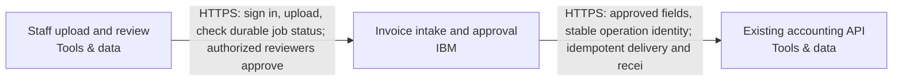

Snapshot a08ef5ab-a5d2-4447-8db2-02503221caa8 · design r4 · generated 2026-11-10T08:20:22.237Z

# Asynchronous document intake — deployment document

Generated 2026-11-10 08:20 UTC from design revision r4 · project format 2.3.0 · AtMem AI Architect workbench

> No blockers found by the automated review. Human review and the open questions below still apply.
>
> Statements are **facts** from project data unless marked _assumption_ or listed under open questions. Estimate — not a bill or guarantee.

## 1. Summary

Users upload PDF invoices. Extract the supplier, invoice date, total and currency into a review queue. Delivery can repeat; retries must not create duplicate invoices. A reviewer approves a result before it is sent to our existing accounting API. Use IBM Cloud. Recommend a coherent system and the engineering choices. Ask only a small material business question when needed; do not make me configure the system.

- **Cloud:** IBM
- **Usage:** unknown
- **Estimated run cost:** not estimated
- **Review:** 7 open findings (0 blockers)
- **Current decisions:** 2

## 2. Scope and context

- **What you want to build:** Users upload PDF invoices. Extract the supplier, invoice date, total and currency into a review queue. Delivery can repeat; retries must not create duplicate invoices. A reviewer approves a result before it is sent to our existing accounting API. Use IBM Cloud. Recommend a coherent system and the engineering choices. Ask only a small material business question when needed; do not make me configure the system.
- **Information it uses:** PDF invoices up to 10 MB, around 500 per day; they may contain personal data. Keep originals and extraction audit history for 90 days. Keep documents and extracted data in Australia; flag unverified service availability.
- **Who uses it, and how much:** Here are the remaining project facts before we finalize the handoff. Preserve these requirements and update the system as needed. Twenty signed-in staff and three reviewers; ordinary uploaders cannot approve. 500 uploads per day, bursts of twenty. Jobs may take several minutes. The accounting system already exists. An administrator will supply its endpoint and credentials; treat it as external, not a new system to provision. Use a durable job queue, stable invoice/job identity, bounded retries, a dead-letter/recovery path, approval checks and an idempotent outbound operation.
- **Systems it connects to:** —
- **How good, fast and safe:** —
- **Cloud preference:** IBM
- **Budget and timeline:** —

## 3. Architecture

**Staff access**

- Staff upload and review (Tools & data, existing) — Existing staff browsers for twenty signed-in staff and three reviewers. Staff upload PDF invoices and see durable job status while processing takes several minutes; reviewers inspect supplier, invoice date, total and currency alongside original source evidence, correct results and approve the exact result revision. Ordinary uploaders cannot approve. Server-side membership and authorization enforce these permissions independently of browser controls. This browser is an existing client reference outside provisioning scope.

**Invoice processing**

- Invoice intake and approval (IBM) — Proposed composed invoice-workflow delivery unit on IBM Code Engine. Sydney (au-syd) remains proposed within the accepted Australian data boundary. Owns browser/API, background worker, isolated PDF/OCR parser, IBM Cloud Databases for PostgreSQL transactional job queue/outbox and review state, private versioned IBM Cloud Object Storage originals, IBM Cloud App ID staff sign-in, separate workload identities and regional watsonx extraction. Supports twenty signed-in staff and three reviewers; ordinary uploaders cannot approve. Server-side SQL membership gates review and approval independently of sign-in and workload IAM. Accepts Confidential PDF invoices containing possible personal data, up to 10,000,000 bytes (decimal 10 MB), at 500 uploads per day with bursts of twenty. Qualify durable admission for that burst without assuming twenty simultaneous extraction workers or an unprovided completion deadline. Jobs may take several minutes: return a stable job identity and expose persisted progress/status independently of the upload HTTP request. Extract supplier, invoice date, total and currency into a review queue linked to original source evidence; invalid, failed or uncertain extraction remains visible for staff resolution. Only the isolated parser handles untrusted PDF bytes, without model, database, object-store or accounting identity. Persist stable invoice/job identity, document version and business state with queue/outbox changes atomically in PostgreSQL. Fence worker leases, recover stalled jobs after crashes and preserve identity across retries. Proposed bounded retry policy uses backoff, attempt/deadline limits and durable terminal-failure records as a dead-letter/recovery path; authorized recovery retains original identity and audit history. Repeated delivery must not create duplicate invoice records. Approval binds the authorized reviewer to the exact source/result revision and destination operation; edits require renewed approval. Persist the outbound operation identity and payload digest before sending approved fields. Retry only under the independently accepted destination idempotency contract, retaining the same operation identity and payload; uncertain outcomes are held for receipt reconciliation rather than blindly resent or assigned a fresh identity. Existing accounting remains external: an administrator supplies its reviewed HTTPS endpoint and credentials through protected deployment inputs and secret storage, never through the diagram or browser. Retain originals and extraction audit history for 90 days with scheduled cleanup and reviewed object-version/backup expiry; retention clock and final deletion timing remain acceptance details. Documents, extracted data and copies containing them remain in Australia, including inference, recovery copies and sensitive diagnostics; no silent overseas fallback. Owns audit history, maintenance, recovery procedures, monitoring tasks and restricted operator recovery. Current scope remains staff PDF upload, extraction, review and approved accounting submission. Operating ownership remains unresolved. Regional Code Engine, PostgreSQL, object storage, App ID, selected watsonx model and private-connectivity availability remain unverified. Artifact/registry replication geography, model-processing policy, dependency security, retention behavior, restore and alert delivery need independent acceptance. Acceptance must cover uploader approval denial, stale approval rejection, burst admission, multi-minute processing, duplicate delivery, worker crashes, bounded retry exhaustion, authorized recovery and lost accounting responses without duplicate submission. Local reviewed practice evidence is not validation of this composition or destination.

**Accounting delivery**

- Existing accounting API (Tools & data, existing) — Client-owned existing accounting service, preserved outside provisioning scope and never recreated. An administrator will supply its endpoint and credentials through protected destination inputs; no secrets belong in this diagram. Receives only reviewer-approved invoice fields through the guarded accounting adapter, using a durable outbound operation identity and fixed payload digest. Actual API/schema, authorization, Australian processing/storage boundary, idempotency durability/window and receipt/reconciliation interface still require qualification. The destination must implement and independently pass the normalized-action-v1 contract and idempotency acceptance; this diagram does not establish native compatibility. Verify that processing/storage satisfies Australian residency before sending personal data. Lost responses or ambiguous outcomes remain held for reconciliation; no fresh operation or blind resubmission may bypass that hold.

## Cloud resource schedule

Typed composed invoice implementation; extra required systems and flows remain visible. Source generation and local qualifications do not prove the destination deployment.

| Block ID | Component | Provider | Service | Region | Ownership | Terraform coverage |
|---|---|---|---|---|---|---|
| staff-browser | Staff upload and review | tools | Web browser | To be selected | Existing | External staff browser — authenticated workflow channel generated; no browser infrastructure to provision |
| invoice-workflow | Invoice intake and approval | ibm | IBM Code Engine | au-syd | Proposed | Composed invoice API/worker/parser, durable SQL queue, private originals, review authorization, guarded accounting delivery and operating tasks generated; destination behavior remains unverified |
| existing-accounting | Existing accounting API | tools | Existing accounting API | To be selected | Existing | Existing service reference — preserve without provisioning/import; actual connection acceptance required |

### Resources and cost dimensions

- **Staff upload and review** (staff-browser): Resource types to confirm. Existing system or actor; review its externally owned costs and access contract.. Depends on: none drawn.
- **Invoice intake and approval** (invoice-workflow): ibm_code_engine_project, ibm_database, ibm_cos_bucket, ibm_appid_application. API/worker/parser/operator compute, private database/backup/storage, NAT/private endpoints, identity, registry, model tokens, retained object versions, logging and notification delivery. Verify current regional rates and quotas; capacity limits are not spending caps.. Depends on: staff-browser.
- **Existing accounting API** (existing-accounting): Resource types to confirm. Existing system or actor; review its externally owned costs and access contract.. Depends on: invoice-workflow.

### Engineering work remaining

S3 foundation only. Validate the plan, account, region, cost and security before applying.

References (resource semantics; not retrieved prices):

## 4. Data flows

| From | To | Data | Classification |
|---|---|---|---|
| Staff upload and review | Invoice intake and approval | HTTPS: sign in, upload, check durable job status; authorized reviewers approve | Confidential |
| Invoice intake and approval | Existing accounting API | HTTPS: approved fields, stable operation identity; idempotent delivery and recei | Confidential |

## 5. Security controls

- _No guardrail or approval components in the design._
- Requirement: Accounting submission shall require an authorized reviewer’s recorded approval of the exact result revision and destination operation; changing the result shall require renewed approval, and extraction alone shall never authorize submission. (must)
- Requirement: Documents and extracted data shall be stored and processed in Australia. Apply this boundary to inference, recovery copies, diagnostics containing those data and accounting delivery. Flag unverified service/model availability and processing geography; do not enable an overseas fallback. (must)
- Requirement: The system shall retain invoice originals and extraction audit history for 90 days and implement scheduled retention cleanup. Document and test the retention clock, object-version handling and backup expiry before claiming a final deletion deadline. (must)
- Requirement: Integrate with the existing externally managed accounting API without provisioning or modifying that system. Accept administrator-supplied endpoint and credentials through protected destination configuration. Qualify authorization, Australian processing geography, normalized-action-v1 compatibility, durable idempotency and receipt reconciliation before enabling delivery. (must)
- Open finding SEC-002: Sensitive data is involved but where it must be stored is not stated.

## 6. Requirements

**Non-functional**

| Requirement | Category | Target | Status |
|---|---|---|---|
| Repeated delivery and worker retries shall not create duplicate invoice records or accounting submissions. Persist workflow state and operation identity durably, retry only under a tested destination idempotency contract, and hold ambiguous outcomes for reconciliation before resubmission. | reliability | not measurable yet | Open |
| Documents and extracted data shall be stored and processed in Australia. Apply this boundary to inference, recovery copies, diagnostics containing those data and accounting delivery. Flag unverified service/model availability and processing geography; do not enable an overseas fallback. | compliance | not measurable yet | Open |
| The system shall retain invoice originals and extraction audit history for 90 days and implement scheduled retention cleanup. Document and test the retention clock, object-version handling and backup expiry before claiming a final deletion deadline. | compliance | Original and extraction audit retention period == 90days | Open |
| Design and qualify asynchronous intake for approximately 500 invoices per day, using durable queueing and recoverable processing. Establish tested burst capacity and processing completion times without treating the daily average as a peak-rate guarantee. | scalability | not measurable yet | Open |
| Persist job state and queue/outbox changes transactionally, preserve invoice/job identity across retries, and recover stalled workers with lease fencing. Bound retry attempts and deadlines; retain exhausted jobs in a durable dead-letter/recovery state with reason and audit history. Authorized recovery shall preserve identity and approval constraints. Demonstrate crash recovery, retry exhaustion and recovery without duplicate invoices or submissions. | reliability | not measurable yet | Open |

**Functional**

- The system shall accept PDF invoices and persist supplier, invoice date, total and currency in a review queue, linked to the original document; failed or uncertain extraction shall remain visible for staff resolution. (must, open)
- Accounting submission shall require an authorized reviewer’s recorded approval of the exact result revision and destination operation; changing the result shall require renewed approval, and extraction alone shall never authorize submission. (must, open)
- Run extraction asynchronously after durable intake and return a stable job reference. Persist and expose processing, review and failure/recovery status to authorized staff independently of the upload request or browser session. Do not impose an unconfirmed completion-time target. (must, open)
- Integrate with the existing externally managed accounting API without provisioning or modifying that system. Accept administrator-supplied endpoint and credentials through protected destination configuration. Qualify authorization, Australian processing geography, normalized-action-v1 compatibility, durable idempotency and receipt reconciliation before enabling delivery. (must, open)

**Success measures**

_No success measures defined._

## 7. Review findings

**Security & controls**

- [major] Sensitive data is involved but where it must be stored is not stated. Add a compliance requirement such as “data stays in the EU”, and set regions on data blocks. _(AtMem AI Architect rule SEC-002 v1.0.0)_

**Reliability**

- [minor] The design depends on existing systems; their failure behaviour is not described. State what happens when each existing system is unavailable (retry, queue, fallback). _(AtMem AI Architect rule REL-002 v1.0.0)_

**Availability**

- [minor] No availability target. Add a requirement such as “available 99.5% of the time” or “business hours only”. _(AtMem AI Architect rule AVL-001 v1.0.0)_

**Scalability**

- [info] Expected usage is unknown, so scale can't be assessed. Tell us in the chat roughly how many people use it and how often. _(AtMem AI Architect rule SCL-001 v1.0.0)_

**Maintainability**

- [minor] 4 quality requirements have no measurable target. Add a metric and target to: “Repeated delivery and worker retries shall not create duplicate invoice records or accounting submissions. Persist workflow state and operation identity durably, retry only under a tested destination idempotency contract, and hold ambiguous outcomes for reconciliation before resubmission.”, “Documents and extracted data shall be stored and processed in Australia. Apply this boundary to inference, recovery copies, diagnostics containing those data and accounting delivery. Flag unverified service/model availability and processing geography; do not enable an overseas fallback.”, “Design and qualify asynchronous intake for approximately 500 invoices per day, using durable queueing and recoverable processing. Establish tested burst capacity and processing completion times without treating the daily average as a peak-rate guarantee.”, “Persist job state and queue/outbox changes transactionally, preserve invoice/job identity across retries, and recover stalled workers with lease fencing. Bound retry attempts and deadlines; retain exhausted jobs in a durable dead-letter/recovery state with reason and audit history. Authorized recovery shall preserve identity and approval constraints. Demonstrate crash recovery, retry exhaustion and recovery without duplicate invoices or submissions.”. _(AtMem AI Architect rule MNT-001 v1.0.0)_
- [minor] 2 accepted decisions have no owner. Assign an owner in Design → Decisions. _(AtMem AI Architect rule MNT-002 v1.0.0)_

**Cost**

- [info] No budget stated. Mention a monthly running budget, or a range, in the chat. _(AtMem AI Architect rule CST-001 v1.0.0)_

## 8. Cost estimate

Estimate — not a bill or guarantee. Monthly run cost only. Prices are as entered, with their sources.

**Estimate stage:** Not estimated. Rough order of magnitude, refined as scope and charge dimensions become known.

_No costed components._

**Usage inputs:** Quantities are entered directly on detailed charge lines above.

**Range:** low ×0.7, high ×1.5 of expected. Not costed in this release: Staff upload and review, Invoice intake and approval, Existing accounting API.

**Estimate gaps:**

- Staff upload and review: no cost lines; add charges or an explicit zero-cost line with a reason.
- Invoice intake and approval: no cost lines; add charges or an explicit zero-cost line with a reason.
- Existing accounting API: no cost lines; add charges or an explicit zero-cost line with a reason.

### Consulting and build estimate (one-off)

Not estimated; enter work-package days, rates and a basis.

| Work package | Low / expected / high days | Rate / day | Expected | Basis and exclusions |
|---|---|---|---|---|
| Discovery & specification | — / — / — | — | — | Needed |
| Architecture & security | — / — / — | — | — | Needed |
| Implementation & integration | — / — / — | — | — | Needed |
| Testing & acceptance | — / — / — | — | — | Needed |
| Deployment & handover | — / — / — | — | — | Needed |

One-off effort is separate from monthly cloud charges. Days are person-days, not elapsed time. Taxes, support, licences and migration are excluded unless explicitly included in the basis or charge lines.

## 9. Deployment steps

_Draft generated from the design; validate against the provider's current documentation before use. Nothing has been provisioned._

1. Confirm accounts, target regions and who approves each step; resolve every blocker in this document.
2. Create least-privilege identities for each component; keep credentials in the provider's secret store, never in the project.
3. Provision invoice processing: Invoice intake and approval.
4. Connect existing systems: Staff upload and review, Existing accounting API; test failure behaviour.
5. Run the acceptance checks (success measures and requirements) in staging; record results.
6. Review results and approve promotion to production; keep a rollback plan for each step.

## 10. Decisions

### ADR-001 · platform.cloud

**Status:** Accepted · **Owner:** unassigned · **Date:** 2026-11-10 · **Design:** r2 · **Subject:** `platform.cloud`

**Context**

User statement: Use IBM Cloud.

**Options considered**

—

**Decision**

ibm

_Changed because: Chosen in the conversation_

**Consequences**

—

### ADR-002 · data.country

**Status:** Accepted · **Owner:** unassigned · **Date:** 2026-11-10 · **Design:** r3 · **Subject:** `data.country`

**Context**

User statement: Keep documents and extracted data in Australia

**Options considered**

—

**Decision**

Australia

_Changed because: Chosen in the conversation_

**Consequences**

—

## 11. Assumptions

_None recorded._

## 12. Open questions

_None._
