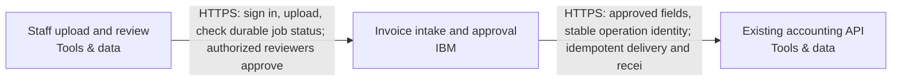

Snapshot a08ef5ab-a5d2-4447-8db2-02503221caa8 · design r4 · generated 2026-11-10T08:20:22.237Z

# Asynchronous document intake — solution specification

## Problem and intended outcome

Users upload PDF invoices. Extract the supplier, invoice date, total and currency into a review queue. Delivery can repeat; retries must not create duplicate invoices. A reviewer approves a result before it is sent to our existing accounting API. Use IBM Cloud. Recommend a coherent system and the engineering choices. Ask only a small material business question when needed; do not make me configure the system.

## Scope

None recorded.

## Requirements and acceptance criteria

- [REQ-001] The system shall accept PDF invoices and persist supplier, invoice date, total and currency in a review queue, linked to the original document; failed or uncertain extraction shall remain visible for staff resolution. (must, open); target: acceptance target needed; linked blocks: staff-browser, invoice-workflow

Design explanation: Makes the requested outcome observable and prevents incomplete or uncertain extraction from bypassing review.

Basis: “Users upload PDF invoices. Extract the supplier, invoice date, total and currency into a review queue.” Source evidence and handling of uncertain extraction are engineering proposals.
- [REQ-002] Accounting submission shall require an authorized reviewer’s recorded approval of the exact result revision and destination operation; changing the result shall require renewed approval, and extraction alone shall never authorize submission. (must, open); target: acceptance target needed; linked blocks: staff-browser, invoice-workflow, existing-accounting

Design explanation: Prevents model output or unauthorized users from triggering accounting actions, and prevents approval from being reused after the reviewed result changes.

Basis: “A reviewer approves a result before it is sent to our existing accounting API.” Server-side reviewer authorization and revision-bound approval are proposed controls.
- [REQ-003] Repeated delivery and worker retries shall not create duplicate invoice records or accounting submissions. Persist workflow state and operation identity durably, retry only under a tested destination idempotency contract, and hold ambiguous outcomes for reconciliation before resubmission. (must, open); target: acceptance target needed; linked blocks: invoice-workflow, existing-accounting

Design explanation: Retries after a crash or lost response can create duplicate financial records; durable identities and destination acceptance are necessary to establish safe delivery.

Basis: “Delivery can repeat; retries must not create duplicate invoices.” Durable operation identity, uncertain-outcome fencing and reconciliation are proposed engineering mechanisms supported by the supplied durable-approval practice.
- [REQ-004] Documents and extracted data shall be stored and processed in Australia. Apply this boundary to inference, recovery copies, diagnostics containing those data and accounting delivery. Flag unverified service/model availability and processing geography; do not enable an overseas fallback. (must, open); target: acceptance target needed; linked blocks: invoice-workflow, existing-accounting

Design explanation: Personal data could leave Australia through inference, backups, diagnostics or accounting delivery even when primary storage is Australian. This proposed requirement makes those paths subject to acceptance.

Basis: “they may contain personal data” and “Keep documents and extracted data in Australia; flag unverified service availability.”
- [REQ-005] The system shall retain invoice originals and extraction audit history for 90 days and implement scheduled retention cleanup. Document and test the retention clock, object-version handling and backup expiry before claiming a final deletion deadline. (must, open); target: Original and extraction audit retention period == 90days; linked blocks: invoice-workflow

Design explanation: Retention must cover original objects and durable audit records consistently; backup and object-version expiry need acceptance to avoid retaining hidden copies indefinitely.

Basis: “Keep originals and extraction audit history for 90 days.”
- [REQ-006] Design and qualify asynchronous intake for approximately 500 invoices per day, using durable queueing and recoverable processing. Establish tested burst capacity and processing completion times without treating the daily average as a peak-rate guarantee. (must, open); target: acceptance target needed; linked blocks: invoice-workflow

Design explanation: The stated daily volume informs queue capacity and worker sizing; durable intake must preserve invoices during processing delays. No peak rate or completion deadline was supplied.

Basis: “around 500 per day” and the existing asynchronous invoice review workflow.
- [REQ-007] Persist job state and queue/outbox changes transactionally, preserve invoice/job identity across retries, and recover stalled workers with lease fencing. Bound retry attempts and deadlines; retain exhausted jobs in a durable dead-letter/recovery state with reason and audit history. Authorized recovery shall preserve identity and approval constraints. Demonstrate crash recovery, retry exhaustion and recovery without duplicate invoices or submissions. (must, open); target: acceptance target needed; linked blocks: invoice-workflow, existing-accounting

Design explanation: Durable failure records and controlled recovery prevent exhausted or interrupted jobs from disappearing or creating duplicate work. Lease fencing and recovery procedures are proposed engineering controls.

Basis: “Use a durable job queue, stable invoice/job identity, bounded retries, a dead-letter/recovery path, approval checks and an idempotent outbound operation.”
- [REQ-008] Run extraction asynchronously after durable intake and return a stable job reference. Persist and expose processing, review and failure/recovery status to authorized staff independently of the upload request or browser session. Do not impose an unconfirmed completion-time target. (must, open); target: acceptance target needed; linked blocks: staff-browser, invoice-workflow

Design explanation: Several-minute jobs must survive browser disconnection and HTTP timeouts. Persisted status lets staff distinguish queued, processing, review and recovery states.

Basis: “Jobs may take several minutes.”
- [REQ-009] Integrate with the existing externally managed accounting API without provisioning or modifying that system. Accept administrator-supplied endpoint and credentials through protected destination configuration. Qualify authorization, Australian processing geography, normalized-action-v1 compatibility, durable idempotency and receipt reconciliation before enabling delivery. (must, open); target: acceptance target needed; linked blocks: invoice-workflow, existing-accounting

Design explanation: Preserving the existing accounting system avoids accidental provisioning or ownership changes; a protected configuration boundary prevents secrets entering project records.

Basis: “The accounting system already exists. An administrator will supply its endpoint and credentials; treat it as external, not a new system to provision.”

## How the system works

The current design contains 3 components and 2 connections. 2 components are existing systems. The descriptions below follow the actual board; implementation guidance is identified separately from recorded behavior.

### Interaction 1: Staff upload and review → Invoice intake and approval

HTTPS: sign in, upload, check durable job status; authorized reviewers approve

Integration contract: browser-https.

Proposed verification: Verify the expected exchange, reject malformed or unauthorized input, and exercise interruption and recovery. Retry and duplicate-handling behavior must match the operation; it cannot be inferred from an arrow.

### Interaction 2: Invoice intake and approval → Existing accounting API

HTTPS: approved fields, stable operation identity; idempotent delivery and recei

Integration contract: approved-accounting-api.

Proposed verification: Verify the expected exchange, reject malformed or unauthorized input, and exercise interruption and recovery. Retry and duplicate-handling behavior must match the operation; it cannot be inferred from an arrow.

## Component responsibilities and design rationale

### Staff upload and review

Web browser · tools · region: To be selected · classification: Confidential

Existing staff browsers for twenty signed-in staff and three reviewers. Staff upload PDF invoices and see durable job status while processing takes several minutes; reviewers inspect supplier, invoice date, total and currency alongside original source evidence, correct results and approve the exact result revision. Ordinary uploaders cannot approve. Server-side membership and authorization enforce these permissions independently of browser controls. This browser is an existing client reference outside provisioning scope.

Existing system: integrate with its owner and access contract; the design does not authorize replacing it.

Inputs: No incoming connection is drawn.

Outputs: Staff upload and review → Invoice intake and approval: HTTPS: sign in, upload, check durable job status; authorized reviewers approve (integration: browser-https)

Requirement traceability: REQ-001: The system shall accept PDF invoices and persist supplier, invoice date, total and currency in a review queue, linked to the original document; failed or uncertain extraction shall remain visible for staff resolution.; REQ-002: Accounting submission shall require an authorized reviewer’s recorded approval of the exact result revision and destination operation; changing the result shall require renewed approval, and extraction alone shall never authorize submission.; REQ-008: Run extraction asynchronously after durable intake and return a stable job reference. Persist and expose processing, review and failure/recovery status to authorized staff independently of the upload request or browser session. Do not impose an unconfirmed completion-time target.

Implementation status: External staff browser — authenticated workflow channel generated; no browser infrastructure to provision

Implementation considerations (guidance):
- Preserve the external browser; no resource or import is required.
- Define and test its HTTPS/application interactions, including denied access and unavailable service behavior.

### Invoice intake and approval

IBM Code Engine · ibm · region: au-syd · classification: Confidential

Proposed composed invoice-workflow delivery unit on IBM Code Engine. Sydney (au-syd) remains proposed within the accepted Australian data boundary. Owns browser/API, background worker, isolated PDF/OCR parser, IBM Cloud Databases for PostgreSQL transactional job queue/outbox and review state, private versioned IBM Cloud Object Storage originals, IBM Cloud App ID staff sign-in, separate workload identities and regional watsonx extraction. Supports twenty signed-in staff and three reviewers; ordinary uploaders cannot approve. Server-side SQL membership gates review and approval independently of sign-in and workload IAM. Accepts Confidential PDF invoices containing possible personal data, up to 10,000,000 bytes (decimal 10 MB), at 500 uploads per day with bursts of twenty. Qualify durable admission for that burst without assuming twenty simultaneous extraction workers or an unprovided completion deadline. Jobs may take several minutes: return a stable job identity and expose persisted progress/status independently of the upload HTTP request. Extract supplier, invoice date, total and currency into a review queue linked to original source evidence; invalid, failed or uncertain extraction remains visible for staff resolution. Only the isolated parser handles untrusted PDF bytes, without model, database, object-store or accounting identity. Persist stable invoice/job identity, document version and business state with queue/outbox changes atomically in PostgreSQL. Fence worker leases, recover stalled jobs after crashes and preserve identity across retries. Proposed bounded retry policy uses backoff, attempt/deadline limits and durable terminal-failure records as a dead-letter/recovery path; authorized recovery retains original identity and audit history. Repeated delivery must not create duplicate invoice records. Approval binds the authorized reviewer to the exact source/result revision and destination operation; edits require renewed approval. Persist the outbound operation identity and payload digest before sending approved fields. Retry only under the independently accepted destination idempotency contract, retaining the same operation identity and payload; uncertain outcomes are held for receipt reconciliation rather than blindly resent or assigned a fresh identity. Existing accounting remains external: an administrator supplies its reviewed HTTPS endpoint and credentials through protected deployment inputs and secret storage, never through the diagram or browser. Retain originals and extraction audit history for 90 days with scheduled cleanup and reviewed object-version/backup expiry; retention clock and final deletion timing remain acceptance details. Documents, extracted data and copies containing them remain in Australia, including inference, recovery copies and sensitive diagnostics; no silent overseas fallback. Owns audit history, maintenance, recovery procedures, monitoring tasks and restricted operator recovery. Current scope remains staff PDF upload, extraction, review and approved accounting submission. Operating ownership remains unresolved. Regional Code Engine, PostgreSQL, object storage, App ID, selected watsonx model and private-connectivity availability remain unverified. Artifact/registry replication geography, model-processing policy, dependency security, retention behavior, restore and alert delivery need independent acceptance. Acceptance must cover uploader approval denial, stale approval rejection, burst admission, multi-minute processing, duplicate delivery, worker crashes, bounded retry exhaustion, authorized recovery and lost accounting responses without duplicate submission. Local reviewed practice evidence is not validation of this composition or destination.

Proposed component: its responsibility is part of the current design, with implementation and deployment still subject to validation.

Inputs: Staff upload and review → Invoice intake and approval: HTTPS: sign in, upload, check durable job status; authorized reviewers approve (integration: browser-https)

Outputs: Invoice intake and approval → Existing accounting API: HTTPS: approved fields, stable operation identity; idempotent delivery and recei (integration: approved-accounting-api)

Requirement traceability: REQ-001: The system shall accept PDF invoices and persist supplier, invoice date, total and currency in a review queue, linked to the original document; failed or uncertain extraction shall remain visible for staff resolution.; REQ-002: Accounting submission shall require an authorized reviewer’s recorded approval of the exact result revision and destination operation; changing the result shall require renewed approval, and extraction alone shall never authorize submission.; REQ-003: Repeated delivery and worker retries shall not create duplicate invoice records or accounting submissions. Persist workflow state and operation identity durably, retry only under a tested destination idempotency contract, and hold ambiguous outcomes for reconciliation before resubmission.; REQ-004: Documents and extracted data shall be stored and processed in Australia. Apply this boundary to inference, recovery copies, diagnostics containing those data and accounting delivery. Flag unverified service/model availability and processing geography; do not enable an overseas fallback.; REQ-005: The system shall retain invoice originals and extraction audit history for 90 days and implement scheduled retention cleanup. Document and test the retention clock, object-version handling and backup expiry before claiming a final deletion deadline.; REQ-006: Design and qualify asynchronous intake for approximately 500 invoices per day, using durable queueing and recoverable processing. Establish tested burst capacity and processing completion times without treating the daily average as a peak-rate guarantee.; REQ-007: Persist job state and queue/outbox changes transactionally, preserve invoice/job identity across retries, and recover stalled workers with lease fencing. Bound retry attempts and deadlines; retain exhausted jobs in a durable dead-letter/recovery state with reason and audit history. Authorized recovery shall preserve identity and approval constraints. Demonstrate crash recovery, retry exhaustion and recovery without duplicate invoices or submissions.; REQ-008: Run extraction asynchronously after durable intake and return a stable job reference. Persist and expose processing, review and failure/recovery status to authorized staff independently of the upload request or browser session. Do not impose an unconfirmed completion-time target.; REQ-009: Integrate with the existing externally managed accounting API without provisioning or modifying that system. Accept administrator-supplied endpoint and credentials through protected destination configuration. Qualify authorization, Australian processing geography, normalized-action-v1 compatibility, durable idempotency and receipt reconciliation before enabling delivery.

Implementation status: Composed invoice API/worker/parser, durable SQL queue, private originals, review authorization, guarded accounting delivery and operating tasks generated; destination behavior remains unverified

Implementation considerations (guidance):
- Confirm the exact ibm service, deployment mode, region and supported resource types using current primary documentation.
- Specify runtime/artifact, identity, network paths, secrets, capacity, health checks and operational owner; resolve whether this is infrastructure or a responsibility within another application.
- Document service-specific failure modes, retention/recovery and acceptance tests; do not substitute a similarly named service or another provider.

### Existing accounting API

Existing accounting API · tools · region: To be selected · classification: Confidential

Client-owned existing accounting service, preserved outside provisioning scope and never recreated. An administrator will supply its endpoint and credentials through protected destination inputs; no secrets belong in this diagram. Receives only reviewer-approved invoice fields through the guarded accounting adapter, using a durable outbound operation identity and fixed payload digest. Actual API/schema, authorization, Australian processing/storage boundary, idempotency durability/window and receipt/reconciliation interface still require qualification. The destination must implement and independently pass the normalized-action-v1 contract and idempotency acceptance; this diagram does not establish native compatibility. Verify that processing/storage satisfies Australian residency before sending personal data. Lost responses or ambiguous outcomes remain held for reconciliation; no fresh operation or blind resubmission may bypass that hold.

Existing system: integrate with its owner and access contract; the design does not authorize replacing it.

Inputs: Invoice intake and approval → Existing accounting API: HTTPS: approved fields, stable operation identity; idempotent delivery and recei (integration: approved-accounting-api)

Outputs: No outgoing connection is drawn.

Requirement traceability: REQ-002: Accounting submission shall require an authorized reviewer’s recorded approval of the exact result revision and destination operation; changing the result shall require renewed approval, and extraction alone shall never authorize submission.; REQ-003: Repeated delivery and worker retries shall not create duplicate invoice records or accounting submissions. Persist workflow state and operation identity durably, retry only under a tested destination idempotency contract, and hold ambiguous outcomes for reconciliation before resubmission.; REQ-004: Documents and extracted data shall be stored and processed in Australia. Apply this boundary to inference, recovery copies, diagnostics containing those data and accounting delivery. Flag unverified service/model availability and processing geography; do not enable an overseas fallback.; REQ-007: Persist job state and queue/outbox changes transactionally, preserve invoice/job identity across retries, and recover stalled workers with lease fencing. Bound retry attempts and deadlines; retain exhausted jobs in a durable dead-letter/recovery state with reason and audit history. Authorized recovery shall preserve identity and approval constraints. Demonstrate crash recovery, retry exhaustion and recovery without duplicate invoices or submissions.; REQ-009: Integrate with the existing externally managed accounting API without provisioning or modifying that system. Accept administrator-supplied endpoint and credentials through protected destination configuration. Qualify authorization, Australian processing geography, normalized-action-v1 compatibility, durable idempotency and receipt reconciliation before enabling delivery.

Implementation status: Existing service reference — preserve without provisioning/import; actual connection acceptance required

Implementation considerations (guidance):
- Preserve this externally managed service without creating or importing it.
- Document its owner, endpoint, identity and integration contract; test actual connections separately.

## Architecture

## Cloud resource schedule

Typed composed invoice implementation; extra required systems and flows remain visible. Source generation and local qualifications do not prove the destination deployment.

| Block ID | Component | Provider | Service | Region | Ownership | Terraform coverage |
|---|---|---|---|---|---|---|
| staff-browser | Staff upload and review | tools | Web browser | To be selected | Existing | External staff browser — authenticated workflow channel generated; no browser infrastructure to provision |
| invoice-workflow | Invoice intake and approval | ibm | IBM Code Engine | au-syd | Proposed | Composed invoice API/worker/parser, durable SQL queue, private originals, review authorization, guarded accounting delivery and operating tasks generated; destination behavior remains unverified |
| existing-accounting | Existing accounting API | tools | Existing accounting API | To be selected | Existing | Existing service reference — preserve without provisioning/import; actual connection acceptance required |

### Resources and cost dimensions

- **Staff upload and review** (staff-browser): Resource types to confirm. Existing system or actor; review its externally owned costs and access contract.. Depends on: none drawn.
- **Invoice intake and approval** (invoice-workflow): ibm_code_engine_project, ibm_database, ibm_cos_bucket, ibm_appid_application. API/worker/parser/operator compute, private database/backup/storage, NAT/private endpoints, identity, registry, model tokens, retained object versions, logging and notification delivery. Verify current regional rates and quotas; capacity limits are not spending caps.. Depends on: staff-browser.
- **Existing accounting API** (existing-accounting): Resource types to confirm. Existing system or actor; review its externally owned costs and access contract.. Depends on: invoice-workflow.

### Engineering work remaining

S3 foundation only. Validate the plan, account, region, cost and security before applying.

References (resource semantics; not retrieved prices):

## Options and tradeoffs

Use Design → Options to compare cloud choices and record the rationale before choosing.

## Decisions and change history

### ADR-001 · platform.cloud

**Status:** Accepted · **Owner:** unassigned · **Date:** 2026-11-10 · **Design:** r2 · **Subject:** `platform.cloud`

**Context**

User statement: Use IBM Cloud.

**Options considered**

—

**Decision**

ibm

_Changed because: Chosen in the conversation_

**Consequences**

—

### ADR-002 · data.country

**Status:** Accepted · **Owner:** unassigned · **Date:** 2026-11-10 · **Design:** r3 · **Subject:** `data.country`

**Context**

User statement: Keep documents and extracted data in Australia

**Options considered**

—

**Decision**

Australia

_Changed because: Chosen in the conversation_

**Consequences**

—

## Assumptions

None recorded.

## Questions to resolve

None recorded.

## Implementation specification and coding-agent handoff

The Spec Kit translates these requirements and the architecture into implementation work. Start with START_HERE.md and AGENTS.md; read spec-kit/implementation-spec.md (or PDF) for the implementation plan, contracts, detailed tasks and validation plan. Requirements remain the source of desired outcomes; the kit is the build plan derived from them.
