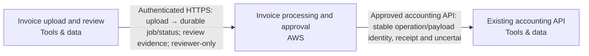

Snapshot fae1fcc6-010e-4cce-9c48-17bfe556fd5e · design r5 · generated 2026-11-10T07:47:28.350Z

# Asynchronous document intake — deployment document

Generated 2026-11-10 07:47 UTC from design revision r5 · project format 2.3.0 · AtMem AI Architect workbench

> No blockers found by the automated review. Human review and the open questions below still apply.
>
> Statements are **facts** from project data unless marked _assumption_ or listed under open questions. Estimate — not a bill or guarantee.

## 1. Summary

Users upload PDF invoices. Extract the supplier, invoice date, total and currency into a review queue. Delivery can repeat; retries must not create duplicate invoices. A reviewer approves a result before it is sent to our existing accounting API. Use AWS. Recommend a coherent system and the engineering choices. Ask only a small material business question when needed; do not make me configure the system.

- **Cloud:** AWS
- **Usage:** unknown
- **Estimated run cost:** not estimated
- **Review:** 8 open findings (0 blockers)
- **Current decisions:** 2

## 2. Scope and context

- **What you want to build:** Users upload PDF invoices. Extract the supplier, invoice date, total and currency into a review queue. Delivery can repeat; retries must not create duplicate invoices. A reviewer approves a result before it is sent to our existing accounting API. Use AWS. Recommend a coherent system and the engineering choices. Ask only a small material business question when needed; do not make me configure the system.
- **Information it uses:** —
- **Who uses it, and how much:** Here are the remaining project facts before we finalize the handoff. Preserve these requirements and update the system as needed. 500 uploads per day, bursts of twenty. Jobs may take several minutes. The accounting system already exists. An administrator will supply its endpoint and credentials; treat it as external, not a new system to provision. Use a durable job queue, stable invoice/job identity, bounded retries, a dead-letter/recovery path, approval checks and an idempotent outbound operation.
- **Systems it connects to:** Twenty signed-in staff and three reviewers; ordinary uploaders cannot approve. PDF invoices up to 10 MB, around 500 per day; they may contain personal data. Keep originals and extraction audit history for 90 days.
- **How good, fast and safe:** PDF invoices up to 10 MB, around 500 per day; they may contain personal data. Keep originals and extraction audit history for 90 days. Keep documents and extracted data in Australia; flag unverified service availability.
- **Cloud preference:** AWS
- **Budget and timeline:** —

## 3. Architecture

**Staff access**

- Invoice upload and review (Tools & data, existing) — Existing staff browser outside provisioning scope. Serves twenty signed-in staff and three reviewers; whether these populations overlap is unspecified. Staff upload PDF invoices and inspect extracted fields alongside source evidence. Only authorized reviewers may approve a specific result revision; ordinary uploaders cannot approve. Authentication and application reviewer membership are separate controls enforced by the workflow server.

**Invoice workflow**

- Invoice processing and approval (AWS, sketch) — Composed invoice-workflow deployment unit on Amazon ECS. Owns browser/API, background worker, isolated PDF/OCR parser, private versioned Amazon S3 originals, durable PostgreSQL queue/outbox on Amazon RDS, staff sign-in, SQL user/reviewer membership, regional model integration, separate workload identities and operating tasks/monitoring. Current scope covers PDF upload, extraction of supplier/invoice date/total/currency, evidence-backed review, approval, accounting delivery and recovery. Serves twenty signed-in staff and three reviewers; population overlap is unspecified. Ordinary uploaders cannot approve, including through direct API requests. Server-side approval binds the exact result revision, source and destination contract; changed results invalidate approval and model output cannot authorize delivery. Accept PDFs up to 10,000,000 bytes; the proposed 100-page safeguard remains reviewable. Design for 500 uploads/day and bursts of twenty; validate admission with twenty concurrent submissions as a proposed interpretation of a burst. Jobs may take several minutes: return a durable job identity and status after accepted intake, process asynchronously and let staff revisit progress without holding the upload request open. A monthly volume is not confirmed. Invoices may contain personal data. Persist stable invoice/job identity and exact source object version; transactionally commit processing state and queue notification. Use fenced worker leases, recovery of stalled jobs and bounded retries with backoff. Exhausted jobs enter a durable failed/dead-letter state in the owned PostgreSQL workflow, visible to authorized operators with failure history and controlled replay using the same identity. Do not provision a duplicate queue service for this internal responsibility. Accounting delivery uses a transactional outbox, stable outbound operation ID and immutable payload identity. Recheck authorization and approval before delivery. Fence ambiguous external outcomes for reconciliation; do not blindly resend or create a new operation ID. Destination must independently pass normalized-action-v1 and durable idempotency acceptance. An administrator supplies the existing accounting endpoint and credentials through reviewed destination configuration and managed secret references; never put credentials in the diagram, logs or client responses. Retain originals and extraction audit history for 90 days. Implement scheduled cleanup and review object versions, backups and restore behavior; retention eligibility alone does not prove erasure, and the retention start event and exact deletion deadline remain unresolved. Propose Sydney ap-southeast-2, not yet user-approved, with documents, extracted data, model processing, invoice-bearing logs, backups and state restricted to Australia. No silent overseas inference or recovery fallback. Propose encryption, authorized staff/workload access and exclusion of invoice content from operational logs. Accounting residency is unresolved. Acceptance must cover burst intake, multi-minute processing, worker interruption, duplicate deliveries, exhausted retries, controlled recovery, denied uploader approval, exact-revision reviewer approval and accounting success followed by a lost response. Service/model availability, quotas, model retention policy, destination connectivity/compatibility, exact image build/scan evidence, restore and alert delivery remain unverified.

**Existing accounting**

- Existing accounting API (Tools & data, existing) — Client-owned existing accounting service outside provisioning scope; retain as a reference without recreation or modification. Receives only approved invoice results. An administrator will supply its endpoint and credentials through reviewed destination configuration and managed secret references; no credentials belong in the diagram. Vendor, hosting/processing locations, authentication mechanism and retention behavior remain unknown. Australian residency must be established before sending invoice data. Its adapter must independently pass normalized-action-v1 acceptance, including durable idempotency for repeated operation IDs with identical payloads, rejection of conflicting payload reuse and reconciliation after ambiguous responses. The workflow must preserve operation identity across retries and recovery. Compatibility, effective access, residency and live connectivity are not established by this diagram.

## Cloud resource schedule

Typed composed invoice implementation; extra required systems and flows remain visible. Source generation and local qualifications do not prove the destination deployment.

| Block ID | Component | Provider | Service | Region | Ownership | Terraform coverage |
|---|---|---|---|---|---|---|
| staff-browser | Invoice upload and review | tools | Web browser | To be selected | Existing | External staff browser — authenticated workflow channel generated; no browser infrastructure to provision |
| invoice-workflow | Invoice processing and approval | aws | Amazon ECS | ap-southeast-2 | Proposed | Composed invoice API/worker/parser, durable SQL queue, private originals, review authorization, guarded accounting delivery and operating tasks generated; destination behavior remains unverified |
| accounting-api | Existing accounting API | tools | Existing accounting API | Existing location — unconfirmed | Existing | Existing service reference — preserve without provisioning/import; actual connection acceptance required |

### Resources and cost dimensions

- **Invoice upload and review** (staff-browser): Resource types to confirm. Existing system or actor; review its externally owned costs and access contract.. Depends on: none drawn.
- **Invoice processing and approval** (invoice-workflow): aws_vpc, aws_db_instance, aws_s3_bucket, aws_ecs_cluster. API/worker/parser/operator compute, private database/backup/storage, NAT/private endpoints, identity, registry, model tokens, retained object versions, logging and notification delivery. Verify current regional rates and quotas; capacity limits are not spending caps.. Depends on: staff-browser.
- **Existing accounting API** (accounting-api): Resource types to confirm. Existing system or actor; review its externally owned costs and access contract.. Depends on: invoice-workflow.

### Engineering work remaining

S3 foundation only. Validate the plan, account, region, cost and security before applying.

References (resource semantics; not retrieved prices):

## 4. Data flows

| From | To | Data | Classification |
|---|---|---|---|
| Invoice upload and review | Invoice processing and approval | Authenticated HTTPS: upload → durable job/status; review evidence; reviewer-only | Confidential |
| Invoice processing and approval | Existing accounting API | Approved accounting API: stable operation/payload identity, receipt and uncertai | Confidential |

## 5. Security controls

- **Invoice upload and review** — Existing staff browser outside provisioning scope. Serves twenty signed-in staff and three reviewers; whether these populations overlap is unspecified. Staff upload PDF invoices and inspect extracted fields alongside source evidence. Only authorized reviewers may approve a specific result revision; ordinary uploaders cannot approve. Authentication and application reviewer membership are separate controls enforced by the workflow server.
- Requirement: Send an invoice result to the existing accounting API only after an authorized reviewer approves that exact result revision. Proposed controls bind approval to the source and destination contract, invalidate approval when the result changes and retain an attributable approval/delivery history. (must)
- Requirement: Keep invoice documents and extracted data in Australia across storage, processing, inference, backups, recovery and accounting delivery. Proposed controls restrict personal-data access to authorized staff/workloads and exclude invoice content from operational logs. Verify service/model availability and processing geography before use; keep unresolved destinations blocked from receiving invoice data. (must)
- Requirement: Retain invoice originals and extraction audit history for 90 days. Implement and verify cleanup across application records and object versions, with documented backup expiry and restoration handling; an exact deletion deadline and retention start event remain to be resolved. (must)
- Requirement: Integrate with the existing accounting system without provisioning or modifying it. Accept administrator-supplied endpoint configuration and securely referenced credentials. Before delivery, independently qualify authentication, Australian processing geography, normalized-action-v1 compatibility, durable idempotency and ambiguous-outcome reconciliation. Keep unresolved destinations blocked from receiving invoice data. (must)
- Open finding SEC-002: Sensitive data is involved but where it must be stored is not stated.

## 6. Requirements

**Non-functional**

| Requirement | Category | Target | Status |
|---|---|---|---|
| Repeated delivery and retries for the same invoice operation must not create duplicate accounting invoices. Preserve durable operation and payload identity across recovery; reconcile ambiguous external outcomes before resending unless destination idempotency is independently established. Acceptance must cover duplicate delivery, worker interruption and an accounting write followed by a lost response. | reliability | not measurable yet | Open |
| Keep invoice documents and extracted data in Australia across storage, processing, inference, backups, recovery and accounting delivery. Proposed controls restrict personal-data access to authorized staff/workloads and exclude invoice content from operational logs. Verify service/model availability and processing geography before use; keep unresolved destinations blocked from receiving invoice data. | compliance | not measurable yet | Open |
| Retain invoice originals and extraction audit history for 90 days. Implement and verify cleanup across application records and object versions, with documented backup expiry and restoration handling; an exact deletion deadline and retention start event remain to be resolved. | compliance | Original and extraction audit retention == 90days | Open |
| Support approximately 500 PDF invoices per day through durable intake, extraction and review without losing accepted work. Validate this baseline with representative PDFs and failure recovery; daily volume does not establish peak capacity or processing latency. | scalability | not measurable yet | Open |
| Persist accepted work and stable invoice/job identities durably. Bound retries, recover interrupted workers and retain exhausted jobs in an operator-visible dead-letter/recovery state with failure history. Controlled replay must preserve identity and approval boundaries. Demonstrate recovery after interruption and retry exhaustion without lost work or duplicate accounting delivery. | reliability | not measurable yet | Open |

**Functional**

- Accept PDF invoice uploads and durably present supplier, invoice date, total and currency in a review queue. Proposed safeguard: show supporting source evidence and keep failed or uncertain extraction visible for review rather than automatically delivering it. (must, open)
- Send an invoice result to the existing accounting API only after an authorized reviewer approves that exact result revision. Proposed controls bind approval to the source and destination contract, invalidate approval when the result changes and retain an attributable approval/delivery history. (must, open)
- Integrate with the existing accounting system without provisioning or modifying it. Accept administrator-supplied endpoint configuration and securely referenced credentials. Before delivery, independently qualify authentication, Australian processing geography, normalized-action-v1 compatibility, durable idempotency and ambiguous-outcome reconciliation. Keep unresolved destinations blocked from receiving invoice data. (must, open)

**Success measures**

_No success measures defined._

## 7. Review findings

**Security & controls**

- [major] Sensitive data is involved but where it must be stored is not stated. Add a compliance requirement such as “data stays in the EU”, and set regions on data blocks. _(AtMem AI Architect rule SEC-002 v1.0.0)_

**Reliability**

- [minor] The design depends on existing systems; their failure behaviour is not described. State what happens when each existing system is unavailable (retry, queue, fallback). _(AtMem AI Architect rule REL-002 v1.0.0)_

**Availability**

- [minor] No availability target. Add a requirement such as “available 99.5% of the time” or “business hours only”. _(AtMem AI Architect rule AVL-001 v1.0.0)_

**Scalability**

- [info] Expected usage is unknown, so scale can't be assessed. Tell us in the chat roughly how many people use it and how often. _(AtMem AI Architect rule SCL-001 v1.0.0)_

**Maintainability**

- [minor] 4 quality requirements have no measurable target. Add a metric and target to: “Repeated delivery and retries for the same invoice operation must not create duplicate accounting invoices. Preserve durable operation and payload identity across recovery; reconcile ambiguous external outcomes before resending unless destination idempotency is independently established. Acceptance must cover duplicate delivery, worker interruption and an accounting write followed by a lost response.”, “Keep invoice documents and extracted data in Australia across storage, processing, inference, backups, recovery and accounting delivery. Proposed controls restrict personal-data access to authorized staff/workloads and exclude invoice content from operational logs. Verify service/model availability and processing geography before use; keep unresolved destinations blocked from receiving invoice data.”, “Support approximately 500 PDF invoices per day through durable intake, extraction and review without losing accepted work. Validate this baseline with representative PDFs and failure recovery; daily volume does not establish peak capacity or processing latency.”, “Persist accepted work and stable invoice/job identities durably. Bound retries, recover interrupted workers and retain exhausted jobs in an operator-visible dead-letter/recovery state with failure history. Controlled replay must preserve identity and approval boundaries. Demonstrate recovery after interruption and retry exhaustion without lost work or duplicate accounting delivery.”. _(AtMem AI Architect rule MNT-001 v1.0.0)_
- [minor] 2 accepted decisions have no owner. Assign an owner in Design → Decisions. _(AtMem AI Architect rule MNT-002 v1.0.0)_
- [info] 1 block is sketch-only and can't be test-run yet. Keep designing; assign a runnable behaviour in block detail when one exists. _(AtMem AI Architect rule DSN-001 v1.0.0)_

**Cost**

- [info] No budget stated. Mention a monthly running budget, or a range, in the chat. _(AtMem AI Architect rule CST-001 v1.0.0)_

## 8. Cost estimate

Estimate — not a bill or guarantee. Monthly run cost only. Prices are as entered, with their sources.

**Estimate stage:** Not estimated. Rough order of magnitude, refined as scope and charge dimensions become known.

_No costed components._

**Usage inputs:** Quantities are entered directly on detailed charge lines above.

**Range:** low ×0.7, high ×1.5 of expected. Not costed in this release: Invoice upload and review, Invoice processing and approval, Existing accounting API.

**Estimate gaps:**

- Invoice upload and review: no cost lines; add charges or an explicit zero-cost line with a reason.
- Invoice processing and approval: no cost lines; add charges or an explicit zero-cost line with a reason.
- Existing accounting API: no cost lines; add charges or an explicit zero-cost line with a reason.

### Consulting and build estimate (one-off)

Not estimated; enter work-package days, rates and a basis.

| Work package | Low / expected / high days | Rate / day | Expected | Basis and exclusions |
|---|---|---|---|---|
| Discovery & specification | — / — / — | — | — | Needed |
| Architecture & security | — / — / — | — | — | Needed |
| Implementation & integration | — / — / — | — | — | Needed |
| Testing & acceptance | — / — / — | — | — | Needed |
| Deployment & handover | — / — / — | — | — | Needed |

One-off effort is separate from monthly cloud charges. Days are person-days, not elapsed time. Taxes, support, licences and migration are excluded unless explicitly included in the basis or charge lines.

## 9. Deployment steps

_Draft generated from the design; validate against the provider's current documentation before use. Nothing has been provisioned._

1. Confirm accounts, target regions and who approves each step; resolve every blocker in this document.
2. Create least-privilege identities for each component; keep credentials in the provider's secret store, never in the project.
3. Provision invoice workflow: Invoice processing and approval.
4. Connect existing systems: Invoice upload and review, Existing accounting API; test failure behaviour.
5. Run the acceptance checks (success measures and requirements) in staging; record results.
6. Review results and approve promotion to production; keep a rollback plan for each step.

## 10. Decisions

### ADR-001 · platform.cloud

**Status:** Accepted · **Owner:** unassigned · **Date:** 2026-11-10 · **Design:** r2 · **Subject:** `platform.cloud`

**Context**

User statement: Use AWS.

**Options considered**

—

**Decision**

aws

_Changed because: Chosen in the conversation_

**Consequences**

—

### ADR-002 · data.country

**Status:** Accepted · **Owner:** unassigned · **Date:** 2026-11-10 · **Design:** r3 · **Subject:** `data.country`

**Context**

User statement: Keep documents and extracted data in Australia

**Options considered**

—

**Decision**

Australia

_Changed because: Chosen in the conversation_

**Consequences**

—

## 11. Assumptions

_None recorded._

## 12. Open questions

- Which information should the system use? _(discovery)_
