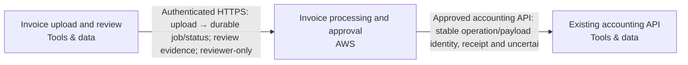

Snapshot fae1fcc6-010e-4cce-9c48-17bfe556fd5e · design r5 · generated 2026-11-10T07:47:28.350Z

# Asynchronous document intake — solution specification

## Problem and intended outcome

Users upload PDF invoices. Extract the supplier, invoice date, total and currency into a review queue. Delivery can repeat; retries must not create duplicate invoices. A reviewer approves a result before it is sent to our existing accounting API. Use AWS. Recommend a coherent system and the engineering choices. Ask only a small material business question when needed; do not make me configure the system.

## Scope

None recorded.

## Requirements and acceptance criteria

- [REQ-001] Accept PDF invoice uploads and durably present supplier, invoice date, total and currency in a review queue. Proposed safeguard: show supporting source evidence and keep failed or uncertain extraction visible for review rather than automatically delivering it. (must, open); target: acceptance target needed; linked blocks: staff-browser, invoice-workflow

Design explanation: Makes extraction observable and reviewable before incorrect financial information reaches accounting.

Basis: “Users upload PDF invoices. Extract the supplier, invoice date, total and currency into a review queue.” Source evidence is a proposed safeguard.
- [REQ-002] Send an invoice result to the existing accounting API only after an authorized reviewer approves that exact result revision. Proposed controls bind approval to the source and destination contract, invalidate approval when the result changes and retain an attributable approval/delivery history. (must, open); target: acceptance target needed; linked blocks: staff-browser, invoice-workflow, accounting-api

Design explanation: Prevents model output or subsequent edits from bypassing the required human approval.

Basis: “A reviewer approves a result before it is sent to our existing accounting API.” Revision-bound approval and reviewer authorization are proposed controls.
- [REQ-003] Repeated delivery and retries for the same invoice operation must not create duplicate accounting invoices. Preserve durable operation and payload identity across recovery; reconcile ambiguous external outcomes before resending unless destination idempotency is independently established. Acceptance must cover duplicate delivery, worker interruption and an accounting write followed by a lost response. (must, open); target: acceptance target needed; linked blocks: invoice-workflow, accounting-api

Design explanation: A timeout can hide a successful accounting write; blindly retrying could create a second invoice.

Basis: “Delivery can repeat; retries must not create duplicate invoices.” Durable operation identity, uncertain-outcome fencing and destination acceptance tests are proposed engineering controls.
- [REQ-004] Keep invoice documents and extracted data in Australia across storage, processing, inference, backups, recovery and accounting delivery. Proposed controls restrict personal-data access to authorized staff/workloads and exclude invoice content from operational logs. Verify service/model availability and processing geography before use; keep unresolved destinations blocked from receiving invoice data. (must, open); target: acceptance target needed; linked blocks: invoice-workflow, accounting-api

Design explanation: Personal data could leave the required country through inference, backups, logs or accounting delivery even when primary storage is Australian. Regional placement alone is insufficient.

Basis: “they may contain personal data” and “Keep documents and extracted data in Australia; flag unverified service availability.”
- [REQ-005] Retain invoice originals and extraction audit history for 90 days. Implement and verify cleanup across application records and object versions, with documented backup expiry and restoration handling; an exact deletion deadline and retention start event remain to be resolved. (must, open); target: Original and extraction audit retention == 90days; linked blocks: invoice-workflow

Design explanation: Retention must cover originals and extraction evidence consistently; object versions or restored backups could otherwise retain or reintroduce expired personal data.

Basis: “Keep originals and extraction audit history for 90 days.”
- [REQ-006] Support approximately 500 PDF invoices per day through durable intake, extraction and review without losing accepted work. Validate this baseline with representative PDFs and failure recovery; daily volume does not establish peak capacity or processing latency. (must, open); target: acceptance target needed; linked blocks: invoice-workflow

Design explanation: The intake volume establishes a capacity baseline while durable queuing prevents transient processing failures from losing accepted invoices. Peak rates and completion deadlines are not yet specified.

Basis: “around 500 per day” and the existing durable invoice review workflow.
- [REQ-007] Persist accepted work and stable invoice/job identities durably. Bound retries, recover interrupted workers and retain exhausted jobs in an operator-visible dead-letter/recovery state with failure history. Controlled replay must preserve identity and approval boundaries. Demonstrate recovery after interruption and retry exhaustion without lost work or duplicate accounting delivery. (must, open); target: acceptance target needed; linked blocks: invoice-workflow

Design explanation: Exhausted retries must remain recoverable without losing accepted invoices or allowing replay to bypass approval or duplicate accounting writes.

Basis: “Use a durable job queue, stable invoice/job identity, bounded retries, a dead-letter/recovery path, approval checks and an idempotent outbound operation.”
- [REQ-008] Integrate with the existing accounting system without provisioning or modifying it. Accept administrator-supplied endpoint configuration and securely referenced credentials. Before delivery, independently qualify authentication, Australian processing geography, normalized-action-v1 compatibility, durable idempotency and ambiguous-outcome reconciliation. Keep unresolved destinations blocked from receiving invoice data. (must, open); target: acceptance target needed; linked blocks: invoice-workflow, accounting-api

Design explanation: Keeping accounting outside provisioning scope prevents accidental replacement; reviewed secret handling and adapter acceptance are needed for safe delivery.

Basis: “The accounting system already exists. An administrator will supply its endpoint and credentials; treat it as external, not a new system to provision.”

## How the system works

The current design contains 3 components and 2 connections. 2 components are existing systems. The descriptions below follow the actual board; implementation guidance is identified separately from recorded behavior.

### Interaction 1: Invoice upload and review → Invoice processing and approval

Authenticated HTTPS: upload → durable job/status; review evidence; reviewer-only

Integration contract: browser-https.

Proposed verification: Verify the expected exchange, reject malformed or unauthorized input, and exercise interruption and recovery. Retry and duplicate-handling behavior must match the operation; it cannot be inferred from an arrow.

### Interaction 2: Invoice processing and approval → Existing accounting API

Approved accounting API: stable operation/payload identity, receipt and uncertai

Integration contract: approved-accounting-api.

Proposed verification: Verify the expected exchange, reject malformed or unauthorized input, and exercise interruption and recovery. Retry and duplicate-handling behavior must match the operation; it cannot be inferred from an arrow.

## Component responsibilities and design rationale

### Invoice upload and review

Web browser · tools · region: To be selected · classification: Confidential

Existing staff browser outside provisioning scope. Serves twenty signed-in staff and three reviewers; whether these populations overlap is unspecified. Staff upload PDF invoices and inspect extracted fields alongside source evidence. Only authorized reviewers may approve a specific result revision; ordinary uploaders cannot approve. Authentication and application reviewer membership are separate controls enforced by the workflow server.

Existing system: integrate with its owner and access contract; the design does not authorize replacing it.

Inputs: No incoming connection is drawn.

Outputs: Invoice upload and review → Invoice processing and approval: Authenticated HTTPS: upload → durable job/status; review evidence; reviewer-only (integration: browser-https)

Requirement traceability: REQ-001: Accept PDF invoice uploads and durably present supplier, invoice date, total and currency in a review queue. Proposed safeguard: show supporting source evidence and keep failed or uncertain extraction visible for review rather than automatically delivering it.; REQ-002: Send an invoice result to the existing accounting API only after an authorized reviewer approves that exact result revision. Proposed controls bind approval to the source and destination contract, invalidate approval when the result changes and retain an attributable approval/delivery history.

Implementation status: External staff browser — authenticated workflow channel generated; no browser infrastructure to provision

Implementation considerations (guidance):
- Preserve the external browser; no resource or import is required.
- Define and test its HTTPS/application interactions, including denied access and unavailable service behavior.

### Invoice processing and approval

Amazon ECS · aws · region: ap-southeast-2 · classification: Confidential

Composed invoice-workflow deployment unit on Amazon ECS. Owns browser/API, background worker, isolated PDF/OCR parser, private versioned Amazon S3 originals, durable PostgreSQL queue/outbox on Amazon RDS, staff sign-in, SQL user/reviewer membership, regional model integration, separate workload identities and operating tasks/monitoring. Current scope covers PDF upload, extraction of supplier/invoice date/total/currency, evidence-backed review, approval, accounting delivery and recovery. Serves twenty signed-in staff and three reviewers; population overlap is unspecified. Ordinary uploaders cannot approve, including through direct API requests. Server-side approval binds the exact result revision, source and destination contract; changed results invalidate approval and model output cannot authorize delivery. Accept PDFs up to 10,000,000 bytes; the proposed 100-page safeguard remains reviewable. Design for 500 uploads/day and bursts of twenty; validate admission with twenty concurrent submissions as a proposed interpretation of a burst. Jobs may take several minutes: return a durable job identity and status after accepted intake, process asynchronously and let staff revisit progress without holding the upload request open. A monthly volume is not confirmed. Invoices may contain personal data. Persist stable invoice/job identity and exact source object version; transactionally commit processing state and queue notification. Use fenced worker leases, recovery of stalled jobs and bounded retries with backoff. Exhausted jobs enter a durable failed/dead-letter state in the owned PostgreSQL workflow, visible to authorized operators with failure history and controlled replay using the same identity. Do not provision a duplicate queue service for this internal responsibility. Accounting delivery uses a transactional outbox, stable outbound operation ID and immutable payload identity. Recheck authorization and approval before delivery. Fence ambiguous external outcomes for reconciliation; do not blindly resend or create a new operation ID. Destination must independently pass normalized-action-v1 and durable idempotency acceptance. An administrator supplies the existing accounting endpoint and credentials through reviewed destination configuration and managed secret references; never put credentials in the diagram, logs or client responses. Retain originals and extraction audit history for 90 days. Implement scheduled cleanup and review object versions, backups and restore behavior; retention eligibility alone does not prove erasure, and the retention start event and exact deletion deadline remain unresolved. Propose Sydney ap-southeast-2, not yet user-approved, with documents, extracted data, model processing, invoice-bearing logs, backups and state restricted to Australia. No silent overseas inference or recovery fallback. Propose encryption, authorized staff/workload access and exclusion of invoice content from operational logs. Accounting residency is unresolved. Acceptance must cover burst intake, multi-minute processing, worker interruption, duplicate deliveries, exhausted retries, controlled recovery, denied uploader approval, exact-revision reviewer approval and accounting success followed by a lost response. Service/model availability, quotas, model retention policy, destination connectivity/compatibility, exact image build/scan evidence, restore and alert delivery remain unverified.

Proposed component: its responsibility is part of the current design, with implementation and deployment still subject to validation.

Inputs: Invoice upload and review → Invoice processing and approval: Authenticated HTTPS: upload → durable job/status; review evidence; reviewer-only (integration: browser-https)

Outputs: Invoice processing and approval → Existing accounting API: Approved accounting API: stable operation/payload identity, receipt and uncertai (integration: approved-accounting-api)

Requirement traceability: REQ-001: Accept PDF invoice uploads and durably present supplier, invoice date, total and currency in a review queue. Proposed safeguard: show supporting source evidence and keep failed or uncertain extraction visible for review rather than automatically delivering it.; REQ-002: Send an invoice result to the existing accounting API only after an authorized reviewer approves that exact result revision. Proposed controls bind approval to the source and destination contract, invalidate approval when the result changes and retain an attributable approval/delivery history.; REQ-003: Repeated delivery and retries for the same invoice operation must not create duplicate accounting invoices. Preserve durable operation and payload identity across recovery; reconcile ambiguous external outcomes before resending unless destination idempotency is independently established. Acceptance must cover duplicate delivery, worker interruption and an accounting write followed by a lost response.; REQ-004: Keep invoice documents and extracted data in Australia across storage, processing, inference, backups, recovery and accounting delivery. Proposed controls restrict personal-data access to authorized staff/workloads and exclude invoice content from operational logs. Verify service/model availability and processing geography before use; keep unresolved destinations blocked from receiving invoice data.; REQ-005: Retain invoice originals and extraction audit history for 90 days. Implement and verify cleanup across application records and object versions, with documented backup expiry and restoration handling; an exact deletion deadline and retention start event remain to be resolved.; REQ-006: Support approximately 500 PDF invoices per day through durable intake, extraction and review without losing accepted work. Validate this baseline with representative PDFs and failure recovery; daily volume does not establish peak capacity or processing latency.; REQ-007: Persist accepted work and stable invoice/job identities durably. Bound retries, recover interrupted workers and retain exhausted jobs in an operator-visible dead-letter/recovery state with failure history. Controlled replay must preserve identity and approval boundaries. Demonstrate recovery after interruption and retry exhaustion without lost work or duplicate accounting delivery.; REQ-008: Integrate with the existing accounting system without provisioning or modifying it. Accept administrator-supplied endpoint configuration and securely referenced credentials. Before delivery, independently qualify authentication, Australian processing geography, normalized-action-v1 compatibility, durable idempotency and ambiguous-outcome reconciliation. Keep unresolved destinations blocked from receiving invoice data.

Implementation status: Composed invoice API/worker/parser, durable SQL queue, private originals, review authorization, guarded accounting delivery and operating tasks generated; destination behavior remains unverified

Implementation considerations (guidance):
- Choose explicit ECS/Fargate resources or a reviewed managed deployment mode; define the task image, execution/task roles and secret references.
- Specify subnets, security groups, ingress/load balancing, egress, health checks, scaling and deployment rollback.
- Measure resource limits and request latency; test unhealthy deployments, dependency failures and recovery.

### Existing accounting API

Existing accounting API · tools · region: Existing location — unconfirmed · classification: Confidential

Client-owned existing accounting service outside provisioning scope; retain as a reference without recreation or modification. Receives only approved invoice results. An administrator will supply its endpoint and credentials through reviewed destination configuration and managed secret references; no credentials belong in the diagram. Vendor, hosting/processing locations, authentication mechanism and retention behavior remain unknown. Australian residency must be established before sending invoice data. Its adapter must independently pass normalized-action-v1 acceptance, including durable idempotency for repeated operation IDs with identical payloads, rejection of conflicting payload reuse and reconciliation after ambiguous responses. The workflow must preserve operation identity across retries and recovery. Compatibility, effective access, residency and live connectivity are not established by this diagram.

Existing system: integrate with its owner and access contract; the design does not authorize replacing it.

Inputs: Invoice processing and approval → Existing accounting API: Approved accounting API: stable operation/payload identity, receipt and uncertai (integration: approved-accounting-api)

Outputs: No outgoing connection is drawn.

Requirement traceability: REQ-002: Send an invoice result to the existing accounting API only after an authorized reviewer approves that exact result revision. Proposed controls bind approval to the source and destination contract, invalidate approval when the result changes and retain an attributable approval/delivery history.; REQ-003: Repeated delivery and retries for the same invoice operation must not create duplicate accounting invoices. Preserve durable operation and payload identity across recovery; reconcile ambiguous external outcomes before resending unless destination idempotency is independently established. Acceptance must cover duplicate delivery, worker interruption and an accounting write followed by a lost response.; REQ-004: Keep invoice documents and extracted data in Australia across storage, processing, inference, backups, recovery and accounting delivery. Proposed controls restrict personal-data access to authorized staff/workloads and exclude invoice content from operational logs. Verify service/model availability and processing geography before use; keep unresolved destinations blocked from receiving invoice data.; REQ-008: Integrate with the existing accounting system without provisioning or modifying it. Accept administrator-supplied endpoint configuration and securely referenced credentials. Before delivery, independently qualify authentication, Australian processing geography, normalized-action-v1 compatibility, durable idempotency and ambiguous-outcome reconciliation. Keep unresolved destinations blocked from receiving invoice data.

Implementation status: Existing service reference — preserve without provisioning/import; actual connection acceptance required

Implementation considerations (guidance):
- Preserve this externally managed service without creating or importing it.
- Document its owner, endpoint, identity and integration contract; test actual connections separately.

## Architecture

## Cloud resource schedule

Typed composed invoice implementation; extra required systems and flows remain visible. Source generation and local qualifications do not prove the destination deployment.

| Block ID | Component | Provider | Service | Region | Ownership | Terraform coverage |
|---|---|---|---|---|---|---|
| staff-browser | Invoice upload and review | tools | Web browser | To be selected | Existing | External staff browser — authenticated workflow channel generated; no browser infrastructure to provision |
| invoice-workflow | Invoice processing and approval | aws | Amazon ECS | ap-southeast-2 | Proposed | Composed invoice API/worker/parser, durable SQL queue, private originals, review authorization, guarded accounting delivery and operating tasks generated; destination behavior remains unverified |
| accounting-api | Existing accounting API | tools | Existing accounting API | Existing location — unconfirmed | Existing | Existing service reference — preserve without provisioning/import; actual connection acceptance required |

### Resources and cost dimensions

- **Invoice upload and review** (staff-browser): Resource types to confirm. Existing system or actor; review its externally owned costs and access contract.. Depends on: none drawn.
- **Invoice processing and approval** (invoice-workflow): aws_vpc, aws_db_instance, aws_s3_bucket, aws_ecs_cluster. API/worker/parser/operator compute, private database/backup/storage, NAT/private endpoints, identity, registry, model tokens, retained object versions, logging and notification delivery. Verify current regional rates and quotas; capacity limits are not spending caps.. Depends on: staff-browser.
- **Existing accounting API** (accounting-api): Resource types to confirm. Existing system or actor; review its externally owned costs and access contract.. Depends on: invoice-workflow.

### Engineering work remaining

S3 foundation only. Validate the plan, account, region, cost and security before applying.

References (resource semantics; not retrieved prices):

## Options and tradeoffs

Use Design → Options to compare cloud choices and record the rationale before choosing.

## Decisions and change history

### ADR-001 · platform.cloud

**Status:** Accepted · **Owner:** unassigned · **Date:** 2026-11-10 · **Design:** r2 · **Subject:** `platform.cloud`

**Context**

User statement: Use AWS.

**Options considered**

—

**Decision**

aws

_Changed because: Chosen in the conversation_

**Consequences**

—

### ADR-002 · data.country

**Status:** Accepted · **Owner:** unassigned · **Date:** 2026-11-10 · **Design:** r3 · **Subject:** `data.country`

**Context**

User statement: Keep documents and extracted data in Australia

**Options considered**

—

**Decision**

Australia

_Changed because: Chosen in the conversation_

**Consequences**

—

## Assumptions

None recorded.

## Questions to resolve

None recorded.

## Implementation specification and coding-agent handoff

The Spec Kit translates these requirements and the architecture into implementation work. Start with START_HERE.md and AGENTS.md; read spec-kit/implementation-spec.md (or PDF) for the implementation plan, contracts, detailed tasks and validation plan. Requirements remain the source of desired outcomes; the kit is the build plan derived from them.
