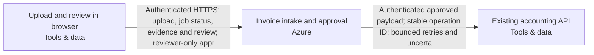

Snapshot f38064da-17e9-4ae6-8f60-453c18b3e1e7 · design r4 · generated 2026-11-10T07:50:08.742Z

# Asynchronous document intake — deployment document

Generated 2026-11-10 07:50 UTC from design revision r4 · project format 2.3.0 · AtMem AI Architect workbench

> No blockers found by the automated review. Human review and the open questions below still apply.
>
> Statements are **facts** from project data unless marked _assumption_ or listed under open questions. Estimate — not a bill or guarantee.

## 1. Summary

Users upload PDF invoices. Extract the supplier, invoice date, total and currency into a review queue. Delivery can repeat; retries must not create duplicate invoices. A reviewer approves a result before it is sent to our existing accounting API. Use Azure. Recommend a coherent system and the engineering choices. Ask only a small material business question when needed; do not make me configure the system.

- **Cloud:** Azure
- **Usage:** unknown
- **Estimated run cost:** not estimated
- **Review:** 7 open findings (0 blockers)
- **Current decisions:** 2

## 2. Scope and context

- **What you want to build:** Users upload PDF invoices. Extract the supplier, invoice date, total and currency into a review queue. Delivery can repeat; retries must not create duplicate invoices. A reviewer approves a result before it is sent to our existing accounting API. Use Azure. Recommend a coherent system and the engineering choices. Ask only a small material business question when needed; do not make me configure the system.
- **Information it uses:** PDF invoices up to 10 MB, around 500 per day; they may contain personal data. Keep originals and extraction audit history for 90 days. Keep documents and extracted data in Australia; flag unverified service availability.
- **Who uses it, and how much:** Here are the remaining project facts before we finalize the handoff. Preserve these requirements and update the system as needed. Twenty signed-in staff and three reviewers; ordinary uploaders cannot approve. 500 uploads per day, bursts of twenty. Jobs may take several minutes. The accounting system already exists. An administrator will supply its endpoint and credentials; treat it as external, not a new system to provision. Use a durable job queue, stable invoice/job identity, bounded retries, a dead-letter/recovery path, approval checks and an idempotent outbound operation.
- **Systems it connects to:** —
- **How good, fast and safe:** —
- **Cloud preference:** Azure
- **Budget and timeline:** —

## 3. Architecture

**Staff access**

- Upload and review in browser (Tools & data, existing) — Existing browser used by twenty signed-in staff and three reviewers; outside provisioning scope. Staff upload PDF invoices and view processing status and extraction evidence. Authorized reviewers correct and approve results. Ordinary uploaders cannot approve; the application enforces permissions on every protected server operation rather than relying on browser controls. Long-running jobs return a durable job reference and expose status without requiring the upload request to remain open.

**Invoice processing**

- Invoice intake and approval (Azure, sketch) — Composed invoice-workflow deployment unit on Azure Container Apps, owning browser/API, background worker, isolated PDF/OCR parser and operating tasks/monitoring. Internal generated resources include Azure Database for PostgreSQL durable transactional queue/outbox and review state, private versioned Azure Blob Storage originals, staff sign-in, separate workload identities and regional model integration; do not provision duplicate internal services. Scope: staff PDF upload, asynchronous extraction of supplier/invoice date/total/currency with source evidence, correction and review, authorized approval, recovery and approved accounting delivery. Support twenty signed-in staff and three reviewers; ordinary uploaders cannot approve. Enforce live application membership and reviewer authorization server-side; sign-in alone grants no approval permission. Accept PDFs up to 10,000,000 bytes, approximately 500 uploads daily and bursts of twenty; jobs may take several minutes without an invented completion deadline. Return durable job/status references and keep processing independent of browser connections. Persist stable invoice/job identities and exact source versions. Commit workflow state and queued work transactionally in PostgreSQL. Fence worker leases, recover stalled work, use bounded retries with backoff, and persist exhausted jobs in a visible dead-letter/recovery state with failure reasons. Authorized recovery preserves identities and history instead of creating fresh invoices. Incomplete or failed extraction stays visible for correction. Bind approval to the exact result revision and outbound payload; edits invalidate approval. Use a stable outbound operation ID and payload identity. Record delivery intent before calling accounting; uncertain outcomes are fenced for lookup/reconciliation rather than blindly resent. Accounting must independently pass normalized-action-v1, durable idempotency and uncertain-outcome acceptance; this does not prove its native API compatibility. An administrator supplies the external endpoint and credentials through protected destination configuration; keep credentials out of the diagram, browser, model input and logs. Treat originals and extracted fields as Confidential and potentially personal data. Keep documents and extracted data in Australia across processing, model inference, queues, data-bearing logs, backups and recovery copies. Australia East is proposed, not approved: verify Container Apps, PostgreSQL, Blob Storage, regional model support, quotas, private networking and processing geography. Never silently use global or cross-region inference. Retain originals and extraction audit history for 90 days; qualify retention start, scheduled cleanup, object versions, SQL records and backup expiry without promising universal exact erasure. Keep invoice content out of routine operational logs. Parser isolation, model retention/abuse-monitoring policy, restore, alert delivery and operating ownership require qualification. Acceptance must cover denied uploader approval, burst intake, worker interruption, retry exhaustion/recovery, stale approvals, repeated delivery and lost accounting responses. The diagram and local synthetic evidence do not establish destination behavior or deployment.

**Accounting boundary**

- Existing accounting API (Tools & data, existing) — Client-owned existing accounting service, referenced without provisioning, recreation or modification. An administrator will supply its endpoint and credentials through protected destination configuration; no identity or credential is invented or verified here. Receives only authorized, revision-bound approved invoice payloads through an authenticated adapter with stable operation and payload identities. Native field mapping, least-privilege access, durable destination idempotency, lookup/reconciliation and normalized-action-v1 acceptance remain unverified. Lost or ambiguous responses must enter reconciliation rather than trigger a fresh outbound operation. Its processing, storage, logging and backup locations must be qualified against Australian residency before invoice data is transferred.

## Cloud resource schedule

Typed composed invoice implementation; extra required systems and flows remain visible. Source generation and local qualifications do not prove the destination deployment.

| Block ID | Component | Provider | Service | Region | Ownership | Terraform coverage |
|---|---|---|---|---|---|---|
| invoice-browser | Upload and review in browser | tools | Web browser | Existing client location | Existing | External staff browser — authenticated workflow channel generated; no browser infrastructure to provision |
| invoice-workflow | Invoice intake and approval | azure | Azure Container Apps | australiaeast | Proposed | Composed invoice API/worker/parser, durable SQL queue, private originals, review authorization, guarded accounting delivery and operating tasks generated; destination behavior remains unverified |
| accounting-api | Existing accounting API | tools | Existing accounting API | Existing location; residency to confirm | Existing | Existing service reference — preserve without provisioning/import; actual connection acceptance required |

### Resources and cost dimensions

- **Upload and review in browser** (invoice-browser): Resource types to confirm. Existing system or actor; review its externally owned costs and access contract.. Depends on: none drawn.
- **Invoice intake and approval** (invoice-workflow): azurerm_resource_group, azurerm_postgresql_flexible_server, azurerm_storage_account, azurerm_container_app_environment. API/worker/parser/operator compute, private database/backup/storage, NAT/private endpoints, identity, registry, model tokens, retained object versions, logging and notification delivery. Verify current regional rates and quotas; capacity limits are not spending caps.. Depends on: invoice-browser.
- **Existing accounting API** (accounting-api): Resource types to confirm. Existing system or actor; review its externally owned costs and access contract.. Depends on: invoice-workflow.

### Engineering work remaining

S3 foundation only. Validate the plan, account, region, cost and security before applying.

References (resource semantics; not retrieved prices):

## 4. Data flows

| From | To | Data | Classification |
|---|---|---|---|
| Upload and review in browser | Invoice intake and approval | Authenticated HTTPS: upload, job status, evidence and review; reviewer-only appr | Confidential |
| Invoice intake and approval | Existing accounting API | Authenticated approved payload; stable operation ID; bounded retries and uncerta | Confidential |

## 5. Security controls

- _No guardrail or approval components in the design._
- Requirement: Permit accounting submission only after an authorized reviewer approves the exact result revision and delivery payload; changes invalidate that approval. Enforce reviewer permissions on the server and retain the approval and delivery history. (must)
- Requirement: Keep invoice documents and extracted data within Australia across application processing, model inference, storage and data-bearing operational/recovery copies. Qualify the existing accounting destination before transfer. Explicitly flag unverified regional service/model support and prohibit silent cross-border fallback. (must)
- Requirement: Retain invoice originals and extraction audit history for 90 days. Implement scheduled cleanup and document deletion behavior for database records, object versions and backups; qualify the retention start event and residual recovery windows before claiming compliance. (must)
- Requirement: Reference the existing accounting system without provisioning or modifying it. Accept administrator-supplied endpoint and credentials through protected configuration. Implement and qualify authenticated payload mapping, destination idempotency and outcome reconciliation before delivery; exclude secrets from browser responses, model inputs and logs. Accounting data handling must satisfy the existing Australian residency requirement. (must)

## 6. Requirements

**Non-functional**

| Requirement | Category | Target | Status |
|---|---|---|---|
| Repeated delivery and worker recovery must not create duplicate accounting invoices. Persist stable operation and payload identities, require a qualified destination idempotency contract, and reconcile uncertain external outcomes before allowing another submission. | reliability | not measurable yet | Open |
| Keep invoice documents and extracted data within Australia across application processing, model inference, storage and data-bearing operational/recovery copies. Qualify the existing accounting destination before transfer. Explicitly flag unverified regional service/model support and prohibit silent cross-border fallback. | compliance | not measurable yet | Open |
| Retain invoice originals and extraction audit history for 90 days. Implement scheduled cleanup and document deletion behavior for database records, object versions and backups; qualify the retention start event and residual recovery windows before claiming compliance. | compliance | Original and extraction-audit retention period == 90days | Open |
| Accept PDF invoices up to 10,000,000 bytes and plan asynchronous capacity for approximately 500 uploads per day. Reject oversized uploads explicitly before parsing. Qualify capacity with representative PDFs and retry/recovery workloads; peak arrival rate and completion-time targets remain unspecified. | scalability | not measurable yet | Open |
| Persist workflow state and queued work transactionally with stable invoice/job identities. Bound retries, recover stalled workers and retain exhausted jobs in a visible dead-letter/recovery state. Restrict recovery to authorized operators, preserve identity and audit history, and test process interruption and retry exhaustion without losing work or bypassing approval. | reliability | not measurable yet | Open |

**Functional**

- Accept uploaded PDF invoices, asynchronously extract supplier, invoice date, total and currency, and persist results in a review queue. Proposed acceptance: show supporting evidence and expose incomplete extraction or processing failures for correction. (must, open)
- Permit accounting submission only after an authorized reviewer approves the exact result revision and delivery payload; changes invalidate that approval. Enforce reviewer permissions on the server and retain the approval and delivery history. (must, open)
- Reference the existing accounting system without provisioning or modifying it. Accept administrator-supplied endpoint and credentials through protected configuration. Implement and qualify authenticated payload mapping, destination idempotency and outcome reconciliation before delivery; exclude secrets from browser responses, model inputs and logs. Accounting data handling must satisfy the existing Australian residency requirement. (must, open)

**Success measures**

_No success measures defined._

## 7. Review findings

**Reliability**

- [minor] The design depends on existing systems; their failure behaviour is not described. State what happens when each existing system is unavailable (retry, queue, fallback). _(AtMem AI Architect rule REL-002 v1.0.0)_

**Availability**

- [minor] No availability target. Add a requirement such as “available 99.5% of the time” or “business hours only”. _(AtMem AI Architect rule AVL-001 v1.0.0)_

**Scalability**

- [info] Expected usage is unknown, so scale can't be assessed. Tell us in the chat roughly how many people use it and how often. _(AtMem AI Architect rule SCL-001 v1.0.0)_

**Maintainability**

- [minor] 4 quality requirements have no measurable target. Add a metric and target to: “Repeated delivery and worker recovery must not create duplicate accounting invoices. Persist stable operation and payload identities, require a qualified destination idempotency contract, and reconcile uncertain external outcomes before allowing another submission.”, “Keep invoice documents and extracted data within Australia across application processing, model inference, storage and data-bearing operational/recovery copies. Qualify the existing accounting destination before transfer. Explicitly flag unverified regional service/model support and prohibit silent cross-border fallback.”, “Accept PDF invoices up to 10,000,000 bytes and plan asynchronous capacity for approximately 500 uploads per day. Reject oversized uploads explicitly before parsing. Qualify capacity with representative PDFs and retry/recovery workloads; peak arrival rate and completion-time targets remain unspecified.”, “Persist workflow state and queued work transactionally with stable invoice/job identities. Bound retries, recover stalled workers and retain exhausted jobs in a visible dead-letter/recovery state. Restrict recovery to authorized operators, preserve identity and audit history, and test process interruption and retry exhaustion without losing work or bypassing approval.”. _(AtMem AI Architect rule MNT-001 v1.0.0)_
- [minor] 2 accepted decisions have no owner. Assign an owner in Design → Decisions. _(AtMem AI Architect rule MNT-002 v1.0.0)_
- [info] 1 block is sketch-only and can't be test-run yet. Keep designing; assign a runnable behaviour in block detail when one exists. _(AtMem AI Architect rule DSN-001 v1.0.0)_

**Cost**

- [info] No budget stated. Mention a monthly running budget, or a range, in the chat. _(AtMem AI Architect rule CST-001 v1.0.0)_

## 8. Cost estimate

Estimate — not a bill or guarantee. Monthly run cost only. Prices are as entered, with their sources.

**Estimate stage:** Not estimated. Rough order of magnitude, refined as scope and charge dimensions become known.

_No costed components._

**Usage inputs:** Quantities are entered directly on detailed charge lines above.

**Range:** low ×0.7, high ×1.5 of expected. Not costed in this release: Upload and review in browser, Invoice intake and approval, Existing accounting API.

**Estimate gaps:**

- Upload and review in browser: no cost lines; add charges or an explicit zero-cost line with a reason.
- Invoice intake and approval: no cost lines; add charges or an explicit zero-cost line with a reason.
- Existing accounting API: no cost lines; add charges or an explicit zero-cost line with a reason.

### Consulting and build estimate (one-off)

Not estimated; enter work-package days, rates and a basis.

| Work package | Low / expected / high days | Rate / day | Expected | Basis and exclusions |
|---|---|---|---|---|
| Discovery & specification | — / — / — | — | — | Needed |
| Architecture & security | — / — / — | — | — | Needed |
| Implementation & integration | — / — / — | — | — | Needed |
| Testing & acceptance | — / — / — | — | — | Needed |
| Deployment & handover | — / — / — | — | — | Needed |

One-off effort is separate from monthly cloud charges. Days are person-days, not elapsed time. Taxes, support, licences and migration are excluded unless explicitly included in the basis or charge lines.

## 9. Deployment steps

_Draft generated from the design; validate against the provider's current documentation before use. Nothing has been provisioned._

1. Confirm accounts, target regions and who approves each step; resolve every blocker in this document.
2. Create least-privilege identities for each component; keep credentials in the provider's secret store, never in the project.
3. Provision invoice processing: Invoice intake and approval.
4. Connect existing systems: Upload and review in browser, Existing accounting API; test failure behaviour.
5. Run the acceptance checks (success measures and requirements) in staging; record results.
6. Review results and approve promotion to production; keep a rollback plan for each step.

## 10. Decisions

### ADR-001 · platform.cloud

**Status:** Accepted · **Owner:** unassigned · **Date:** 2026-11-10 · **Design:** r2 · **Subject:** `platform.cloud`

**Context**

User statement: Use Azure.

**Options considered**

—

**Decision**

azure

_Changed because: Chosen in the conversation_

**Consequences**

—

### ADR-002 · data.country

**Status:** Accepted · **Owner:** unassigned · **Date:** 2026-11-10 · **Design:** r3 · **Subject:** `data.country`

**Context**

User statement: Keep documents and extracted data in Australia

**Options considered**

—

**Decision**

Australia

_Changed because: Chosen in the conversation_

**Consequences**

—

## 11. Assumptions

_None recorded._

## 12. Open questions

_None._
