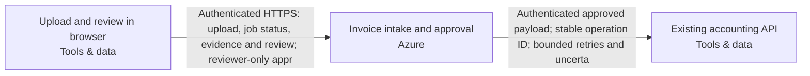

Snapshot f38064da-17e9-4ae6-8f60-453c18b3e1e7 · design r4 · generated 2026-11-10T07:50:08.742Z

# Asynchronous document intake — solution specification

## Problem and intended outcome

Users upload PDF invoices. Extract the supplier, invoice date, total and currency into a review queue. Delivery can repeat; retries must not create duplicate invoices. A reviewer approves a result before it is sent to our existing accounting API. Use Azure. Recommend a coherent system and the engineering choices. Ask only a small material business question when needed; do not make me configure the system.

## Scope

None recorded.

## Requirements and acceptance criteria

- [REQ-001] Accept uploaded PDF invoices, asynchronously extract supplier, invoice date, total and currency, and persist results in a review queue. Proposed acceptance: show supporting evidence and expose incomplete extraction or processing failures for correction. (must, open); target: acceptance target needed; linked blocks: invoice-browser, invoice-workflow

Design explanation: Makes the requested extraction observable and prevents incomplete or unsupported values from silently becoming accounting records.

Basis: “Users upload PDF invoices. Extract the supplier, invoice date, total and currency into a review queue.” Source evidence and explicit failure states are engineering proposals.
- [REQ-002] Permit accounting submission only after an authorized reviewer approves the exact result revision and delivery payload; changes invalidate that approval. Enforce reviewer permissions on the server and retain the approval and delivery history. (must, open); target: acceptance target needed; linked blocks: invoice-workflow, accounting-api

Design explanation: Prevents model output or a later edit from bypassing the user's required human approval.

Basis: “A reviewer approves a result before it is sent to our existing accounting API.” Revision-bound approval and server authorization are proposed controls.
- [REQ-003] Repeated delivery and worker recovery must not create duplicate accounting invoices. Persist stable operation and payload identities, require a qualified destination idempotency contract, and reconcile uncertain external outcomes before allowing another submission. (must, open); target: acceptance target needed; linked blocks: invoice-workflow, accounting-api

Design explanation: A timeout can occur after accounting accepts an invoice; blind retries can create duplicates even when the local queue deduplicates jobs.

Basis: “Delivery can repeat; retries must not create duplicate invoices.” Durable operation identity and uncertain-outcome reconciliation are proposed engineering controls, supported by the supplied durable-approval-and-uncertain-outcome practice.
- [REQ-004] Keep invoice documents and extracted data within Australia across application processing, model inference, storage and data-bearing operational/recovery copies. Qualify the existing accounting destination before transfer. Explicitly flag unverified regional service/model support and prohibit silent cross-border fallback. (must, open); target: acceptance target needed; linked blocks: invoice-workflow, accounting-api

Design explanation: Personal invoice data could leave Australia through inference, backups, logs or the existing accounting integration unless every processing path is qualified.

Basis: “they may contain personal data” and “Keep documents and extracted data in Australia; flag unverified service availability.”
- [REQ-005] Retain invoice originals and extraction audit history for 90 days. Implement scheduled cleanup and document deletion behavior for database records, object versions and backups; qualify the retention start event and residual recovery windows before claiming compliance. (must, open); target: Original and extraction-audit retention period == 90days; linked blocks: invoice-workflow

Design explanation: Cleanup must include audit records and versioned originals; backup windows can prevent immediate erasure and need explicit acceptance.

Basis: “Keep originals and extraction audit history for 90 days.”
- [REQ-006] Accept PDF invoices up to 10,000,000 bytes and plan asynchronous capacity for approximately 500 uploads per day. Reject oversized uploads explicitly before parsing. Qualify capacity with representative PDFs and retry/recovery workloads; peak arrival rate and completion-time targets remain unspecified. (must, open); target: acceptance target needed; linked blocks: invoice-browser, invoice-workflow

Design explanation: Enforcing upload bounds protects parsing resources; daily volume informs capacity without inventing peak traffic or a processing deadline.

Basis: “PDF invoices up to 10 MB, around 500 per day”
- [REQ-007] Persist workflow state and queued work transactionally with stable invoice/job identities. Bound retries, recover stalled workers and retain exhausted jobs in a visible dead-letter/recovery state. Restrict recovery to authorized operators, preserve identity and audit history, and test process interruption and retry exhaustion without losing work or bypassing approval. (must, open); target: acceptance target needed; linked blocks: invoice-workflow

Design explanation: Durable recovery prevents worker crashes and exhausted retries from losing invoices or creating new delivery identities. The PostgreSQL queue and recovery state are proposed internal engineering choices.

Basis: “Use a durable job queue, stable invoice/job identity, bounded retries, a dead-letter/recovery path, approval checks and an idempotent outbound operation.”
- [REQ-008] Reference the existing accounting system without provisioning or modifying it. Accept administrator-supplied endpoint and credentials through protected configuration. Implement and qualify authenticated payload mapping, destination idempotency and outcome reconciliation before delivery; exclude secrets from browser responses, model inputs and logs. Accounting data handling must satisfy the existing Australian residency requirement. (must, open); target: acceptance target needed; linked blocks: invoice-workflow, accounting-api

Design explanation: An external endpoint is not a verified integration. Qualification must establish safe delivery without expanding provisioning into the client's accounting system.

Basis: “The accounting system already exists. An administrator will supply its endpoint and credentials; treat it as external, not a new system to provision.”

## How the system works

The current design contains 3 components and 2 connections. 2 components are existing systems. The descriptions below follow the actual board; implementation guidance is identified separately from recorded behavior.

### Interaction 1: Upload and review in browser → Invoice intake and approval

Authenticated HTTPS: upload, job status, evidence and review; reviewer-only appr

Integration contract: browser-https.

Proposed verification: Verify the expected exchange, reject malformed or unauthorized input, and exercise interruption and recovery. Retry and duplicate-handling behavior must match the operation; it cannot be inferred from an arrow.

### Interaction 2: Invoice intake and approval → Existing accounting API

Authenticated approved payload; stable operation ID; bounded retries and uncerta

Integration contract: approved-accounting-api.

Proposed verification: Verify the expected exchange, reject malformed or unauthorized input, and exercise interruption and recovery. Retry and duplicate-handling behavior must match the operation; it cannot be inferred from an arrow.

## Component responsibilities and design rationale

### Upload and review in browser

Web browser · tools · region: Existing client location · classification: Confidential

Existing browser used by twenty signed-in staff and three reviewers; outside provisioning scope. Staff upload PDF invoices and view processing status and extraction evidence. Authorized reviewers correct and approve results. Ordinary uploaders cannot approve; the application enforces permissions on every protected server operation rather than relying on browser controls. Long-running jobs return a durable job reference and expose status without requiring the upload request to remain open.

Existing system: integrate with its owner and access contract; the design does not authorize replacing it.

Inputs: No incoming connection is drawn.

Outputs: Upload and review in browser → Invoice intake and approval: Authenticated HTTPS: upload, job status, evidence and review; reviewer-only appr (integration: browser-https)

Requirement traceability: REQ-001: Accept uploaded PDF invoices, asynchronously extract supplier, invoice date, total and currency, and persist results in a review queue. Proposed acceptance: show supporting evidence and expose incomplete extraction or processing failures for correction.; REQ-006: Accept PDF invoices up to 10,000,000 bytes and plan asynchronous capacity for approximately 500 uploads per day. Reject oversized uploads explicitly before parsing. Qualify capacity with representative PDFs and retry/recovery workloads; peak arrival rate and completion-time targets remain unspecified.

Implementation status: External staff browser — authenticated workflow channel generated; no browser infrastructure to provision

Implementation considerations (guidance):
- Preserve the external browser; no resource or import is required.
- Define and test its HTTPS/application interactions, including denied access and unavailable service behavior.

### Invoice intake and approval

Azure Container Apps · azure · region: australiaeast · classification: Confidential

Composed invoice-workflow deployment unit on Azure Container Apps, owning browser/API, background worker, isolated PDF/OCR parser and operating tasks/monitoring. Internal generated resources include Azure Database for PostgreSQL durable transactional queue/outbox and review state, private versioned Azure Blob Storage originals, staff sign-in, separate workload identities and regional model integration; do not provision duplicate internal services. Scope: staff PDF upload, asynchronous extraction of supplier/invoice date/total/currency with source evidence, correction and review, authorized approval, recovery and approved accounting delivery. Support twenty signed-in staff and three reviewers; ordinary uploaders cannot approve. Enforce live application membership and reviewer authorization server-side; sign-in alone grants no approval permission. Accept PDFs up to 10,000,000 bytes, approximately 500 uploads daily and bursts of twenty; jobs may take several minutes without an invented completion deadline. Return durable job/status references and keep processing independent of browser connections. Persist stable invoice/job identities and exact source versions. Commit workflow state and queued work transactionally in PostgreSQL. Fence worker leases, recover stalled work, use bounded retries with backoff, and persist exhausted jobs in a visible dead-letter/recovery state with failure reasons. Authorized recovery preserves identities and history instead of creating fresh invoices. Incomplete or failed extraction stays visible for correction. Bind approval to the exact result revision and outbound payload; edits invalidate approval. Use a stable outbound operation ID and payload identity. Record delivery intent before calling accounting; uncertain outcomes are fenced for lookup/reconciliation rather than blindly resent. Accounting must independently pass normalized-action-v1, durable idempotency and uncertain-outcome acceptance; this does not prove its native API compatibility. An administrator supplies the external endpoint and credentials through protected destination configuration; keep credentials out of the diagram, browser, model input and logs. Treat originals and extracted fields as Confidential and potentially personal data. Keep documents and extracted data in Australia across processing, model inference, queues, data-bearing logs, backups and recovery copies. Australia East is proposed, not approved: verify Container Apps, PostgreSQL, Blob Storage, regional model support, quotas, private networking and processing geography. Never silently use global or cross-region inference. Retain originals and extraction audit history for 90 days; qualify retention start, scheduled cleanup, object versions, SQL records and backup expiry without promising universal exact erasure. Keep invoice content out of routine operational logs. Parser isolation, model retention/abuse-monitoring policy, restore, alert delivery and operating ownership require qualification. Acceptance must cover denied uploader approval, burst intake, worker interruption, retry exhaustion/recovery, stale approvals, repeated delivery and lost accounting responses. The diagram and local synthetic evidence do not establish destination behavior or deployment.

Proposed component: its responsibility is part of the current design, with implementation and deployment still subject to validation.

Inputs: Upload and review in browser → Invoice intake and approval: Authenticated HTTPS: upload, job status, evidence and review; reviewer-only appr (integration: browser-https)

Outputs: Invoice intake and approval → Existing accounting API: Authenticated approved payload; stable operation ID; bounded retries and uncerta (integration: approved-accounting-api)

Requirement traceability: REQ-001: Accept uploaded PDF invoices, asynchronously extract supplier, invoice date, total and currency, and persist results in a review queue. Proposed acceptance: show supporting evidence and expose incomplete extraction or processing failures for correction.; REQ-002: Permit accounting submission only after an authorized reviewer approves the exact result revision and delivery payload; changes invalidate that approval. Enforce reviewer permissions on the server and retain the approval and delivery history.; REQ-003: Repeated delivery and worker recovery must not create duplicate accounting invoices. Persist stable operation and payload identities, require a qualified destination idempotency contract, and reconcile uncertain external outcomes before allowing another submission.; REQ-004: Keep invoice documents and extracted data within Australia across application processing, model inference, storage and data-bearing operational/recovery copies. Qualify the existing accounting destination before transfer. Explicitly flag unverified regional service/model support and prohibit silent cross-border fallback.; REQ-005: Retain invoice originals and extraction audit history for 90 days. Implement scheduled cleanup and document deletion behavior for database records, object versions and backups; qualify the retention start event and residual recovery windows before claiming compliance.; REQ-006: Accept PDF invoices up to 10,000,000 bytes and plan asynchronous capacity for approximately 500 uploads per day. Reject oversized uploads explicitly before parsing. Qualify capacity with representative PDFs and retry/recovery workloads; peak arrival rate and completion-time targets remain unspecified.; REQ-007: Persist workflow state and queued work transactionally with stable invoice/job identities. Bound retries, recover stalled workers and retain exhausted jobs in a visible dead-letter/recovery state. Restrict recovery to authorized operators, preserve identity and audit history, and test process interruption and retry exhaustion without losing work or bypassing approval.; REQ-008: Reference the existing accounting system without provisioning or modifying it. Accept administrator-supplied endpoint and credentials through protected configuration. Implement and qualify authenticated payload mapping, destination idempotency and outcome reconciliation before delivery; exclude secrets from browser responses, model inputs and logs. Accounting data handling must satisfy the existing Australian residency requirement.

Implementation status: Composed invoice API/worker/parser, durable SQL queue, private originals, review authorization, guarded accounting delivery and operating tasks generated; destination behavior remains unverified

Implementation considerations (guidance):
- Confirm the exact azure service, deployment mode, region and supported resource types using current primary documentation.
- Specify runtime/artifact, identity, network paths, secrets, capacity, health checks and operational owner; resolve whether this is infrastructure or a responsibility within another application.
- Document service-specific failure modes, retention/recovery and acceptance tests; do not substitute a similarly named service or another provider.

### Existing accounting API

Existing accounting API · tools · region: Existing location; residency to confirm · classification: Confidential

Client-owned existing accounting service, referenced without provisioning, recreation or modification. An administrator will supply its endpoint and credentials through protected destination configuration; no identity or credential is invented or verified here. Receives only authorized, revision-bound approved invoice payloads through an authenticated adapter with stable operation and payload identities. Native field mapping, least-privilege access, durable destination idempotency, lookup/reconciliation and normalized-action-v1 acceptance remain unverified. Lost or ambiguous responses must enter reconciliation rather than trigger a fresh outbound operation. Its processing, storage, logging and backup locations must be qualified against Australian residency before invoice data is transferred.

Existing system: integrate with its owner and access contract; the design does not authorize replacing it.

Inputs: Invoice intake and approval → Existing accounting API: Authenticated approved payload; stable operation ID; bounded retries and uncerta (integration: approved-accounting-api)

Outputs: No outgoing connection is drawn.

Requirement traceability: REQ-002: Permit accounting submission only after an authorized reviewer approves the exact result revision and delivery payload; changes invalidate that approval. Enforce reviewer permissions on the server and retain the approval and delivery history.; REQ-003: Repeated delivery and worker recovery must not create duplicate accounting invoices. Persist stable operation and payload identities, require a qualified destination idempotency contract, and reconcile uncertain external outcomes before allowing another submission.; REQ-004: Keep invoice documents and extracted data within Australia across application processing, model inference, storage and data-bearing operational/recovery copies. Qualify the existing accounting destination before transfer. Explicitly flag unverified regional service/model support and prohibit silent cross-border fallback.; REQ-008: Reference the existing accounting system without provisioning or modifying it. Accept administrator-supplied endpoint and credentials through protected configuration. Implement and qualify authenticated payload mapping, destination idempotency and outcome reconciliation before delivery; exclude secrets from browser responses, model inputs and logs. Accounting data handling must satisfy the existing Australian residency requirement.

Implementation status: Existing service reference — preserve without provisioning/import; actual connection acceptance required

Implementation considerations (guidance):
- Preserve this externally managed service without creating or importing it.
- Document its owner, endpoint, identity and integration contract; test actual connections separately.

## Architecture

## Cloud resource schedule

Typed composed invoice implementation; extra required systems and flows remain visible. Source generation and local qualifications do not prove the destination deployment.

| Block ID | Component | Provider | Service | Region | Ownership | Terraform coverage |
|---|---|---|---|---|---|---|
| invoice-browser | Upload and review in browser | tools | Web browser | Existing client location | Existing | External staff browser — authenticated workflow channel generated; no browser infrastructure to provision |
| invoice-workflow | Invoice intake and approval | azure | Azure Container Apps | australiaeast | Proposed | Composed invoice API/worker/parser, durable SQL queue, private originals, review authorization, guarded accounting delivery and operating tasks generated; destination behavior remains unverified |
| accounting-api | Existing accounting API | tools | Existing accounting API | Existing location; residency to confirm | Existing | Existing service reference — preserve without provisioning/import; actual connection acceptance required |

### Resources and cost dimensions

- **Upload and review in browser** (invoice-browser): Resource types to confirm. Existing system or actor; review its externally owned costs and access contract.. Depends on: none drawn.
- **Invoice intake and approval** (invoice-workflow): azurerm_resource_group, azurerm_postgresql_flexible_server, azurerm_storage_account, azurerm_container_app_environment. API/worker/parser/operator compute, private database/backup/storage, NAT/private endpoints, identity, registry, model tokens, retained object versions, logging and notification delivery. Verify current regional rates and quotas; capacity limits are not spending caps.. Depends on: invoice-browser.
- **Existing accounting API** (accounting-api): Resource types to confirm. Existing system or actor; review its externally owned costs and access contract.. Depends on: invoice-workflow.

### Engineering work remaining

S3 foundation only. Validate the plan, account, region, cost and security before applying.

References (resource semantics; not retrieved prices):

## Options and tradeoffs

Use Design → Options to compare cloud choices and record the rationale before choosing.

## Decisions and change history

### ADR-001 · platform.cloud

**Status:** Accepted · **Owner:** unassigned · **Date:** 2026-11-10 · **Design:** r2 · **Subject:** `platform.cloud`

**Context**

User statement: Use Azure.

**Options considered**

—

**Decision**

azure

_Changed because: Chosen in the conversation_

**Consequences**

—

### ADR-002 · data.country

**Status:** Accepted · **Owner:** unassigned · **Date:** 2026-11-10 · **Design:** r3 · **Subject:** `data.country`

**Context**

User statement: Keep documents and extracted data in Australia

**Options considered**

—

**Decision**

Australia

_Changed because: Chosen in the conversation_

**Consequences**

—

## Assumptions

None recorded.

## Questions to resolve

None recorded.

## Implementation specification and coding-agent handoff

The Spec Kit translates these requirements and the architecture into implementation work. Start with START_HERE.md and AGENTS.md; read spec-kit/implementation-spec.md (or PDF) for the implementation plan, contracts, detailed tasks and validation plan. Requirements remain the source of desired outcomes; the kit is the build plan derived from them.
