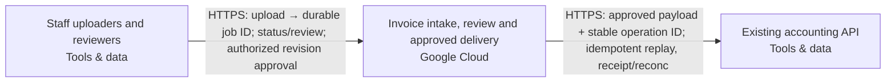

Snapshot d36e9cc0-3a6b-4fde-b9ac-4446bfe6e9fe · design r5 · generated 2026-11-10T07:53:46.129Z

# Asynchronous document intake — deployment document

Generated 2026-11-10 07:53 UTC from design revision r5 · project format 2.3.0 · AtMem AI Architect workbench

> No blockers found by the automated review. Human review and the open questions below still apply.
>
> Statements are **facts** from project data unless marked _assumption_ or listed under open questions. Estimate — not a bill or guarantee.

## 1. Summary

Users upload PDF invoices. Extract the supplier, invoice date, total and currency into a review queue. Delivery can repeat; retries must not create duplicate invoices. A reviewer approves a result before it is sent to our existing accounting API. Use Google Cloud. Recommend a coherent system and the engineering choices. Ask only a small material business question when needed; do not make me configure the system.

- **Cloud:** Google Cloud
- **Usage:** unknown
- **Estimated run cost:** not estimated
- **Review:** 7 open findings (0 blockers)
- **Current decisions:** 2

## 2. Scope and context

- **What you want to build:** Users upload PDF invoices. Extract the supplier, invoice date, total and currency into a review queue. Delivery can repeat; retries must not create duplicate invoices. A reviewer approves a result before it is sent to our existing accounting API. Use Google Cloud. Recommend a coherent system and the engineering choices. Ask only a small material business question when needed; do not make me configure the system.
- **Information it uses:** Keep documents and extracted data in Australia; flag unverified service availability.
- **Who uses it, and how much:** Here are the remaining project facts before we finalize the handoff. Preserve these requirements and update the system as needed. 500 uploads per day, bursts of twenty. Jobs may take several minutes. The accounting system already exists. An administrator will supply its endpoint and credentials; treat it as external, not a new system to provision. Use a durable job queue, stable invoice/job identity, bounded retries, a dead-letter/recovery path, approval checks and an idempotent outbound operation.
- **Systems it connects to:** Twenty signed-in staff and three reviewers; ordinary uploaders cannot approve. PDF invoices up to 10 MB, around 500 per day; they may contain personal data. Keep originals and extraction audit history for 90 days.
- **How good, fast and safe:** —
- **Cloud preference:** Google Cloud
- **Budget and timeline:** —

## 3. Architecture

**Staff access**

- Staff uploaders and reviewers (Tools & data, existing) — Existing browsers used by 20 signed-in staff, with three reviewers identified; whether reviewers are included in the 20 is unspecified. Staff upload PDFs and inspect permitted processing results. Only authorized reviewers may approve the exact reviewed revision; ordinary uploaders cannot approve. The server enforces membership and permissions on every relevant request. Client reference outside provisioning scope; staff identity provider and access geography remain unresolved.

**Invoice processing**

- Invoice intake, review and approved delivery (Google Cloud, sketch) — Proposed composed delivery unit on Google Cloud Run: browser/API, background worker and isolated PDF/OCR parser. Owns Cloud SQL for PostgreSQL transactional durable job queue/outbox and review state, private versioned Google Cloud Storage originals, regional Vertex AI extraction, staff sign-in, SQL user/reviewer membership and separate keyless workload identities. Supports 20 signed-in staff and three reviewers; whether reviewers are included in the 20 remains unspecified. Ordinary uploaders cannot approve; the server enforces membership and permissions on every relevant request. Staff identity provider and access geography remain unresolved. Scope includes PDF intake, extraction of supplier/invoice date/total/currency with source evidence, durable review, authorized approval and approved accounting delivery. Planning workload is 500 uploads daily with bursts of twenty, PDFs up to 10,000,000 bytes and jobs that may take several minutes; this is not a completion-time guarantee. Proposed parser bound remains 100 pages. Accept uploads durably and return a stable job ID/status without holding the browser request open for extraction. Repeated delivery of the same intake identity resolves to the same invoice/job; independently submitted business duplicates require a separately agreed matching policy. Persist exact source object-version identity, invoice/job identity and processing results. Commit business state and queued work in one PostgreSQL transaction. Propose leased PostgreSQL workers with fencing, heartbeats, bounded processing deadlines, bounded exponential-backoff retries and stalled/orphaned-job recovery. Exhausted or permanent failures enter durable dead-letter/quarantine records with failure reason, attempts and audit history; authorized recovery reuses the original identity and cannot bypass approval or accounting outcome fences. Queue admission and worker concurrency are independently bounded so bursts need not start twenty extraction workers. Validate burst intake, several-minute execution, duplicate delivery, worker termination, retry exhaustion and controlled recovery against emitted artifacts before claiming capacity or reliability. Documents may contain personal data: restrict originals, extracted fields and audit access to authorized staff, exclude document contents from operational logs and clean up temporary parser data. Parser alone sees untrusted PDF bytes and has no database, model or accounting identity. Return extracted fields, source evidence and processing/review/delivery status through the review UI. Bind approval to the exact source/result revision and destination contract; edits invalidate approval. Only an authorized reviewer can approve. Send only approved payloads through the external accounting adapter with a durable operation ID and stable payload identity. Persist delivery intent and receipt/outcome. Retry only under a verified destination idempotency contract using the same operation and payload identity; uncertain outcomes pause for reconciliation, never a fresh send identity or automatic reapproval. Administrator supplies the existing accounting endpoint and credentials through reviewed destination configuration and secret handling, outside the diagram; do not provision or modify the accounting service. Own audit events, monitoring, alerts, retention and restore/reconciliation operating tasks. Retain originals and extraction audit history for 90 days; propose intake time as retention clock pending lifecycle confirmation. Cleanup covers processing state, object versions, database records, backups and restored copies; backup/version windows and deletion timing require destination review, with no exact universal erasure deadline claimed. Required boundary: documents and extracted data remain stored and processed in Australia, including temporary parser data, model requests/results, sensitive logs, database backups, object versions and recovery copies. Sydney (australia-southeast1) remains proposed, not accepted or verified. Verify Cloud Run, Cloud SQL, storage, selected Vertex AI model, private networking, quotas, processing geography and zonal recovery before implementation approval. No silent global model endpoints, overseas replication or overseas failover. Model retention/caching/logging policy, staff identity/access geography and accounting residency/adapter acceptance remain unresolved. Compiler capability and reviewed practices do not establish deployment or combined-system validation.

**Accounting integration**

- Existing accounting API (Tools & data, existing) — Client-owned existing accounting service; external reference only, outside provisioning scope and never recreated or modified by this design. An administrator will supply its endpoint and credentials through reviewed destination inputs and secret handling, never in the diagram or chat. Receives only reviewer-approved invoice payloads tied to the exact approved revision. The workflow-owned adapter must independently pass normalized-action-v1 acceptance for authentication, schema, durable idempotency, stable operation/payload identity, receipts and outcome reconciliation. Repeated outbound attempts must retain the same operation and payload identity. Uncertain delivery outcomes pause for reconciliation unless verified destination behavior permits safe replay. Supplying an endpoint and credentials does not prove compatibility or idempotency. Vendor compatibility and deployment location remain unknown. Australian storage and processing of submitted invoice data must be established before enabling delivery; do not assume the existing service satisfies the residency boundary.

## Cloud resource schedule

Typed composed invoice implementation; extra required systems and flows remain visible. Source generation and local qualifications do not prove the destination deployment.

| Block ID | Component | Provider | Service | Region | Ownership | Terraform coverage |
|---|---|---|---|---|---|---|
| staff-browser | Staff uploaders and reviewers | tools | Web browser | To be selected | Existing | External staff browser — authenticated workflow channel generated; no browser infrastructure to provision |
| invoice-workflow | Invoice intake, review and approved delivery | gcp | Google Cloud Run | australia-southeast1 | Proposed | Composed invoice API/worker/parser, durable SQL queue, private originals, review authorization, guarded accounting delivery and operating tasks generated; destination behavior remains unverified |
| existing-accounting | Existing accounting API | tools | Existing accounting API | Existing location unknown | Existing | Existing service reference — preserve without provisioning/import; actual connection acceptance required |

### Resources and cost dimensions

- **Staff uploaders and reviewers** (staff-browser): Resource types to confirm. Existing system or actor; review its externally owned costs and access contract.. Depends on: none drawn.
- **Invoice intake, review and approved delivery** (invoice-workflow): google_compute_network, google_sql_database_instance, google_storage_bucket, google_artifact_registry_repository. API/worker/parser/operator compute, private database/backup/storage, NAT/private endpoints, identity, registry, model tokens, retained object versions, logging and notification delivery. Verify current regional rates and quotas; capacity limits are not spending caps.. Depends on: staff-browser.
- **Existing accounting API** (existing-accounting): Resource types to confirm. Existing system or actor; review its externally owned costs and access contract.. Depends on: invoice-workflow.

### Engineering work remaining

S3 foundation only. Validate the plan, account, region, cost and security before applying.

References (resource semantics; not retrieved prices):

## 4. Data flows

| From | To | Data | Classification |
|---|---|---|---|
| Staff uploaders and reviewers | Invoice intake, review and approved delivery | HTTPS: upload → durable job ID; status/review; authorized revision approval | Confidential |
| Invoice intake, review and approved delivery | Existing accounting API | HTTPS: approved payload + stable operation ID; idempotent replay, receipt/reconc | Confidential |

## 5. Security controls

- **Staff uploaders and reviewers** — Existing browsers used by 20 signed-in staff, with three reviewers identified; whether reviewers are included in the 20 is unspecified. Staff upload PDFs and inspect permitted processing results. Only authorized reviewers may approve the exact reviewed revision; ordinary uploaders cannot approve. The server enforces membership and permissions on every relevant request. Client reference outside provisioning scope; staff identity provider and access geography remain unresolved.
- Requirement: Only an authorized reviewer's approval of the exact invoice result revision shall permit accounting submission; proposed revision binding shall invalidate approval after changes and record the reviewer and approved payload. (must)
- Requirement: Invoice documents and extracted data shall remain stored and processed in Australia across application, parser, model, database, object versions, sensitive logs, backups, recovery and accounting delivery. Regional service/model availability and processing policies shall remain explicitly unverified until supported by destination-specific evidence; overseas routing or fallback shall not be enabled. (must)
- Requirement: Original invoices and extraction audit history shall be retained for 90 days. Proposed lifecycle controls shall cover primary records, object versions and recovery copies; retention-clock semantics, backup windows and deletion completion shall be documented and tested before production. (must)
- Requirement: Proposed controls shall restrict access to invoice originals, extracted personal data and audit history to authorized staff, exclude document contents from operational logs, and clean up temporary parser data. Authorization-denial and cleanup tests shall demonstrate these boundaries before production. (must)
- Requirement: The accounting system shall remain an externally owned reference outside provisioning scope. An administrator shall supply its endpoint and credentials through secure destination configuration. Proposed adapter acceptance shall establish authentication, payload compatibility, durable idempotency and reconciliation before delivery is enabled; endpoint availability alone shall not establish compatibility or Australian residency. (must)

## 6. Requirements

**Non-functional**

| Requirement | Category | Target | Status |
|---|---|---|---|
| Repeated delivery and retries shall not create duplicate invoices. Proposed durable intake identity, transactional state/outbox and stable accounting operation/payload identity shall preserve this invariant; uncertain external outcomes shall pause for reconciliation unless the destination's verified idempotency contract permits safe replay. | reliability | not measurable yet | Open |
| Invoice documents and extracted data shall remain stored and processed in Australia across application, parser, model, database, object versions, sensitive logs, backups, recovery and accounting delivery. Regional service/model availability and processing policies shall remain explicitly unverified until supported by destination-specific evidence; overseas routing or fallback shall not be enabled. | compliance | not measurable yet | Open |
| Original invoices and extraction audit history shall be retained for 90 days. Proposed lifecycle controls shall cover primary records, object versions and recovery copies; retention-clock semantics, backup windows and deletion completion shall be documented and tested before production. | compliance | Original and extraction audit retention period == 90days | Open |
| Proposed controls shall restrict access to invoice originals, extracted personal data and audit history to authorized staff, exclude document contents from operational logs, and clean up temporary parser data. Authorization-denial and cleanup tests shall demonstrate these boundaries before production. | security | not measurable yet | Open |
| Processing shall use durable queued jobs, stable invoice/job identities and bounded retries. Proposed fenced leases and stalled-job recovery shall prevent obsolete workers committing results. Exhausted or permanent failures shall enter durable dead-letter records with reason and attempt history; authorized recovery shall preserve identity, approval and uncertain-outcome safeguards. Acceptance shall cover worker termination, duplicate delivery, retry exhaustion and recovery without lost jobs or duplicate accounting effects. | reliability | not measurable yet | Open |

**Functional**

- Uploaded PDF invoices shall be processed asynchronously into a durable review queue containing supplier, invoice date, total and currency; proposed source evidence and explicit failure states shall support reviewer inspection. (must, open)
- Only an authorized reviewer's approval of the exact invoice result revision shall permit accounting submission; proposed revision binding shall invalidate approval after changes and record the reviewer and approved payload. (must, open)
- The workflow shall accept PDF invoices up to 10 MB and reject oversized uploads before extraction. Capacity planning shall use approximately 500 invoices daily; peak-load and completion-time acceptance targets remain open. (must, open)
- The accounting system shall remain an externally owned reference outside provisioning scope. An administrator shall supply its endpoint and credentials through secure destination configuration. Proposed adapter acceptance shall establish authentication, payload compatibility, durable idempotency and reconciliation before delivery is enabled; endpoint availability alone shall not establish compatibility or Australian residency. (must, open)

**Success measures**

_No success measures defined._

## 7. Review findings

**Reliability**

- [minor] The design depends on existing systems; their failure behaviour is not described. State what happens when each existing system is unavailable (retry, queue, fallback). _(AtMem AI Architect rule REL-002 v1.0.0)_

**Availability**

- [minor] No availability target. Add a requirement such as “available 99.5% of the time” or “business hours only”. _(AtMem AI Architect rule AVL-001 v1.0.0)_

**Scalability**

- [info] Expected usage is unknown, so scale can't be assessed. Tell us in the chat roughly how many people use it and how often. _(AtMem AI Architect rule SCL-001 v1.0.0)_

**Maintainability**

- [minor] 4 quality requirements have no measurable target. Add a metric and target to: “Repeated delivery and retries shall not create duplicate invoices. Proposed durable intake identity, transactional state/outbox and stable accounting operation/payload identity shall preserve this invariant; uncertain external outcomes shall pause for reconciliation unless the destination's verified idempotency contract permits safe replay.”, “Invoice documents and extracted data shall remain stored and processed in Australia across application, parser, model, database, object versions, sensitive logs, backups, recovery and accounting delivery. Regional service/model availability and processing policies shall remain explicitly unverified until supported by destination-specific evidence; overseas routing or fallback shall not be enabled.”, “Proposed controls shall restrict access to invoice originals, extracted personal data and audit history to authorized staff, exclude document contents from operational logs, and clean up temporary parser data. Authorization-denial and cleanup tests shall demonstrate these boundaries before production.”, “Processing shall use durable queued jobs, stable invoice/job identities and bounded retries. Proposed fenced leases and stalled-job recovery shall prevent obsolete workers committing results. Exhausted or permanent failures shall enter durable dead-letter records with reason and attempt history; authorized recovery shall preserve identity, approval and uncertain-outcome safeguards. Acceptance shall cover worker termination, duplicate delivery, retry exhaustion and recovery without lost jobs or duplicate accounting effects.”. _(AtMem AI Architect rule MNT-001 v1.0.0)_
- [minor] 2 accepted decisions have no owner. Assign an owner in Design → Decisions. _(AtMem AI Architect rule MNT-002 v1.0.0)_
- [info] 1 block is sketch-only and can't be test-run yet. Keep designing; assign a runnable behaviour in block detail when one exists. _(AtMem AI Architect rule DSN-001 v1.0.0)_

**Cost**

- [info] No budget stated. Mention a monthly running budget, or a range, in the chat. _(AtMem AI Architect rule CST-001 v1.0.0)_

## 8. Cost estimate

Estimate — not a bill or guarantee. Monthly run cost only. Prices are as entered, with their sources.

**Estimate stage:** Not estimated. Rough order of magnitude, refined as scope and charge dimensions become known.

_No costed components._

**Usage inputs:** Quantities are entered directly on detailed charge lines above.

**Range:** low ×0.7, high ×1.5 of expected. Not costed in this release: Staff uploaders and reviewers, Invoice intake, review and approved delivery, Existing accounting API.

**Estimate gaps:**

- Staff uploaders and reviewers: no cost lines; add charges or an explicit zero-cost line with a reason.
- Invoice intake, review and approved delivery: no cost lines; add charges or an explicit zero-cost line with a reason.
- Existing accounting API: no cost lines; add charges or an explicit zero-cost line with a reason.

### Consulting and build estimate (one-off)

Not estimated; enter work-package days, rates and a basis.

| Work package | Low / expected / high days | Rate / day | Expected | Basis and exclusions |
|---|---|---|---|---|
| Discovery & specification | — / — / — | — | — | Needed |
| Architecture & security | — / — / — | — | — | Needed |
| Implementation & integration | — / — / — | — | — | Needed |
| Testing & acceptance | — / — / — | — | — | Needed |
| Deployment & handover | — / — / — | — | — | Needed |

One-off effort is separate from monthly cloud charges. Days are person-days, not elapsed time. Taxes, support, licences and migration are excluded unless explicitly included in the basis or charge lines.

## 9. Deployment steps

_Draft generated from the design; validate against the provider's current documentation before use. Nothing has been provisioned._

1. Confirm accounts, target regions and who approves each step; resolve every blocker in this document.
2. Create least-privilege identities for each component; keep credentials in the provider's secret store, never in the project.
3. Provision invoice processing: Invoice intake, review and approved delivery.
4. Connect existing systems: Staff uploaders and reviewers, Existing accounting API; test failure behaviour.
5. Run the acceptance checks (success measures and requirements) in staging; record results.
6. Review results and approve promotion to production; keep a rollback plan for each step.

## 10. Decisions

### ADR-001 · platform.cloud

**Status:** Accepted · **Owner:** unassigned · **Date:** 2026-11-10 · **Design:** r2 · **Subject:** `platform.cloud`

**Context**

User statement: Use Google Cloud.

**Options considered**

—

**Decision**

gcp

_Changed because: Chosen in the conversation_

**Consequences**

—

### ADR-002 · data.country

**Status:** Accepted · **Owner:** unassigned · **Date:** 2026-11-10 · **Design:** r3 · **Subject:** `data.country`

**Context**

User statement: Keep documents and extracted data in Australia; flag unverified service availability.

**Options considered**

—

**Decision**

Australia

_Changed because: Chosen in the conversation_

**Consequences**

—

## 11. Assumptions

_None recorded._

## 12. Open questions

_None._
