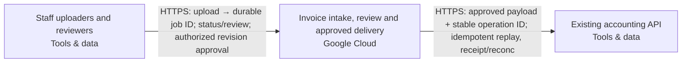

Snapshot d36e9cc0-3a6b-4fde-b9ac-4446bfe6e9fe · design r5 · generated 2026-11-10T07:53:46.129Z

# Asynchronous document intake — solution specification

## Problem and intended outcome

Users upload PDF invoices. Extract the supplier, invoice date, total and currency into a review queue. Delivery can repeat; retries must not create duplicate invoices. A reviewer approves a result before it is sent to our existing accounting API. Use Google Cloud. Recommend a coherent system and the engineering choices. Ask only a small material business question when needed; do not make me configure the system.

## Scope

None recorded.

## Requirements and acceptance criteria

- [REQ-001] Uploaded PDF invoices shall be processed asynchronously into a durable review queue containing supplier, invoice date, total and currency; proposed source evidence and explicit failure states shall support reviewer inspection. (must, open); target: acceptance target needed; linked blocks: staff-browser, invoice-workflow

Design explanation: Makes extraction inspectable and prevents incomplete or unsupported model results from silently becoming accounting records.

Basis: “Users upload PDF invoices. Extract the supplier, invoice date, total and currency into a review queue.”
- [REQ-002] Only an authorized reviewer's approval of the exact invoice result revision shall permit accounting submission; proposed revision binding shall invalidate approval after changes and record the reviewer and approved payload. (must, open); target: acceptance target needed; linked blocks: staff-browser, invoice-workflow, existing-accounting

Design explanation: Prevents an automated or stale result from authorizing an accounting action.

Basis: “A reviewer approves a result before it is sent to our existing accounting API.”
- [REQ-003] Repeated delivery and retries shall not create duplicate invoices. Proposed durable intake identity, transactional state/outbox and stable accounting operation/payload identity shall preserve this invariant; uncertain external outcomes shall pause for reconciliation unless the destination's verified idempotency contract permits safe replay. (must, open); target: acceptance target needed; linked blocks: invoice-workflow, existing-accounting

Design explanation: A lost receipt can otherwise cause duplicate accounting entries; destination idempotency and reconciliation must be proven rather than assumed.

Basis: “Delivery can repeat; retries must not create duplicate invoices.”
- [REQ-004] Invoice documents and extracted data shall remain stored and processed in Australia across application, parser, model, database, object versions, sensitive logs, backups, recovery and accounting delivery. Regional service/model availability and processing policies shall remain explicitly unverified until supported by destination-specific evidence; overseas routing or fallback shall not be enabled. (must, open); target: acceptance target needed; linked blocks: invoice-workflow, existing-accounting

Design explanation: Prevents an Australian application placement from concealing overseas model processing, backups, logging or accounting delivery. Availability and destination-policy evidence are still required.

Basis: “Keep documents and extracted data in Australia; flag unverified service availability.” The invoice-workflow processes and stores invoices and sends approved fields to existing-accounting.
- [REQ-005] The workflow shall accept PDF invoices up to 10 MB and reject oversized uploads before extraction. Capacity planning shall use approximately 500 invoices daily; peak-load and completion-time acceptance targets remain open. (must, open); target: acceptance target needed; linked blocks: invoice-workflow

Design explanation: Makes the stated upload boundary enforceable and records the workload without inventing a peak rate or processing deadline.

Basis: “PDF invoices up to 10 MB, around 500 per day”
- [REQ-006] Original invoices and extraction audit history shall be retained for 90 days. Proposed lifecycle controls shall cover primary records, object versions and recovery copies; retention-clock semantics, backup windows and deletion completion shall be documented and tested before production. (must, open); target: Original and extraction audit retention period == 90days; linked blocks: invoice-workflow

Design explanation: Preserves originals and extraction evidence for review while requiring lifecycle rules to address versions, backups and recovery copies.

Basis: “Keep originals and extraction audit history for 90 days.”
- [REQ-007] Proposed controls shall restrict access to invoice originals, extracted personal data and audit history to authorized staff, exclude document contents from operational logs, and clean up temporary parser data. Authorization-denial and cleanup tests shall demonstrate these boundaries before production. (must, open); target: acceptance target needed; linked blocks: staff-browser, invoice-workflow

Design explanation: Personal data can leak through document access, temporary parser files and diagnostic logging; these are proposed controls requiring implementation evidence.

Basis: “they may contain personal data” and the invoice-workflow document, parser and audit responsibilities.
- [REQ-008] Processing shall use durable queued jobs, stable invoice/job identities and bounded retries. Proposed fenced leases and stalled-job recovery shall prevent obsolete workers committing results. Exhausted or permanent failures shall enter durable dead-letter records with reason and attempt history; authorized recovery shall preserve identity, approval and uncertain-outcome safeguards. Acceptance shall cover worker termination, duplicate delivery, retry exhaustion and recovery without lost jobs or duplicate accounting effects. (must, open); target: acceptance target needed; linked blocks: invoice-workflow, existing-accounting

Design explanation: A crashed worker or exhausted retry must leave recoverable work rather than lose an invoice or restart an unsafe accounting submission. The proposed PostgreSQL dead-letter path stays inside the composed workflow.

Basis: User: “Use a durable job queue, stable invoice/job identity, bounded retries, a dead-letter/recovery path, approval checks and an idempotent outbound operation.”
- [REQ-009] The accounting system shall remain an externally owned reference outside provisioning scope. An administrator shall supply its endpoint and credentials through secure destination configuration. Proposed adapter acceptance shall establish authentication, payload compatibility, durable idempotency and reconciliation before delivery is enabled; endpoint availability alone shall not establish compatibility or Australian residency. (must, open); target: acceptance target needed; linked blocks: invoice-workflow, existing-accounting

Design explanation: The accounting system already exists; treating it as a provisioning target would change ownership and scope. Secure destination configuration and contract tests are necessary before enabling delivery.

Basis: User: “An administrator will supply its endpoint and credentials; treat it as external, not a new system to provision.”

## How the system works

The current design contains 3 components and 2 connections. 2 components are existing systems. The descriptions below follow the actual board; implementation guidance is identified separately from recorded behavior.

### Interaction 1: Staff uploaders and reviewers → Invoice intake, review and approved delivery

HTTPS: upload → durable job ID; status/review; authorized revision approval

Integration contract: browser-https.

Proposed verification: Verify the expected exchange, reject malformed or unauthorized input, and exercise interruption and recovery. Retry and duplicate-handling behavior must match the operation; it cannot be inferred from an arrow.

### Interaction 2: Invoice intake, review and approved delivery → Existing accounting API

HTTPS: approved payload + stable operation ID; idempotent replay, receipt/reconc

Integration contract: approved-accounting-api.

Proposed verification: Verify the expected exchange, reject malformed or unauthorized input, and exercise interruption and recovery. Retry and duplicate-handling behavior must match the operation; it cannot be inferred from an arrow.

## Component responsibilities and design rationale

### Staff uploaders and reviewers

Web browser · tools · region: To be selected · classification: Confidential

Existing browsers used by 20 signed-in staff, with three reviewers identified; whether reviewers are included in the 20 is unspecified. Staff upload PDFs and inspect permitted processing results. Only authorized reviewers may approve the exact reviewed revision; ordinary uploaders cannot approve. The server enforces membership and permissions on every relevant request. Client reference outside provisioning scope; staff identity provider and access geography remain unresolved.

Existing system: integrate with its owner and access contract; the design does not authorize replacing it.

Inputs: No incoming connection is drawn.

Outputs: Staff uploaders and reviewers → Invoice intake, review and approved delivery: HTTPS: upload → durable job ID; status/review; authorized revision approval (integration: browser-https)

Requirement traceability: REQ-001: Uploaded PDF invoices shall be processed asynchronously into a durable review queue containing supplier, invoice date, total and currency; proposed source evidence and explicit failure states shall support reviewer inspection.; REQ-002: Only an authorized reviewer's approval of the exact invoice result revision shall permit accounting submission; proposed revision binding shall invalidate approval after changes and record the reviewer and approved payload.; REQ-007: Proposed controls shall restrict access to invoice originals, extracted personal data and audit history to authorized staff, exclude document contents from operational logs, and clean up temporary parser data. Authorization-denial and cleanup tests shall demonstrate these boundaries before production.

Implementation status: External staff browser — authenticated workflow channel generated; no browser infrastructure to provision

Implementation considerations (guidance):
- Preserve the external browser; no resource or import is required.
- Define and test its HTTPS/application interactions, including denied access and unavailable service behavior.

### Invoice intake, review and approved delivery

Google Cloud Run · gcp · region: australia-southeast1 · classification: Confidential

Proposed composed delivery unit on Google Cloud Run: browser/API, background worker and isolated PDF/OCR parser. Owns Cloud SQL for PostgreSQL transactional durable job queue/outbox and review state, private versioned Google Cloud Storage originals, regional Vertex AI extraction, staff sign-in, SQL user/reviewer membership and separate keyless workload identities. Supports 20 signed-in staff and three reviewers; whether reviewers are included in the 20 remains unspecified. Ordinary uploaders cannot approve; the server enforces membership and permissions on every relevant request. Staff identity provider and access geography remain unresolved. Scope includes PDF intake, extraction of supplier/invoice date/total/currency with source evidence, durable review, authorized approval and approved accounting delivery. Planning workload is 500 uploads daily with bursts of twenty, PDFs up to 10,000,000 bytes and jobs that may take several minutes; this is not a completion-time guarantee. Proposed parser bound remains 100 pages. Accept uploads durably and return a stable job ID/status without holding the browser request open for extraction. Repeated delivery of the same intake identity resolves to the same invoice/job; independently submitted business duplicates require a separately agreed matching policy. Persist exact source object-version identity, invoice/job identity and processing results. Commit business state and queued work in one PostgreSQL transaction. Propose leased PostgreSQL workers with fencing, heartbeats, bounded processing deadlines, bounded exponential-backoff retries and stalled/orphaned-job recovery. Exhausted or permanent failures enter durable dead-letter/quarantine records with failure reason, attempts and audit history; authorized recovery reuses the original identity and cannot bypass approval or accounting outcome fences. Queue admission and worker concurrency are independently bounded so bursts need not start twenty extraction workers. Validate burst intake, several-minute execution, duplicate delivery, worker termination, retry exhaustion and controlled recovery against emitted artifacts before claiming capacity or reliability. Documents may contain personal data: restrict originals, extracted fields and audit access to authorized staff, exclude document contents from operational logs and clean up temporary parser data. Parser alone sees untrusted PDF bytes and has no database, model or accounting identity. Return extracted fields, source evidence and processing/review/delivery status through the review UI. Bind approval to the exact source/result revision and destination contract; edits invalidate approval. Only an authorized reviewer can approve. Send only approved payloads through the external accounting adapter with a durable operation ID and stable payload identity. Persist delivery intent and receipt/outcome. Retry only under a verified destination idempotency contract using the same operation and payload identity; uncertain outcomes pause for reconciliation, never a fresh send identity or automatic reapproval. Administrator supplies the existing accounting endpoint and credentials through reviewed destination configuration and secret handling, outside the diagram; do not provision or modify the accounting service. Own audit events, monitoring, alerts, retention and restore/reconciliation operating tasks. Retain originals and extraction audit history for 90 days; propose intake time as retention clock pending lifecycle confirmation. Cleanup covers processing state, object versions, database records, backups and restored copies; backup/version windows and deletion timing require destination review, with no exact universal erasure deadline claimed. Required boundary: documents and extracted data remain stored and processed in Australia, including temporary parser data, model requests/results, sensitive logs, database backups, object versions and recovery copies. Sydney (australia-southeast1) remains proposed, not accepted or verified. Verify Cloud Run, Cloud SQL, storage, selected Vertex AI model, private networking, quotas, processing geography and zonal recovery before implementation approval. No silent global model endpoints, overseas replication or overseas failover. Model retention/caching/logging policy, staff identity/access geography and accounting residency/adapter acceptance remain unresolved. Compiler capability and reviewed practices do not establish deployment or combined-system validation.

Proposed component: its responsibility is part of the current design, with implementation and deployment still subject to validation.

Inputs: Staff uploaders and reviewers → Invoice intake, review and approved delivery: HTTPS: upload → durable job ID; status/review; authorized revision approval (integration: browser-https)

Outputs: Invoice intake, review and approved delivery → Existing accounting API: HTTPS: approved payload + stable operation ID; idempotent replay, receipt/reconc (integration: approved-accounting-api)

Requirement traceability: REQ-001: Uploaded PDF invoices shall be processed asynchronously into a durable review queue containing supplier, invoice date, total and currency; proposed source evidence and explicit failure states shall support reviewer inspection.; REQ-002: Only an authorized reviewer's approval of the exact invoice result revision shall permit accounting submission; proposed revision binding shall invalidate approval after changes and record the reviewer and approved payload.; REQ-003: Repeated delivery and retries shall not create duplicate invoices. Proposed durable intake identity, transactional state/outbox and stable accounting operation/payload identity shall preserve this invariant; uncertain external outcomes shall pause for reconciliation unless the destination's verified idempotency contract permits safe replay.; REQ-004: Invoice documents and extracted data shall remain stored and processed in Australia across application, parser, model, database, object versions, sensitive logs, backups, recovery and accounting delivery. Regional service/model availability and processing policies shall remain explicitly unverified until supported by destination-specific evidence; overseas routing or fallback shall not be enabled.; REQ-005: The workflow shall accept PDF invoices up to 10 MB and reject oversized uploads before extraction. Capacity planning shall use approximately 500 invoices daily; peak-load and completion-time acceptance targets remain open.; REQ-006: Original invoices and extraction audit history shall be retained for 90 days. Proposed lifecycle controls shall cover primary records, object versions and recovery copies; retention-clock semantics, backup windows and deletion completion shall be documented and tested before production.; REQ-007: Proposed controls shall restrict access to invoice originals, extracted personal data and audit history to authorized staff, exclude document contents from operational logs, and clean up temporary parser data. Authorization-denial and cleanup tests shall demonstrate these boundaries before production.; REQ-008: Processing shall use durable queued jobs, stable invoice/job identities and bounded retries. Proposed fenced leases and stalled-job recovery shall prevent obsolete workers committing results. Exhausted or permanent failures shall enter durable dead-letter records with reason and attempt history; authorized recovery shall preserve identity, approval and uncertain-outcome safeguards. Acceptance shall cover worker termination, duplicate delivery, retry exhaustion and recovery without lost jobs or duplicate accounting effects.; REQ-009: The accounting system shall remain an externally owned reference outside provisioning scope. An administrator shall supply its endpoint and credentials through secure destination configuration. Proposed adapter acceptance shall establish authentication, payload compatibility, durable idempotency and reconciliation before delivery is enabled; endpoint availability alone shall not establish compatibility or Australian residency.

Implementation status: Composed invoice API/worker/parser, durable SQL queue, private originals, review authorization, guarded accounting delivery and operating tasks generated; destination behavior remains unverified

Implementation considerations (guidance):
- Confirm the exact gcp service, deployment mode, region and supported resource types using current primary documentation.
- Specify runtime/artifact, identity, network paths, secrets, capacity, health checks and operational owner; resolve whether this is infrastructure or a responsibility within another application.
- Document service-specific failure modes, retention/recovery and acceptance tests; do not substitute a similarly named service or another provider.

### Existing accounting API

Existing accounting API · tools · region: Existing location unknown · classification: Confidential

Client-owned existing accounting service; external reference only, outside provisioning scope and never recreated or modified by this design. An administrator will supply its endpoint and credentials through reviewed destination inputs and secret handling, never in the diagram or chat. Receives only reviewer-approved invoice payloads tied to the exact approved revision. The workflow-owned adapter must independently pass normalized-action-v1 acceptance for authentication, schema, durable idempotency, stable operation/payload identity, receipts and outcome reconciliation. Repeated outbound attempts must retain the same operation and payload identity. Uncertain delivery outcomes pause for reconciliation unless verified destination behavior permits safe replay. Supplying an endpoint and credentials does not prove compatibility or idempotency. Vendor compatibility and deployment location remain unknown. Australian storage and processing of submitted invoice data must be established before enabling delivery; do not assume the existing service satisfies the residency boundary.

Existing system: integrate with its owner and access contract; the design does not authorize replacing it.

Inputs: Invoice intake, review and approved delivery → Existing accounting API: HTTPS: approved payload + stable operation ID; idempotent replay, receipt/reconc (integration: approved-accounting-api)

Outputs: No outgoing connection is drawn.

Requirement traceability: REQ-002: Only an authorized reviewer's approval of the exact invoice result revision shall permit accounting submission; proposed revision binding shall invalidate approval after changes and record the reviewer and approved payload.; REQ-003: Repeated delivery and retries shall not create duplicate invoices. Proposed durable intake identity, transactional state/outbox and stable accounting operation/payload identity shall preserve this invariant; uncertain external outcomes shall pause for reconciliation unless the destination's verified idempotency contract permits safe replay.; REQ-004: Invoice documents and extracted data shall remain stored and processed in Australia across application, parser, model, database, object versions, sensitive logs, backups, recovery and accounting delivery. Regional service/model availability and processing policies shall remain explicitly unverified until supported by destination-specific evidence; overseas routing or fallback shall not be enabled.; REQ-008: Processing shall use durable queued jobs, stable invoice/job identities and bounded retries. Proposed fenced leases and stalled-job recovery shall prevent obsolete workers committing results. Exhausted or permanent failures shall enter durable dead-letter records with reason and attempt history; authorized recovery shall preserve identity, approval and uncertain-outcome safeguards. Acceptance shall cover worker termination, duplicate delivery, retry exhaustion and recovery without lost jobs or duplicate accounting effects.; REQ-009: The accounting system shall remain an externally owned reference outside provisioning scope. An administrator shall supply its endpoint and credentials through secure destination configuration. Proposed adapter acceptance shall establish authentication, payload compatibility, durable idempotency and reconciliation before delivery is enabled; endpoint availability alone shall not establish compatibility or Australian residency.

Implementation status: Existing service reference — preserve without provisioning/import; actual connection acceptance required

Implementation considerations (guidance):
- Preserve this externally managed service without creating or importing it.
- Document its owner, endpoint, identity and integration contract; test actual connections separately.

## Architecture

## Cloud resource schedule

Typed composed invoice implementation; extra required systems and flows remain visible. Source generation and local qualifications do not prove the destination deployment.

| Block ID | Component | Provider | Service | Region | Ownership | Terraform coverage |
|---|---|---|---|---|---|---|
| staff-browser | Staff uploaders and reviewers | tools | Web browser | To be selected | Existing | External staff browser — authenticated workflow channel generated; no browser infrastructure to provision |
| invoice-workflow | Invoice intake, review and approved delivery | gcp | Google Cloud Run | australia-southeast1 | Proposed | Composed invoice API/worker/parser, durable SQL queue, private originals, review authorization, guarded accounting delivery and operating tasks generated; destination behavior remains unverified |
| existing-accounting | Existing accounting API | tools | Existing accounting API | Existing location unknown | Existing | Existing service reference — preserve without provisioning/import; actual connection acceptance required |

### Resources and cost dimensions

- **Staff uploaders and reviewers** (staff-browser): Resource types to confirm. Existing system or actor; review its externally owned costs and access contract.. Depends on: none drawn.
- **Invoice intake, review and approved delivery** (invoice-workflow): google_compute_network, google_sql_database_instance, google_storage_bucket, google_artifact_registry_repository. API/worker/parser/operator compute, private database/backup/storage, NAT/private endpoints, identity, registry, model tokens, retained object versions, logging and notification delivery. Verify current regional rates and quotas; capacity limits are not spending caps.. Depends on: staff-browser.
- **Existing accounting API** (existing-accounting): Resource types to confirm. Existing system or actor; review its externally owned costs and access contract.. Depends on: invoice-workflow.

### Engineering work remaining

S3 foundation only. Validate the plan, account, region, cost and security before applying.

References (resource semantics; not retrieved prices):

## Options and tradeoffs

Use Design → Options to compare cloud choices and record the rationale before choosing.

## Decisions and change history

### ADR-001 · platform.cloud

**Status:** Accepted · **Owner:** unassigned · **Date:** 2026-11-10 · **Design:** r2 · **Subject:** `platform.cloud`

**Context**

User statement: Use Google Cloud.

**Options considered**

—

**Decision**

gcp

_Changed because: Chosen in the conversation_

**Consequences**

—

### ADR-002 · data.country

**Status:** Accepted · **Owner:** unassigned · **Date:** 2026-11-10 · **Design:** r3 · **Subject:** `data.country`

**Context**

User statement: Keep documents and extracted data in Australia; flag unverified service availability.

**Options considered**

—

**Decision**

Australia

_Changed because: Chosen in the conversation_

**Consequences**

—

## Assumptions

None recorded.

## Questions to resolve

None recorded.

## Implementation specification and coding-agent handoff

The Spec Kit translates these requirements and the architecture into implementation work. Start with START_HERE.md and AGENTS.md; read spec-kit/implementation-spec.md (or PDF) for the implementation plan, contracts, detailed tasks and validation plan. Requirements remain the source of desired outcomes; the kit is the build plan derived from them.
