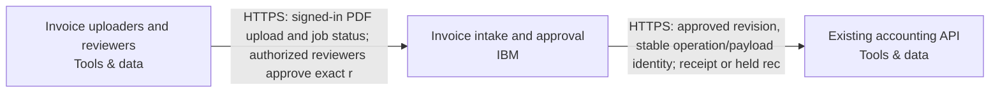

Snapshot ff90ecad-37e2-46e9-b0bc-3c58f4493bf0 · design r4 · generated 2026-11-10T07:56:28.114Z

# Asynchronous document intake — deployment document

Generated 2026-11-10 07:56 UTC from design revision r4 · project format 2.3.0 · AtMem AI Architect workbench

> No blockers found by the automated review. Human review and the open questions below still apply.
>
> Statements are **facts** from project data unless marked _assumption_ or listed under open questions. Estimate — not a bill or guarantee.

## 1. Summary

Users upload PDF invoices. Extract the supplier, invoice date, total and currency into a review queue. Delivery can repeat; retries must not create duplicate invoices. A reviewer approves a result before it is sent to our existing accounting API. Use IBM Cloud. Recommend a coherent system and the engineering choices. Ask only a small material business question when needed; do not make me configure the system.

- **Cloud:** IBM
- **Usage:** unknown
- **Estimated run cost:** not estimated
- **Review:** 8 open findings (0 blockers)
- **Current decisions:** 2

## 2. Scope and context

- **What you want to build:** Users upload PDF invoices. Extract the supplier, invoice date, total and currency into a review queue. Delivery can repeat; retries must not create duplicate invoices. A reviewer approves a result before it is sent to our existing accounting API. Use IBM Cloud. Recommend a coherent system and the engineering choices. Ask only a small material business question when needed; do not make me configure the system.
- **Information it uses:** —
- **Who uses it, and how much:** Here are the remaining project facts before we finalize the handoff. Preserve these requirements and update the system as needed. Twenty signed-in staff and three reviewers; ordinary uploaders cannot approve. PDF invoices up to 10 MB, around 500 per day; they may contain personal data. Keep originals and extraction audit history for 90 days. 500 uploads per day, bursts of twenty. Jobs may take several minutes. The accounting system already exists. An administrator will supply its endpoint and credentials; treat it as external, not a new system to provision. Use a durable job queue, stable invoice/job identity, bounded retries, a dead-letter/recovery path, approval checks and an idempotent outbound operation.
- **Systems it connects to:** —
- **How good, fast and safe:** Keep documents and extracted data in Australia; flag unverified service availability.
- **Cloud preference:** IBM
- **Budget and timeline:** —

## 3. Architecture

**Staff access**

- Invoice uploaders and reviewers (Tools & data, existing) — Existing staff using a browser, outside provisioning scope: twenty signed-in staff and three reviewers; overlap between these groups is unspecified. Staff upload PDFs, inspect job status and review source evidence. Ordinary uploaders cannot approve. Server-side application membership restricts approval to authorized reviewers; browser claims never grant permission. Actual staff enrollment and reviewer assignment require authorized administration. No passwords or credentials belong in the diagram.

**Invoice processing**

- Invoice intake and approval (IBM, sketch) — Proposed composed IBM Code Engine invoice deployment owns browser/API, background worker, isolated PDF/OCR parser and separate operating tasks. Its internal IBM Cloud Databases for PostgreSQL stores transactional jobs, stable invoice/job identities, extraction revisions, reviewer membership, approvals, delivery outbox and recovery records. Private versioned IBM Cloud Object Storage holds PDF originals. Staff sign-in is separate from native workload identity. Regional watsonx extracts supplier, invoice date, total, currency and source evidence; invalid or uncertain extraction remains in review. Scope includes PDF upload, asynchronous extraction, correction, reviewer approval, accounting delivery, status, audit and operator recovery. Additional document formats and business actions are outside this proposed delivery scope. Accept PDFs up to 10000000 bytes; the existing 100-page limit remains proposed. Capacity acceptance must cover approximately 500 uploads per day and bursts of twenty; jobs may take several minutes, with durable status independent of the browser request. Commit job state and queue notification transactionally. Fence worker leases, recover stalled jobs and bound retries. Exhausted or unsafe jobs enter a durable dead-letter/recovery state with a reason and authorized operator recovery; replay preserves the original identity. Repeated intake must not create duplicate invoices. Ordinary uploaders cannot approve; server-side reviewer membership authorizes approval of the exact result revision, source and destination contract. Edits invalidate approval. Persist one accounting operation ID and payload identity across retries; uncertain outcomes are held for reconciliation rather than blindly resent. Parser alone receives untrusted PDF bytes and has no model, database or accounting identity. Separate native identities and scoped permissions protect other responsibilities. PDFs may contain personal data: keep content out of routine logs, restrict original/evidence access and protect stored data and transport. Retain originals and extraction audit history for 90 days. The module's default retention eligibility alone does not establish deletion by day 90: cleanup, object versions, database backups and restore behavior require explicit implementation reconciliation and acceptance evidence. Monitor queue age, failures, recovery backlog and accounting uncertainty without logging invoice content. An authorized operator owns recovery, retention, monitoring and restore procedures; the named operating owner remains open. Documents and extracted data remain in Australia throughout processing, inference, storage, content-bearing logs, backups, recovery and accounting delivery. Sydney au-syd remains proposed. Code Engine, PostgreSQL, Object Storage, identity, watsonx model availability, private connectivity and processing geography remain unverified; no overseas fallback is authorized. Regional registry naming does not prove artifact replica residency. IBM cron scheduling requires explicit supported Knative operations outside Terraform and delivery evidence. Production Terraform state requires an existing protected HTTP state/lock platform with reviewed custody and residency. Internal services belong to this module and must not be duplicated as unbound nodes. Build/scan exact images, validate native resources, qualify accounting behavior and test the complete runtime before claiming handoff readiness.

**Accounting integration**

- Existing accounting API (Tools & data, existing) — Client-owned existing accounting API, outside provisioning scope; do not recreate or modify it. An authorized administrator supplies its endpoint and credentials securely as destination inputs, never in the diagram or chat. The workflow adapter submits only authorized approved invoice revisions with a stable operation ID and payload identity. Native compatibility remains unverified: the adapter and destination must independently pass normalized-action-v1, durable idempotency and timeout-after-commit reconciliation acceptance. Destination deduplication durability and replay window require evidence. Unknown outcomes remain held for reconciliation. Processing, storage and backup locations remain unverified; accounting delivery stays blocked until its handling of extracted personal data meets Australian residency. No integration test or deployment is established by this reference.

## Cloud resource schedule

Typed composed invoice implementation; extra required systems and flows remain visible. Source generation and local qualifications do not prove the destination deployment.

| Block ID | Component | Provider | Service | Region | Ownership | Terraform coverage |
|---|---|---|---|---|---|---|
| invoice-staff | Invoice uploaders and reviewers | tools | Web browser | Existing users; location unconfirmed | Existing | External staff browser — authenticated workflow channel generated; no browser infrastructure to provision |
| invoice-workflow | Invoice intake and approval | ibm | IBM Code Engine | Sydney (au-syd) proposed; service and model availability unverified | Proposed | Composed invoice API/worker/parser, durable SQL queue, private originals, review authorization, guarded accounting delivery and operating tasks generated; destination behavior remains unverified |
| accounting-api | Existing accounting API | tools | Existing accounting API | Existing placement; unconfirmed | Existing | Existing service reference — preserve without provisioning/import; actual connection acceptance required |

### Resources and cost dimensions

- **Invoice uploaders and reviewers** (invoice-staff): Resource types to confirm. Existing system or actor; review its externally owned costs and access contract.. Depends on: none drawn.
- **Invoice intake and approval** (invoice-workflow): ibm_code_engine_project, ibm_database, ibm_cos_bucket, ibm_appid_application. API/worker/parser/operator compute, private database/backup/storage, NAT/private endpoints, identity, registry, model tokens, retained object versions, logging and notification delivery. Verify current regional rates and quotas; capacity limits are not spending caps.. Depends on: invoice-staff.
- **Existing accounting API** (accounting-api): Resource types to confirm. Existing system or actor; review its externally owned costs and access contract.. Depends on: invoice-workflow.

### Engineering work remaining

- Preserve the selected placement and propose a canonical provider region within that accepted residency. Country names or expressions are not deployment-region identifiers; this is engineering work, not a request for the user to configure infrastructure.

References (resource semantics; not retrieved prices):

## 4. Data flows

| From | To | Data | Classification |
|---|---|---|---|
| Invoice uploaders and reviewers | Invoice intake and approval | HTTPS: signed-in PDF upload and job status; authorized reviewers approve exact r | Confidential |
| Invoice intake and approval | Existing accounting API | HTTPS: approved revision, stable operation/payload identity; receipt or held rec | Confidential |

## 5. Security controls

- **Invoice uploaders and reviewers** — Existing staff using a browser, outside provisioning scope: twenty signed-in staff and three reviewers; overlap between these groups is unspecified. Staff upload PDFs, inspect job status and review source evidence. Ordinary uploaders cannot approve. Server-side application membership restricts approval to authorized reviewers; browser claims never grant permission. Actual staff enrollment and reviewer assignment require authorized administration. No passwords or credentials belong in the diagram.
- Requirement: Require an authorized reviewer’s approval of the exact invoice result revision before accounting submission. Editing the approved fields invalidates that approval; extraction output and uploader-supplied claims cannot authorize delivery. (must)
- Requirement: Keep invoice documents and extracted data within Australia during processing, model inference, storage, backups, recovery and accounting delivery, including logs containing invoice data. Explicitly flag unverified service/model availability and processing geography; require evidence before enabling affected paths, with no automatic overseas fallback. (must)
- Requirement: Retain invoice originals and extraction audit history for 90 days. Implement and document cleanup across primary storage, object versions and database backups, including how restored data is re-expired. Demonstrate the effective retention behavior; do not claim that a 90-day eligibility setting alone meets this requirement. (must)
- Requirement: Proposed safeguards: enforce authenticated, authorized access to invoice originals, extracted fields and audit history; protect transport and stored data; exclude invoice content and credentials from routine operational logs. Keep parser, model, database and accounting permissions separated and test denied access paths. (must)
- Open finding SEC-002: Sensitive data is involved but where it must be stored is not stated.

## 6. Requirements

**Non-functional**

| Requirement | Category | Target | Status |
|---|---|---|---|
| Repeated intake delivery and processing or accounting retries must not create duplicate invoices. Persist intake and delivery identities, preserve the same operation and payload identity on replay, and hold uncertain accounting outcomes for reconciliation. Acceptance must include duplicate delivery, worker restart and timeout-after-destination-commit cases. | reliability | not measurable yet | Open |
| Keep invoice documents and extracted data within Australia during processing, model inference, storage, backups, recovery and accounting delivery, including logs containing invoice data. Explicitly flag unverified service/model availability and processing geography; require evidence before enabling affected paths, with no automatic overseas fallback. | compliance | not measurable yet | Open |
| Retain invoice originals and extraction audit history for 90 days. Implement and document cleanup across primary storage, object versions and database backups, including how restored data is re-expired. Demonstrate the effective retention behavior; do not claim that a 90-day eligibility setting alone meets this requirement. | compliance | not measurable yet | Open |
| Support approximately 500 PDF uploads per day and bursts of twenty, with durable job status while processing takes several minutes. Acceptance must exercise the burst with bounded workers, persistent backlog and continued status access. No completion-time guarantee is inferred. | scalability | accepted_uploads_in_test_burst >= 20uploads | Open |
| Proposed safeguards: enforce authenticated, authorized access to invoice originals, extracted fields and audit history; protect transport and stored data; exclude invoice content and credentials from routine operational logs. Keep parser, model, database and accounting permissions separated and test denied access paths. | security | not measurable yet | Open |

**Functional**

- Accept PDF invoice uploads and durably queue extraction of supplier, invoice date, total and currency for staff review. Proposed safeguards retain source evidence and expose invalid, uncertain or failed extraction for correction without accounting submission. (must, open)
- Require an authorized reviewer’s approval of the exact invoice result revision before accounting submission. Editing the approved fields invalidates that approval; extraction output and uploader-supplied claims cannot authorize delivery. (must, open)
- Reference the existing accounting API without provisioning or modifying it. Accept endpoint and credentials through a secure administrator-controlled destination configuration. Qualify its adapter, authorization, residency, durable idempotency and reconciliation behavior before enabling delivery. (must, open)

**Success measures**

_No success measures defined._

## 7. Review findings

**Security & controls**

- [major] Sensitive data is involved but where it must be stored is not stated. Add a compliance requirement such as “data stays in the EU”, and set regions on data blocks. _(AtMem AI Architect rule SEC-002 v1.0.0)_

**Reliability**

- [minor] The design depends on existing systems; their failure behaviour is not described. State what happens when each existing system is unavailable (retry, queue, fallback). _(AtMem AI Architect rule REL-002 v1.0.0)_

**Availability**

- [minor] No availability target. Add a requirement such as “available 99.5% of the time” or “business hours only”. _(AtMem AI Architect rule AVL-001 v1.0.0)_

**Scalability**

- [info] Expected usage is unknown, so scale can't be assessed. Tell us in the chat roughly how many people use it and how often. _(AtMem AI Architect rule SCL-001 v1.0.0)_

**Maintainability**

- [minor] 4 quality requirements have no measurable target. Add a metric and target to: “Repeated intake delivery and processing or accounting retries must not create duplicate invoices. Persist intake and delivery identities, preserve the same operation and payload identity on replay, and hold uncertain accounting outcomes for reconciliation. Acceptance must include duplicate delivery, worker restart and timeout-after-destination-commit cases.”, “Keep invoice documents and extracted data within Australia during processing, model inference, storage, backups, recovery and accounting delivery, including logs containing invoice data. Explicitly flag unverified service/model availability and processing geography; require evidence before enabling affected paths, with no automatic overseas fallback.”, “Retain invoice originals and extraction audit history for 90 days. Implement and document cleanup across primary storage, object versions and database backups, including how restored data is re-expired. Demonstrate the effective retention behavior; do not claim that a 90-day eligibility setting alone meets this requirement.”, “Proposed safeguards: enforce authenticated, authorized access to invoice originals, extracted fields and audit history; protect transport and stored data; exclude invoice content and credentials from routine operational logs. Keep parser, model, database and accounting permissions separated and test denied access paths.”. _(AtMem AI Architect rule MNT-001 v1.0.0)_
- [minor] 2 accepted decisions have no owner. Assign an owner in Design → Decisions. _(AtMem AI Architect rule MNT-002 v1.0.0)_
- [info] 1 block is sketch-only and can't be test-run yet. Keep designing; assign a runnable behaviour in block detail when one exists. _(AtMem AI Architect rule DSN-001 v1.0.0)_

**Cost**

- [info] No budget stated. Mention a monthly running budget, or a range, in the chat. _(AtMem AI Architect rule CST-001 v1.0.0)_

## 8. Cost estimate

Estimate — not a bill or guarantee. Monthly run cost only. Prices are as entered, with their sources.

**Estimate stage:** Not estimated. Rough order of magnitude, refined as scope and charge dimensions become known.

_No costed components._

**Usage inputs:** Quantities are entered directly on detailed charge lines above.

**Range:** low ×0.7, high ×1.5 of expected. Not costed in this release: Invoice uploaders and reviewers, Invoice intake and approval, Existing accounting API.

**Estimate gaps:**

- Invoice uploaders and reviewers: no cost lines; add charges or an explicit zero-cost line with a reason.
- Invoice intake and approval: no cost lines; add charges or an explicit zero-cost line with a reason.
- Existing accounting API: no cost lines; add charges or an explicit zero-cost line with a reason.

### Consulting and build estimate (one-off)

Not estimated; enter work-package days, rates and a basis.

| Work package | Low / expected / high days | Rate / day | Expected | Basis and exclusions |
|---|---|---|---|---|
| Discovery & specification | — / — / — | — | — | Needed |
| Architecture & security | — / — / — | — | — | Needed |
| Implementation & integration | — / — / — | — | — | Needed |
| Testing & acceptance | — / — / — | — | — | Needed |
| Deployment & handover | — / — / — | — | — | Needed |

One-off effort is separate from monthly cloud charges. Days are person-days, not elapsed time. Taxes, support, licences and migration are excluded unless explicitly included in the basis or charge lines.

## 9. Deployment steps

_Draft generated from the design; validate against the provider's current documentation before use. Nothing has been provisioned._

1. Confirm accounts, target regions and who approves each step; resolve every blocker in this document.
2. Create least-privilege identities for each component; keep credentials in the provider's secret store, never in the project.
3. Provision invoice processing: Invoice intake and approval.
4. Connect existing systems: Invoice uploaders and reviewers, Existing accounting API; test failure behaviour.
5. Run the acceptance checks (success measures and requirements) in staging; record results.
6. Review results and approve promotion to production; keep a rollback plan for each step.

## 10. Decisions

### ADR-001 · platform.cloud

**Status:** Accepted · **Owner:** unassigned · **Date:** 2026-11-10 · **Design:** r2 · **Subject:** `platform.cloud`

**Context**

User statement: Use IBM Cloud.

**Options considered**

—

**Decision**

ibm

_Changed because: Chosen in the conversation_

**Consequences**

—

### ADR-002 · data.country

**Status:** Accepted · **Owner:** unassigned · **Date:** 2026-11-10 · **Design:** r3 · **Subject:** `data.country`

**Context**

User statement: Keep documents and extracted data in Australia; flag unverified service availability.

**Options considered**

—

**Decision**

Australia

_Changed because: Chosen in the conversation_

**Consequences**

—

## 11. Assumptions

_None recorded._

## 12. Open questions

- Which information should the system use? _(discovery)_
