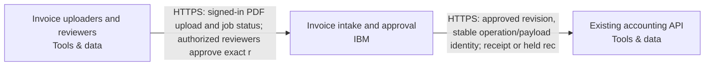

Snapshot ff90ecad-37e2-46e9-b0bc-3c58f4493bf0 · design r4 · generated 2026-11-10T07:56:28.114Z

# Asynchronous document intake — solution specification

## Problem and intended outcome

Users upload PDF invoices. Extract the supplier, invoice date, total and currency into a review queue. Delivery can repeat; retries must not create duplicate invoices. A reviewer approves a result before it is sent to our existing accounting API. Use IBM Cloud. Recommend a coherent system and the engineering choices. Ask only a small material business question when needed; do not make me configure the system.

## Scope

None recorded.

## Requirements and acceptance criteria

- [REQ-001] Accept PDF invoice uploads and durably queue extraction of supplier, invoice date, total and currency for staff review. Proposed safeguards retain source evidence and expose invalid, uncertain or failed extraction for correction without accounting submission. (must, open); target: acceptance target needed; linked blocks: invoice-staff, invoice-workflow

Design explanation: Makes extraction useful and inspectable while preventing uncertain or invalid model output from silently progressing.

Basis: “Users upload PDF invoices. Extract the supplier, invoice date, total and currency into a review queue.” Source evidence and explicit failure states are proposed safeguards.
- [REQ-002] Require an authorized reviewer’s approval of the exact invoice result revision before accounting submission. Editing the approved fields invalidates that approval; extraction output and uploader-supplied claims cannot authorize delivery. (must, open); target: acceptance target needed; linked blocks: invoice-staff, invoice-workflow, accounting-api

Design explanation: Prevents automated or stale approvals from authorizing accounting changes.

Basis: “A reviewer approves a result before it is sent to our existing accounting API.” Revision binding and server-side reviewer authorization are proposed enforcement choices.
- [REQ-003] Repeated intake delivery and processing or accounting retries must not create duplicate invoices. Persist intake and delivery identities, preserve the same operation and payload identity on replay, and hold uncertain accounting outcomes for reconciliation. Acceptance must include duplicate delivery, worker restart and timeout-after-destination-commit cases. (must, open); target: acceptance target needed; linked blocks: invoice-workflow, accounting-api

Design explanation: Repeated delivery and lost accounting responses can otherwise create duplicate financial records. End-to-end assurance depends on the destination’s independently tested idempotency and reconciliation behavior.

Basis: “Delivery can repeat; retries must not create duplicate invoices.” Durable operation identity, bounded retries and uncertain-outcome reconciliation are proposed engineering controls.
- [REQ-004] Keep invoice documents and extracted data within Australia during processing, model inference, storage, backups, recovery and accounting delivery, including logs containing invoice data. Explicitly flag unverified service/model availability and processing geography; require evidence before enabling affected paths, with no automatic overseas fallback. (must, open); target: acceptance target needed; linked blocks: invoice-workflow, accounting-api

Design explanation: Prevents invoice content from leaving Australia through inference, retained copies or the existing accounting destination. Regional labels alone do not establish compliance; destination evidence is required.

Basis: User: “Keep documents and extracted data in Australia; flag unverified service availability.” Applies to invoice-workflow and accounting-api.
- [REQ-005] Retain invoice originals and extraction audit history for 90 days. Implement and document cleanup across primary storage, object versions and database backups, including how restored data is re-expired. Demonstrate the effective retention behavior; do not claim that a 90-day eligibility setting alone meets this requirement. (must, open); target: acceptance target needed; linked blocks: invoice-workflow

Design explanation: Preserves the requested retention period while exposing the difference between cleanup eligibility and deletion across versions and backups; the proposed module needs evidence for the complete lifecycle.

Basis: “Keep originals and extraction audit history for 90 days.” The invoice-workflow component owns storage, audit and cleanup.
- [REQ-006] Support approximately 500 PDF uploads per day and bursts of twenty, with durable job status while processing takes several minutes. Acceptance must exercise the burst with bounded workers, persistent backlog and continued status access. No completion-time guarantee is inferred. (must, open); target: accepted_uploads_in_test_burst >= 20uploads; linked blocks: invoice-staff, invoice-workflow

Design explanation: Durable asynchronous processing accommodates jobs lasting minutes and upload bursts without tying job survival to a browser connection.

Basis: “500 uploads per day, bursts of twenty. Jobs may take several minutes.”
- [REQ-007] Proposed safeguards: enforce authenticated, authorized access to invoice originals, extracted fields and audit history; protect transport and stored data; exclude invoice content and credentials from routine operational logs. Keep parser, model, database and accounting permissions separated and test denied access paths. (must, open); target: acceptance target needed; linked blocks: invoice-staff, invoice-workflow, accounting-api

Design explanation: Personal data in originals and extracted evidence needs protection across application access, processing and operational records. These controls are engineering proposals, not asserted company policy.

Basis: “they may contain personal data.” The existing diagram includes original storage, extraction, review and accounting delivery.
- [REQ-008] Reference the existing accounting API without provisioning or modifying it. Accept endpoint and credentials through a secure administrator-controlled destination configuration. Qualify its adapter, authorization, residency, durable idempotency and reconciliation behavior before enabling delivery. (must, open); target: acceptance target needed; linked blocks: invoice-workflow, accounting-api

Design explanation: Preserves the existing accounting boundary and prevents a generated adapter contract from being mistaken for proven vendor compatibility.

Basis: “The accounting system already exists. An administrator will supply its endpoint and credentials; treat it as external, not a new system to provision.”

## How the system works

The current design contains 3 components and 2 connections. 2 components are existing systems. The descriptions below follow the actual board; implementation guidance is identified separately from recorded behavior.

### Interaction 1: Invoice uploaders and reviewers → Invoice intake and approval

HTTPS: signed-in PDF upload and job status; authorized reviewers approve exact r

Integration contract: browser-https.

Proposed verification: Verify the expected exchange, reject malformed or unauthorized input, and exercise interruption and recovery. Retry and duplicate-handling behavior must match the operation; it cannot be inferred from an arrow.

### Interaction 2: Invoice intake and approval → Existing accounting API

HTTPS: approved revision, stable operation/payload identity; receipt or held rec

Integration contract: approved-accounting-api.

Proposed verification: Verify the expected exchange, reject malformed or unauthorized input, and exercise interruption and recovery. Retry and duplicate-handling behavior must match the operation; it cannot be inferred from an arrow.

## Component responsibilities and design rationale

### Invoice uploaders and reviewers

Web browser · tools · region: Existing users; location unconfirmed · classification: Confidential

Existing staff using a browser, outside provisioning scope: twenty signed-in staff and three reviewers; overlap between these groups is unspecified. Staff upload PDFs, inspect job status and review source evidence. Ordinary uploaders cannot approve. Server-side application membership restricts approval to authorized reviewers; browser claims never grant permission. Actual staff enrollment and reviewer assignment require authorized administration. No passwords or credentials belong in the diagram.

Existing system: integrate with its owner and access contract; the design does not authorize replacing it.

Inputs: No incoming connection is drawn.

Outputs: Invoice uploaders and reviewers → Invoice intake and approval: HTTPS: signed-in PDF upload and job status; authorized reviewers approve exact r (integration: browser-https)

Requirement traceability: REQ-001: Accept PDF invoice uploads and durably queue extraction of supplier, invoice date, total and currency for staff review. Proposed safeguards retain source evidence and expose invalid, uncertain or failed extraction for correction without accounting submission.; REQ-002: Require an authorized reviewer’s approval of the exact invoice result revision before accounting submission. Editing the approved fields invalidates that approval; extraction output and uploader-supplied claims cannot authorize delivery.; REQ-006: Support approximately 500 PDF uploads per day and bursts of twenty, with durable job status while processing takes several minutes. Acceptance must exercise the burst with bounded workers, persistent backlog and continued status access. No completion-time guarantee is inferred.; REQ-007: Proposed safeguards: enforce authenticated, authorized access to invoice originals, extracted fields and audit history; protect transport and stored data; exclude invoice content and credentials from routine operational logs. Keep parser, model, database and accounting permissions separated and test denied access paths.

Implementation status: External staff browser — authenticated workflow channel generated; no browser infrastructure to provision

Implementation considerations (guidance):
- Preserve the external browser; no resource or import is required.
- Define and test its HTTPS/application interactions, including denied access and unavailable service behavior.

### Invoice intake and approval

IBM Code Engine · ibm · region: Sydney (au-syd) proposed; service and model availability unverified · classification: Confidential

Proposed composed IBM Code Engine invoice deployment owns browser/API, background worker, isolated PDF/OCR parser and separate operating tasks. Its internal IBM Cloud Databases for PostgreSQL stores transactional jobs, stable invoice/job identities, extraction revisions, reviewer membership, approvals, delivery outbox and recovery records. Private versioned IBM Cloud Object Storage holds PDF originals. Staff sign-in is separate from native workload identity. Regional watsonx extracts supplier, invoice date, total, currency and source evidence; invalid or uncertain extraction remains in review. Scope includes PDF upload, asynchronous extraction, correction, reviewer approval, accounting delivery, status, audit and operator recovery. Additional document formats and business actions are outside this proposed delivery scope. Accept PDFs up to 10000000 bytes; the existing 100-page limit remains proposed. Capacity acceptance must cover approximately 500 uploads per day and bursts of twenty; jobs may take several minutes, with durable status independent of the browser request. Commit job state and queue notification transactionally. Fence worker leases, recover stalled jobs and bound retries. Exhausted or unsafe jobs enter a durable dead-letter/recovery state with a reason and authorized operator recovery; replay preserves the original identity. Repeated intake must not create duplicate invoices. Ordinary uploaders cannot approve; server-side reviewer membership authorizes approval of the exact result revision, source and destination contract. Edits invalidate approval. Persist one accounting operation ID and payload identity across retries; uncertain outcomes are held for reconciliation rather than blindly resent. Parser alone receives untrusted PDF bytes and has no model, database or accounting identity. Separate native identities and scoped permissions protect other responsibilities. PDFs may contain personal data: keep content out of routine logs, restrict original/evidence access and protect stored data and transport. Retain originals and extraction audit history for 90 days. The module's default retention eligibility alone does not establish deletion by day 90: cleanup, object versions, database backups and restore behavior require explicit implementation reconciliation and acceptance evidence. Monitor queue age, failures, recovery backlog and accounting uncertainty without logging invoice content. An authorized operator owns recovery, retention, monitoring and restore procedures; the named operating owner remains open. Documents and extracted data remain in Australia throughout processing, inference, storage, content-bearing logs, backups, recovery and accounting delivery. Sydney au-syd remains proposed. Code Engine, PostgreSQL, Object Storage, identity, watsonx model availability, private connectivity and processing geography remain unverified; no overseas fallback is authorized. Regional registry naming does not prove artifact replica residency. IBM cron scheduling requires explicit supported Knative operations outside Terraform and delivery evidence. Production Terraform state requires an existing protected HTTP state/lock platform with reviewed custody and residency. Internal services belong to this module and must not be duplicated as unbound nodes. Build/scan exact images, validate native resources, qualify accounting behavior and test the complete runtime before claiming handoff readiness.

Proposed component: its responsibility is part of the current design, with implementation and deployment still subject to validation.

Inputs: Invoice uploaders and reviewers → Invoice intake and approval: HTTPS: signed-in PDF upload and job status; authorized reviewers approve exact r (integration: browser-https)

Outputs: Invoice intake and approval → Existing accounting API: HTTPS: approved revision, stable operation/payload identity; receipt or held rec (integration: approved-accounting-api)

Requirement traceability: REQ-001: Accept PDF invoice uploads and durably queue extraction of supplier, invoice date, total and currency for staff review. Proposed safeguards retain source evidence and expose invalid, uncertain or failed extraction for correction without accounting submission.; REQ-002: Require an authorized reviewer’s approval of the exact invoice result revision before accounting submission. Editing the approved fields invalidates that approval; extraction output and uploader-supplied claims cannot authorize delivery.; REQ-003: Repeated intake delivery and processing or accounting retries must not create duplicate invoices. Persist intake and delivery identities, preserve the same operation and payload identity on replay, and hold uncertain accounting outcomes for reconciliation. Acceptance must include duplicate delivery, worker restart and timeout-after-destination-commit cases.; REQ-004: Keep invoice documents and extracted data within Australia during processing, model inference, storage, backups, recovery and accounting delivery, including logs containing invoice data. Explicitly flag unverified service/model availability and processing geography; require evidence before enabling affected paths, with no automatic overseas fallback.; REQ-005: Retain invoice originals and extraction audit history for 90 days. Implement and document cleanup across primary storage, object versions and database backups, including how restored data is re-expired. Demonstrate the effective retention behavior; do not claim that a 90-day eligibility setting alone meets this requirement.; REQ-006: Support approximately 500 PDF uploads per day and bursts of twenty, with durable job status while processing takes several minutes. Acceptance must exercise the burst with bounded workers, persistent backlog and continued status access. No completion-time guarantee is inferred.; REQ-007: Proposed safeguards: enforce authenticated, authorized access to invoice originals, extracted fields and audit history; protect transport and stored data; exclude invoice content and credentials from routine operational logs. Keep parser, model, database and accounting permissions separated and test denied access paths.; REQ-008: Reference the existing accounting API without provisioning or modifying it. Accept endpoint and credentials through a secure administrator-controlled destination configuration. Qualify its adapter, authorization, residency, durable idempotency and reconciliation behavior before enabling delivery.

Implementation status: Composed invoice API/worker/parser, durable SQL queue, private originals, review authorization, guarded accounting delivery and operating tasks generated; destination behavior remains unverified

Implementation considerations (guidance):
- Confirm the exact ibm service, deployment mode, region and supported resource types using current primary documentation.
- Specify runtime/artifact, identity, network paths, secrets, capacity, health checks and operational owner; resolve whether this is infrastructure or a responsibility within another application.
- Document service-specific failure modes, retention/recovery and acceptance tests; do not substitute a similarly named service or another provider.

### Existing accounting API

Existing accounting API · tools · region: Existing placement; unconfirmed · classification: Confidential

Client-owned existing accounting API, outside provisioning scope; do not recreate or modify it. An authorized administrator supplies its endpoint and credentials securely as destination inputs, never in the diagram or chat. The workflow adapter submits only authorized approved invoice revisions with a stable operation ID and payload identity. Native compatibility remains unverified: the adapter and destination must independently pass normalized-action-v1, durable idempotency and timeout-after-commit reconciliation acceptance. Destination deduplication durability and replay window require evidence. Unknown outcomes remain held for reconciliation. Processing, storage and backup locations remain unverified; accounting delivery stays blocked until its handling of extracted personal data meets Australian residency. No integration test or deployment is established by this reference.

Existing system: integrate with its owner and access contract; the design does not authorize replacing it.

Inputs: Invoice intake and approval → Existing accounting API: HTTPS: approved revision, stable operation/payload identity; receipt or held rec (integration: approved-accounting-api)

Outputs: No outgoing connection is drawn.

Requirement traceability: REQ-002: Require an authorized reviewer’s approval of the exact invoice result revision before accounting submission. Editing the approved fields invalidates that approval; extraction output and uploader-supplied claims cannot authorize delivery.; REQ-003: Repeated intake delivery and processing or accounting retries must not create duplicate invoices. Persist intake and delivery identities, preserve the same operation and payload identity on replay, and hold uncertain accounting outcomes for reconciliation. Acceptance must include duplicate delivery, worker restart and timeout-after-destination-commit cases.; REQ-004: Keep invoice documents and extracted data within Australia during processing, model inference, storage, backups, recovery and accounting delivery, including logs containing invoice data. Explicitly flag unverified service/model availability and processing geography; require evidence before enabling affected paths, with no automatic overseas fallback.; REQ-007: Proposed safeguards: enforce authenticated, authorized access to invoice originals, extracted fields and audit history; protect transport and stored data; exclude invoice content and credentials from routine operational logs. Keep parser, model, database and accounting permissions separated and test denied access paths.; REQ-008: Reference the existing accounting API without provisioning or modifying it. Accept endpoint and credentials through a secure administrator-controlled destination configuration. Qualify its adapter, authorization, residency, durable idempotency and reconciliation behavior before enabling delivery.

Implementation status: Existing service reference — preserve without provisioning/import; actual connection acceptance required

Implementation considerations (guidance):
- Preserve this externally managed service without creating or importing it.
- Document its owner, endpoint, identity and integration contract; test actual connections separately.

## Architecture

## Cloud resource schedule

Typed composed invoice implementation; extra required systems and flows remain visible. Source generation and local qualifications do not prove the destination deployment.

| Block ID | Component | Provider | Service | Region | Ownership | Terraform coverage |
|---|---|---|---|---|---|---|
| invoice-staff | Invoice uploaders and reviewers | tools | Web browser | Existing users; location unconfirmed | Existing | External staff browser — authenticated workflow channel generated; no browser infrastructure to provision |
| invoice-workflow | Invoice intake and approval | ibm | IBM Code Engine | Sydney (au-syd) proposed; service and model availability unverified | Proposed | Composed invoice API/worker/parser, durable SQL queue, private originals, review authorization, guarded accounting delivery and operating tasks generated; destination behavior remains unverified |
| accounting-api | Existing accounting API | tools | Existing accounting API | Existing placement; unconfirmed | Existing | Existing service reference — preserve without provisioning/import; actual connection acceptance required |

### Resources and cost dimensions

- **Invoice uploaders and reviewers** (invoice-staff): Resource types to confirm. Existing system or actor; review its externally owned costs and access contract.. Depends on: none drawn.
- **Invoice intake and approval** (invoice-workflow): ibm_code_engine_project, ibm_database, ibm_cos_bucket, ibm_appid_application. API/worker/parser/operator compute, private database/backup/storage, NAT/private endpoints, identity, registry, model tokens, retained object versions, logging and notification delivery. Verify current regional rates and quotas; capacity limits are not spending caps.. Depends on: invoice-staff.
- **Existing accounting API** (accounting-api): Resource types to confirm. Existing system or actor; review its externally owned costs and access contract.. Depends on: invoice-workflow.

### Engineering work remaining

- Preserve the selected placement and propose a canonical provider region within that accepted residency. Country names or expressions are not deployment-region identifiers; this is engineering work, not a request for the user to configure infrastructure.

References (resource semantics; not retrieved prices):

## Options and tradeoffs

Use Design → Options to compare cloud choices and record the rationale before choosing.

## Decisions and change history

### ADR-001 · platform.cloud

**Status:** Accepted · **Owner:** unassigned · **Date:** 2026-11-10 · **Design:** r2 · **Subject:** `platform.cloud`

**Context**

User statement: Use IBM Cloud.

**Options considered**

—

**Decision**

ibm

_Changed because: Chosen in the conversation_

**Consequences**

—

### ADR-002 · data.country

**Status:** Accepted · **Owner:** unassigned · **Date:** 2026-11-10 · **Design:** r3 · **Subject:** `data.country`

**Context**

User statement: Keep documents and extracted data in Australia; flag unverified service availability.

**Options considered**

—

**Decision**

Australia

_Changed because: Chosen in the conversation_

**Consequences**

—

## Assumptions

None recorded.

## Questions to resolve

None recorded.

## Implementation specification and coding-agent handoff

The Spec Kit translates these requirements and the architecture into implementation work. Start with START_HERE.md and AGENTS.md; read spec-kit/implementation-spec.md (or PDF) for the implementation plan, contracts, detailed tasks and validation plan. Requirements remain the source of desired outcomes; the kit is the build plan derived from them.
