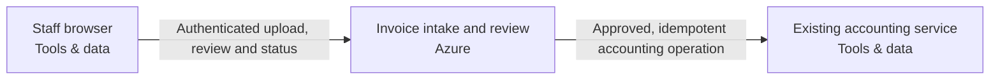

Snapshot c7afd4b4-ee51-43be-be65-aa0444b6f7ae · design r1 · generated 2026-11-10T08:00:00.000Z

# Staff invoice workflow — solution specification

## Problem and intended outcome

Recorded project goal (scope requires confirmation): Twenty staff upload PDF invoices up to 10 MB, 500 per day in bursts of twenty. Extract supplier/date/total/currency. Three reviewers approve before the existing accounting system receives an idempotent action. Preserve originals and audit history for 90 days in Australia. Uncertain outcomes and poison work must be recoverable.

## Scope

None recorded.

## Requirements and acceptance criteria

- [Requirement] Only a reviewer can approve the current extraction revision before accounting delivery; ordinary uploaders cannot approve. (must, open); target: acceptance target needed; linked blocks: invoice, accounting

Design explanation: This requirement makes “Only a reviewer can approve the current extraction revision before accounting delivery; ordinary uploaders cannot approve.” an outcome the implementation must demonstrate. Its linked components identify where that behavior belongs; acceptance should exercise the complete user-visible path rather than checking that those resources merely exist.

## How the system works

The current design contains 3 components and 2 connections. 2 components are existing systems. The descriptions below follow the actual board; implementation guidance is identified separately from recorded behavior.

### Interaction 1: Staff browser → Invoice intake and review

Authenticated upload, review and status

Integration contract: browser-https.

Proposed verification: Verify the expected exchange, reject malformed or unauthorized input, and exercise interruption and recovery. Retry and duplicate-handling behavior must match the operation; it cannot be inferred from an arrow.

### Interaction 2: Invoice intake and review → Existing accounting service

Approved, idempotent accounting operation

Integration contract: approved-accounting-api.

Proposed verification: Verify the expected exchange, reject malformed or unauthorized input, and exercise interruption and recovery. Retry and duplicate-handling behavior must match the operation; it cannot be inferred from an arrow.

## Component responsibilities and design rationale

### Staff browser

Staff browser · tools · region: not selected · classification: not recorded

The diagram assigns Staff browser a resource role. Its specific responsibility needs to be established from the connected flows below.

Existing system: integrate with its owner and access contract; the design does not authorize replacing it.

Inputs: No incoming connection is drawn.

Outputs: Staff browser → Invoice intake and review: Authenticated upload, review and status (integration: browser-https)

Requirement traceability: No requirement has been explicitly linked to this component.

Implementation status: External staff browser — authenticated workflow channel generated; no browser infrastructure to provision

Implementation considerations (guidance):
- Preserve the external browser; no resource or import is required.
- Define and test its HTTPS/application interactions, including denied access and unavailable service behavior.

### Invoice intake and review

Azure Container Apps · azure · region: australiaeast · classification: Confidential

Signed-in staff upload invoices; separate reviewers approve a revision before accounting delivery. Durable work, source evidence, uncertain-outcome recovery and 90-day retention are required.

Proposed component: its responsibility is part of the current design, with implementation and deployment still subject to validation.

Inputs: Staff browser → Invoice intake and review: Authenticated upload, review and status (integration: browser-https)

Outputs: Invoice intake and review → Existing accounting service: Approved, idempotent accounting operation (integration: approved-accounting-api)

Requirement traceability: Requirement: Only a reviewer can approve the current extraction revision before accounting delivery; ordinary uploaders cannot approve.

Implementation status: Composed invoice API/worker/parser, durable SQL queue, private originals, review authorization, guarded accounting delivery and operating tasks generated; destination behavior remains unverified

Implementation considerations (guidance):
- Confirm the exact azure service, deployment mode, region and supported resource types using current primary documentation.
- Specify runtime/artifact, identity, network paths, secrets, capacity, health checks and operational owner; resolve whether this is infrastructure or a responsibility within another application.
- Document service-specific failure modes, retention/recovery and acceptance tests; do not substitute a similarly named service or another provider.

### Existing accounting service

Existing accounting service · tools · region: not selected · classification: not recorded

Externally owned service; endpoint/credential and exact idempotency contract are supplied/verified by its administrator. Never provision a replacement.

Existing system: integrate with its owner and access contract; the design does not authorize replacing it.

Inputs: Invoice intake and review → Existing accounting service: Approved, idempotent accounting operation (integration: approved-accounting-api)

Outputs: No outgoing connection is drawn.

Requirement traceability: Requirement: Only a reviewer can approve the current extraction revision before accounting delivery; ordinary uploaders cannot approve.

Implementation status: Existing service reference — preserve without provisioning/import; actual connection acceptance required

Implementation considerations (guidance):
- Preserve this externally managed service without creating or importing it.
- Document its owner, endpoint, identity and integration contract; test actual connections separately.

## Architecture

## Cloud resource schedule

Typed composed invoice implementation; extra required systems and flows remain visible. Source generation and local qualifications do not prove the destination deployment.

| Block ID | Component | Provider | Service | Region | Ownership | Terraform coverage |
|---|---|---|---|---|---|---|
| browser | Staff browser | tools | Staff browser | To be selected | Existing | External staff browser — authenticated workflow channel generated; no browser infrastructure to provision |
| invoice | Invoice intake and review | azure | Azure Container Apps | australiaeast | Proposed | Composed invoice API/worker/parser, durable SQL queue, private originals, review authorization, guarded accounting delivery and operating tasks generated; destination behavior remains unverified |
| accounting | Existing accounting service | tools | Existing accounting service | To be selected | Existing | Existing service reference — preserve without provisioning/import; actual connection acceptance required |

### Resources and cost dimensions

- **Staff browser** (browser): Resource types to confirm. Existing system or actor; review its externally owned costs and access contract.. Depends on: none drawn.
- **Invoice intake and review** (invoice): azurerm_resource_group, azurerm_postgresql_flexible_server, azurerm_storage_account, azurerm_container_app_environment. API/worker/parser/operator compute, private database/backup/storage, NAT/private endpoints, identity, registry, model tokens, retained object versions, logging and notification delivery. Verify current regional rates and quotas; capacity limits are not spending caps.. Depends on: browser.
- **Existing accounting service** (accounting): Resource types to confirm. Existing system or actor; review its externally owned costs and access contract.. Depends on: invoice.

### Engineering work remaining

S3 foundation only. Validate the plan, account, region, cost and security before applying.

References (resource semantics; not retrieved prices):

## Options and tradeoffs

Use Design → Options to compare cloud choices and record the rationale before choosing.

## Decisions and change history

_No decisions recorded yet._

## Assumptions

None recorded.

## Questions to resolve

None recorded.

## Implementation specification and coding-agent handoff

The Spec Kit translates these requirements and the architecture into implementation work. Start with START_HERE.md and AGENTS.md; read spec-kit/implementation-spec.md (or PDF) for the implementation plan, contracts, detailed tasks and validation plan. Requirements remain the source of desired outcomes; the kit is the build plan derived from them.
