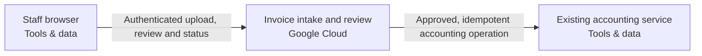

Snapshot b3d76c90-d37f-4688-87e4-0ae74d9ffd3c · design r1 · generated 2026-11-10T08:00:00.000Z

# Staff invoice workflow — deployment document

Generated 2026-11-10 08:00 UTC from design revision r1 · project format 2.3.0 · AtMem AI Architect workbench

> No blockers found by the automated review. Human review and the open questions below still apply.
>
> Statements are **facts** from project data unless marked _assumption_ or listed under open questions. Estimate — not a bill or guarantee.

## 1. Summary

Twenty staff upload PDF invoices up to 10 MB, 500 per day in bursts of twenty. Extract supplier/date/total/currency. Three reviewers approve before the existing accounting system receives an idempotent action. Preserve originals and audit history for 90 days in Australia. Uncertain outcomes and poison work must be recoverable.

- **Cloud:** Google Cloud
- **Usage:** unknown
- **Estimated run cost:** not estimated
- **Review:** 6 open findings (0 blockers)
- **Current decisions:** 0

## 2. Scope and context

- **What you want to build:** —
- **Information it uses:** —
- **Who uses it, and how much:** —
- **Systems it connects to:** —
- **How good, fast and safe:** —
- **Cloud preference:** —
- **Budget and timeline:** —

## 3. Architecture

**Staff browser**

- Staff browser (Tools & data, existing, sketch) — undefined

**Invoice intake and review**

- Invoice intake and review (Google Cloud, sketch) — Signed-in staff upload invoices; separate reviewers approve a revision before accounting delivery. Durable work, source evidence, uncertain-outcome recovery and 90-day retention are required.

**Integration**

- Existing accounting service (Tools & data, existing) — Externally owned service; endpoint/credential and exact idempotency contract are supplied/verified by its administrator. Never provision a replacement.

## Cloud resource schedule

Typed composed invoice implementation; extra required systems and flows remain visible. Source generation and local qualifications do not prove the destination deployment.

| Block ID | Component | Provider | Service | Region | Ownership | Terraform coverage |
|---|---|---|---|---|---|---|
| browser | Staff browser | tools | Staff browser | To be selected | Existing | External staff browser — authenticated workflow channel generated; no browser infrastructure to provision |
| invoice | Invoice intake and review | gcp | Google Cloud Run | australia-southeast1 | Proposed | Composed invoice API/worker/parser, durable SQL queue, private originals, review authorization, guarded accounting delivery and operating tasks generated; destination behavior remains unverified |
| accounting | Existing accounting service | tools | Existing accounting service | To be selected | Existing | Existing service reference — preserve without provisioning/import; actual connection acceptance required |

### Resources and cost dimensions

- **Staff browser** (browser): Resource types to confirm. Existing system or actor; review its externally owned costs and access contract.. Depends on: none drawn.
- **Invoice intake and review** (invoice): google_compute_network, google_sql_database_instance, google_storage_bucket, google_artifact_registry_repository. API/worker/parser/operator compute, private database/backup/storage, NAT/private endpoints, identity, registry, model tokens, retained object versions, logging and notification delivery. Verify current regional rates and quotas; capacity limits are not spending caps.. Depends on: browser.
- **Existing accounting service** (accounting): Resource types to confirm. Existing system or actor; review its externally owned costs and access contract.. Depends on: invoice.

### Engineering work remaining

S3 foundation only. Validate the plan, account, region, cost and security before applying.

References (resource semantics; not retrieved prices):

## 4. Data flows

| From | To | Data | Classification |
|---|---|---|---|
| Staff browser | Invoice intake and review | Authenticated upload, review and status | Confidential |
| Invoice intake and review | Existing accounting service | Approved, idempotent accounting operation | Confidential |

## 5. Security controls

- _No guardrail or approval components in the design._
- Requirement: Only a reviewer can approve the current extraction revision before accounting delivery; ordinary uploaders cannot approve. (must)
- Open finding SEC-002: Sensitive data is involved but where it must be stored is not stated.

## 6. Requirements

**Non-functional**

_None recorded._

**Functional**

- Only a reviewer can approve the current extraction revision before accounting delivery; ordinary uploaders cannot approve. (must, open)

**Success measures**

_No success measures defined._

## 7. Review findings

**Security & controls**

- [major] Sensitive data is involved but where it must be stored is not stated. Add a compliance requirement such as “data stays in the EU”, and set regions on data blocks. _(AtMem AI Architect rule SEC-002 v1.0.0)_

**Reliability**

- [minor] The design depends on existing systems; their failure behaviour is not described. State what happens when each existing system is unavailable (retry, queue, fallback). _(AtMem AI Architect rule REL-002 v1.0.0)_

**Availability**

- [minor] No availability target. Add a requirement such as “available 99.5% of the time” or “business hours only”. _(AtMem AI Architect rule AVL-001 v1.0.0)_

**Scalability**

- [info] Expected usage is unknown, so scale can't be assessed. Tell us in the chat roughly how many people use it and how often. _(AtMem AI Architect rule SCL-001 v1.0.0)_

**Maintainability**

- [info] 2 blocks are sketch-only and can't be test-run yet. Keep designing; assign a runnable behaviour in block detail when one exists. _(AtMem AI Architect rule DSN-001 v1.0.0)_

**Cost**

- [info] No budget stated. Mention a monthly running budget, or a range, in the chat. _(AtMem AI Architect rule CST-001 v1.0.0)_

## 8. Cost estimate

Estimate — not a bill or guarantee. Monthly run cost only. Prices are as entered, with their sources.

**Estimate stage:** Not estimated. Rough order of magnitude, refined as scope and charge dimensions become known.

_No costed components._

**Usage inputs:** Quantities are entered directly on detailed charge lines above.

**Range:** low ×0.7, high ×1.5 of expected. Not costed in this release: Staff browser, Invoice intake and review, Existing accounting service.

**Estimate gaps:**

- Staff browser: no cost lines; add charges or an explicit zero-cost line with a reason.
- Invoice intake and review: no cost lines; add charges or an explicit zero-cost line with a reason.
- Existing accounting service: no cost lines; add charges or an explicit zero-cost line with a reason.

### Consulting and build estimate (one-off)

Not estimated; enter work-package days, rates and a basis.

| Work package | Low / expected / high days | Rate / day | Expected | Basis and exclusions |
|---|---|---|---|---|
| Discovery & specification | — / — / — | — | — | Needed |
| Architecture & security | — / — / — | — | — | Needed |
| Implementation & integration | — / — / — | — | — | Needed |
| Testing & acceptance | — / — / — | — | — | Needed |
| Deployment & handover | — / — / — | — | — | Needed |

One-off effort is separate from monthly cloud charges. Days are person-days, not elapsed time. Taxes, support, licences and migration are excluded unless explicitly included in the basis or charge lines.

## 9. Deployment steps

_Draft generated from the design; validate against the provider's current documentation before use. Nothing has been provisioned._

1. Confirm accounts, target regions and who approves each step; resolve every blocker in this document.
2. Create least-privilege identities for each component; keep credentials in the provider's secret store, never in the project.
3. Provision invoice intake and review: Invoice intake and review.
4. Connect existing systems: Staff browser, Existing accounting service; test failure behaviour.
5. Run the acceptance checks (success measures and requirements) in staging; record results.
6. Review results and approve promotion to production; keep a rollback plan for each step.

## 10. Decisions

_No decisions recorded yet._

## 11. Assumptions

_None recorded._

## 12. Open questions

- What should this system help someone do? _(discovery)_
- Which information should the system use? _(discovery)_
- Who will use this system? _(discovery)_
