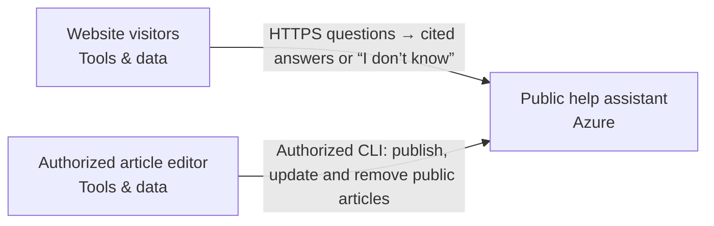

Snapshot 9e56b56c-f354-4d86-9089-eba95a5c71e8 · design r4 · generated 2026-11-09T23:57:26.530Z

# Cited public FAQ — deployment document

Generated 2026-11-09 23:57 UTC from design revision r4 · project format 2.3.0 · AtMem AI Architect workbench

> No blockers found by the automated review. Human review and the open questions below still apply.
>
> Statements are **facts** from project data unless marked _assumption_ or listed under open questions. Estimate — not a bill or guarantee.

## 1. Summary

Build a public website assistant that answers questions from our twenty public help articles, cites the articles it used, and says when it does not know. We need to update and remove articles. It must not answer from private sources. Use Azure. Recommend a coherent system and the engineering choices. Ask only a small material business question when needed; do not make me configure the system.

- **Cloud:** Azure
- **Usage:** 30,000 requests/month (discovery (2026-11-10))
- **Estimated run cost:** not estimated
- **Review:** 5 open findings (0 blockers)
- **Current decisions:** 1

## 2. Scope and context

- **What you want to build:** Build a public website assistant that answers questions from our twenty public help articles, cites the articles it used, and says when it does not know. We need to update and remove articles. It must not answer from private sources. Use Azure. Recommend a coherent system and the engineering choices. Ask only a small material business question when needed; do not make me configure the system.
- **Information it uses:** —
- **Who uses it, and how much:** Here are the remaining project facts before we finalize the handoff. Preserve these requirements and update the system as needed. Anonymous website visitors; an authorized editor manages the articles. Twenty public UTF-8 help articles under 30 KB each, supplied as files. No private content. About 1,000 questions per day and five at once. Answers need valid source citations; unsupported questions must abstain; updates and deletions must affect retrieval. Recommend the simplest suitable retrieval approach and a small footprint. Show assumptions and missing current price evidence.
- **Systems it connects to:** —
- **How good, fast and safe:** —
- **Cloud preference:** Azure Australia is preferred; make model/data-location limitations explicit.
- **Budget and timeline:** —

## 3. Architecture

**Public access**

- Website visitors (Tools & data, existing) — Existing visitor browsers outside provisioning scope. Submit questions over HTTPS and receive answers with article citations or an explicit abstention. No visitor account is proposed.

**Public FAQ application**

- Public help assistant (Azure) — Proposed composed public-faq-app on Azure App Service. Owns the browser/API, private Azure Blob Storage versioned public-article catalog, regional Azure model transport and separate editor/runtime identities; these are internal module resources, not additional independent deployments.

Included scope: anonymous visitor questions, cited answers or explicit abstention, and authorized CLI publication/update/deletion of twenty supplied public UTF-8 article files under 30 KB each. Only approved public articles may ground answers. Private-source ingestion, arbitrary URL fetching and visitor editing are excluded. No visitor account is required. Additional business actions, private enterprise access and general workflows are outside this proposed scope.

Retrieval recommendation: bounded keyword ranking inside the application over the current curated catalog, supplying at most two complete retrieved articles to the model. This avoids a separate managed search service, embeddings pipeline and vector database for this small collection. Keyword matching can miss paraphrases; qualify it with representative questions before launch. Do not claim semantic search or guaranteed factual accuracy. Treat questions and articles as untrusted data. Validate returned source membership and exact supporting quotes, and abstain when support is insufficient; valid citations alone do not prove entailment.

The authorized editor CLI conditionally adds, updates and removes articles. Conflicting writes fail; in-flight source changes withhold affected answers, and there is no cached-source fallback. Runtime has read-only catalog access. Exact editor identity and scoped destination permissions remain required, unverified inputs. Files are already UTF-8, so no PDF extraction or source connector is proposed.

Capacity evidence: user expects about 1,000 questions per day and five at once. Use approximately 30,000 questions per 30-day month only as an estimating convention. Propose one small always-on App Service instance initially, subject to measured capacity, model quota and destination review; no SKU or availability guarantee is established. The implementation admits at most five concurrent requests per instance; overload must be bounded and visibly rejected or retried rather than silently exceeding that limit. Built-in bounds remain 100 public articles, 30000 bytes per article, 2000-byte questions and two complete retrieved articles. Verify supplied file byte sizes against that exact limit. Do not treat these bounds as an invoice cap.

Location: Australia is preferred, not a confirmed Australian-only processing rule. Australia East (australiaeast) is proposed for application and storage, not approved. Australian application/storage placement does not establish model inference location. Before inference, verify exact Azure model/version, deployment type, availability, quota, processing geography, retention and abuse-monitoring policy. Do not silently select Global or Data Zone inference, overseas fallback or cross-region recovery. Present proposed processing outside Australia for user review. One region is proposed; zone redundancy and regional recovery are not established. Visitor browsers may be outside Australia.

Operations proposals: exclude question text and article bodies from application logs; record request outcomes, latency, errors, abstentions and catalog revision identifiers. Platform/model logging and retention need separate verification. Provide an editor runbook for conditional changes and reviewed recovery from a known catalog revision, with deliberate deletion semantics so deleted content is not silently restored. Operational ownership, response-time expectations and recovery targets remain open. Public endpoint abuse controls and spending alerts require implementation review; concurrency limits alone do not prevent sustained spend.

Acceptance work: bind checks to the emitted artifact; test anonymous question access, denial of unauthorized catalog writes, editor add/update/delete and stale-write conflicts, removed-source exclusion, source changes during a request, citation membership/supporting quotes, unsupported-question abstention, prompt-injection cases, catalog/model failures, five concurrent requests and overload behavior. Evaluate representative paraphrases and real-model answer support separately from scripted tests. Build, scan and test the emitted pinned Python 3.13 image; review native provider configuration, destination permissions and an account-specific plan. No exported artifact, runtime report, live model test or deployment evidence is supplied here.

Price evidence: Azure Retail Prices API result dated 2026-11-09 quotes Australia East Blob Storage Hot LRS base storage at USD 0.02/GB-month, covering only the base tier up to 51200 GB. Source: https://prices.azure.com/api/retail/prices?%24filter=serviceName+eq+%27Storage%27+and+armRegionName+eq+%27australiaeast%27+and+meterName+eq+%27Hot+LRS+Data+Stored%27+and+priceType+eq+%27Consumption%27+and+productName+eq+%27Blob+Storage%27 . Twenty files imply less than approximately 0.0006 GB of raw article text, an upper bound rather than measured billed storage; catalog encoding and retained versions add storage. Current prices are missing for App Service compute, the exact model's input/output tokens, storage operations, transfer, logging and recovery storage. Model/token usage is unknown. External browsers and the existing editor are reference actors with no proposed hosted resource charge; their devices, connectivity and editor labor are outside the cloud subtotal. Monthly cloud running costs remain incomplete. One-off build/consulting effort, rates and exclusions are separately unestimated.

**Article management**

- Authorized article editor (Tools & data, existing) — Existing authorized operator outside provisioning scope; exact identity and destination permissions remain required inputs, not verified identities. Supplies twenty public UTF-8 help-article files under 30 KB each through the generated management CLI, then publishes, updates and removes catalog entries. Only public content is permitted. Conditional writes reject stale edits. This operational interface is separate from anonymous visitor access; it is not a browser editing endpoint. Editor ownership and recovery procedures remain to be assigned.

## Cloud resource schedule

Diagram-derived resource schedule; service choices and resource types require engineering review.

| Block ID | Component | Provider | Service | Region | Ownership | Terraform coverage |
|---|---|---|---|---|---|---|
| faq-visitors | Website visitors | tools | Web browser | External client | Existing | External browser — no infrastructure to provision; connection behavior still requires validation |
| faq-app | Public help assistant | azure | Azure App Service | australiaeast | Proposed | Public-only cited FAQ source, browser, private catalog, separate editor/runtime roles and regional model transport generated; destination behavior unverified |
| faq-editor | Authorized article editor | tools | Existing authorized operator | External operator | Existing | Existing public catalog editor — provider-native role/group input and separate conditional editor CLI generated; actual access unverified |

### Resources and cost dimensions

- **Website visitors** (faq-visitors): Resource types to confirm. Confirm service, capacity and billable dimensions. Depends on: none drawn.
- **Public help assistant** (faq-app): azurerm_linux_web_app, azurerm_storage_account, azurerm_storage_container. Compute and HTTP requests, model input/output tokens, catalog read/write/versioned storage, logs and transfer; verify current regional service/model prices and quotas. Capacity limits are not invoice caps.. Depends on: faq-visitors, faq-editor.
- **Authorized article editor** (faq-editor): Resource types to confirm. Confirm service, capacity and billable dimensions. Depends on: none drawn.

### Engineering work remaining

S3 foundation only. Validate the plan, account, region, cost and security before applying.

References (resource semantics; not retrieved prices):
- https://registry.terraform.io/providers/hashicorp/aws/latest/docs/resources/s3_bucket
- https://registry.terraform.io/providers/hashicorp/aws/latest/docs/resources/bedrock_guardrail
- https://registry.terraform.io/providers/hashicorp/aws/latest/docs/resources/bedrockagent_knowledge_base
- https://aws.amazon.com/bedrock/pricing/

## 4. Data flows

| From | To | Data | Classification |
|---|---|---|---|
| Website visitors | Public help assistant | HTTPS questions → cited answers or “I don’t know” | Public |
| Authorized article editor | Public help assistant | Authorized CLI: publish, update and remove public articles | Internal |

## 5. Security controls

- _No guardrail or approval components in the design._
- Requirement: The assistant must use only the approved public-help-article catalog for retrieval and answer grounding, with no private-source ingestion or arbitrary URL retrieval. (must)
- Requirement: Prefer Australian application hosting, article storage and model processing. Before enabling inference, document the selected model deployment's processing geography, retention, logging and recovery locations, identify unverified limitations, and present any proposed processing outside Australia for review. The preference must not be represented as confirmed Australian-only residency. (should)
- Requirement: Visitors must be able to ask questions without signing in; only an authorized editor may publish, update or remove catalog articles through the separate management interface. (must)

## 6. Requirements

**Non-functional**

| Requirement | Category | Target | Status |
|---|---|---|---|
| The assistant must use only the approved public-help-article catalog for retrieval and answer grounding, with no private-source ingestion or arbitrary URL retrieval. | security | not measurable yet | Open |
| Prefer Australian application hosting, article storage and model processing. Before enabling inference, document the selected model deployment's processing geography, retention, logging and recovery locations, identify unverified limitations, and present any proposed processing outside Australia for review. The preference must not be represented as confirmed Australian-only residency. | compliance | not measurable yet | Open |
| The application must support the expected workload of approximately 1,000 questions daily and five simultaneous questions, subject to artifact-bound load tests and verified model quotas; excess concurrency must receive controlled overload handling. | performance | simultaneous_questions_supported >= 5questions | Open |

**Functional**

- Every answer shows its sources (should, open)
- When current approved articles do not adequately support an answer, the assistant must explicitly say it does not know rather than provide an unsupported answer. (must, open)
- Authorized editors must be able to publish, update and remove public articles through a separate management interface; conflicting edits must be rejected and answers must be withheld if their supporting sources change during processing. (must, open)
- Visitors must be able to ask questions without signing in; only an authorized editor may publish, update or remove catalog articles through the separate management interface. (must, open)
- The editor workflow must accept the twenty supplied public UTF-8 article files, validate each against the implementation's exact 30000-byte limit, and reject invalid or oversized files explicitly without silent truncation. (must, open)

**Success measures**

_No success measures defined._

## 7. Review findings

**Reliability**

- [minor] The design depends on existing systems; their failure behaviour is not described. State what happens when each existing system is unavailable (retry, queue, fallback). _(AtMem AI Architect rule REL-002 v1.0.0)_

**Availability**

- [minor] No availability target. Add a requirement such as “available 99.5% of the time” or “business hours only”. _(AtMem AI Architect rule AVL-001 v1.0.0)_

**Maintainability**

- [minor] 2 quality requirements have no measurable target. Add a metric and target to: “The assistant must use only the approved public-help-article catalog for retrieval and answer grounding, with no private-source ingestion or arbitrary URL retrieval.”, “Prefer Australian application hosting, article storage and model processing. Before enabling inference, document the selected model deployment's processing geography, retention, logging and recovery locations, identify unverified limitations, and present any proposed processing outside Australia for review. The preference must not be represented as confirmed Australian-only residency.”. _(AtMem AI Architect rule MNT-001 v1.0.0)_
- [minor] 1 accepted decision has no owner. Assign an owner in Design → Decisions. _(AtMem AI Architect rule MNT-002 v1.0.0)_

**Cost**

- [info] No budget stated. Mention a monthly running budget, or a range, in the chat. _(AtMem AI Architect rule CST-001 v1.0.0)_

## 8. Cost estimate

Estimate — not a bill or guarantee. Monthly run cost only. Prices are as entered, with their sources.

**Estimate stage:** Not estimated. Rough order of magnitude, refined as scope and charge dimensions become known.

_No costed components._

**Usage inputs:** Quantities are entered directly on detailed charge lines above.

**Range:** low ×0.7, high ×1.5 of expected. Not costed in this release: Website visitors, Public help assistant, Authorized article editor.

**Estimate gaps:**

- Website visitors: no cost lines; add charges or an explicit zero-cost line with a reason.
- Public help assistant: no cost lines; add charges or an explicit zero-cost line with a reason.
- Authorized article editor: no cost lines; add charges or an explicit zero-cost line with a reason.

### Consulting and build estimate (one-off)

Not estimated; enter work-package days, rates and a basis.

| Work package | Low / expected / high days | Rate / day | Expected | Basis and exclusions |
|---|---|---|---|---|
| Discovery & specification | — / — / — | — | — | Needed |
| Architecture & security | — / — / — | — | — | Needed |
| Implementation & integration | — / — / — | — | — | Needed |
| Testing & acceptance | — / — / — | — | — | Needed |
| Deployment & handover | — / — / — | — | — | Needed |

One-off effort is separate from monthly cloud charges. Days are person-days, not elapsed time. Taxes, support, licences and migration are excluded unless explicitly included in the basis or charge lines.

## 9. Deployment steps

_Draft generated from the design; validate against the provider's current documentation before use. Nothing has been provisioned._

1. Confirm accounts, target regions and who approves each step; resolve every blocker in this document.
2. Create least-privilege identities for each component; keep credentials in the provider's secret store, never in the project.
3. Provision public faq application: Public help assistant.
4. Connect existing systems: Website visitors, Authorized article editor; test failure behaviour.
5. Run the acceptance checks (success measures and requirements) in staging; record results.
6. Review results and approve promotion to production; keep a rollback plan for each step.

## 10. Decisions

### ADR-001 · platform.cloud

**Status:** Accepted · **Owner:** unassigned · **Date:** 2026-11-10 · **Design:** r2 · **Subject:** `platform.cloud`

**Context**

User statement: Use Azure.

**Options considered**

—

**Decision**

azure

_Changed because: Chosen in the conversation_

**Consequences**

—

## 11. Assumptions

_None recorded._

## 12. Open questions

- Which information should the system use? _(discovery)_
