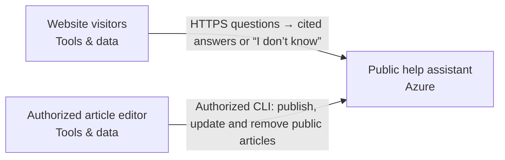

Snapshot 9e56b56c-f354-4d86-9089-eba95a5c71e8 · design r4 · generated 2026-11-09T23:57:26.530Z

# Cited public FAQ — solution specification

## Problem and intended outcome

Build a public website assistant that answers questions from our twenty public help articles, cites the articles it used, and says when it does not know. We need to update and remove articles. It must not answer from private sources. Use Azure. Recommend a coherent system and the engineering choices. Ask only a small material business question when needed; do not make me configure the system.

## Scope

None recorded.

## Requirements and acceptance criteria

- [REQ-001] Every answer shows its sources (should, open); target: acceptance target needed; linked blocks: not linked

Design explanation: Source references make an answer inspectable: the reader can check the supporting material, its relevance and whether it is current. The answer path must retain the link between retrieved evidence and the final response; an unsupported answer should be distinguishable from one backed by documents.
- [REQ-002] The assistant must use only the approved public-help-article catalog for retrieval and answer grounding, with no private-source ingestion or arbitrary URL retrieval. (must, open); target: acceptance target needed; linked blocks: faq-app, faq-editor

Design explanation: Prevents private information or unrelated sources entering publicly accessible answers.

Basis: “It must not answer from private sources.”
- [REQ-003] When current approved articles do not adequately support an answer, the assistant must explicitly say it does not know rather than provide an unsupported answer. (must, open); target: acceptance target needed; linked blocks: faq-app

Design explanation: An explicit abstention avoids presenting unsupported generated content as an authoritative help answer; model behavior still needs acceptance testing.

Basis: “says when it does not know”
- [REQ-004] Authorized editors must be able to publish, update and remove public articles through a separate management interface; conflicting edits must be rejected and answers must be withheld if their supporting sources change during processing. (must, open); target: acceptance target needed; linked blocks: faq-editor, faq-app

Design explanation: Keeps public answers aligned with current content and prevents conflicting edits or deleted content from being served through stale fallbacks.

Basis: “We need to update and remove articles.” The editor access boundary and conflict handling are proposed engineering choices.
- [REQ-005] Prefer Australian application hosting, article storage and model processing. Before enabling inference, document the selected model deployment's processing geography, retention, logging and recovery locations, identify unverified limitations, and present any proposed processing outside Australia for review. The preference must not be represented as confirmed Australian-only residency. (should, open); target: acceptance target needed; linked blocks: faq-app

Design explanation: An Australian hosting region alone does not establish where inference, monitoring or recovery processes data; explicit evidence prevents an unsupported residency claim.

Basis: User statement: “Australia is preferred; make model/data-location limitations explicit.” Proposed placement applies to faq-app and its owned storage/model integration.
- [REQ-006] Visitors must be able to ask questions without signing in; only an authorized editor may publish, update or remove catalog articles through the separate management interface. (must, open); target: acceptance target needed; linked blocks: faq-visitors, faq-editor, faq-app

Design explanation: Preserves the intended public user journey while keeping catalog modification outside anonymous visitor access.

Basis: “Anonymous website visitors; an authorized editor manages the articles.” Existing components faq-visitors, faq-editor and faq-app.
- [REQ-007] The application must support the expected workload of approximately 1,000 questions daily and five simultaneous questions, subject to artifact-bound load tests and verified model quotas; excess concurrency must receive controlled overload handling. (must, open); target: simultaneous_questions_supported >= 5questions; linked blocks: faq-app

Design explanation: Provides a concrete capacity acceptance case without inventing a response-time or availability commitment.

Basis: “About 1,000 questions per day and five at once.”
- [REQ-008] The editor workflow must accept the twenty supplied public UTF-8 article files, validate each against the implementation's exact 30000-byte limit, and reject invalid or oversized files explicitly without silent truncation. (must, open); target: acceptance target needed; linked blocks: faq-editor, faq-app

Design explanation: Defines the ingestion boundary and prevents unnecessary document extraction or connector infrastructure.

Basis: “Twenty public UTF-8 help articles under 30 KB each, supplied as files. No private content.”

## How the system works

The current design contains 3 components and 2 connections. 2 components are existing systems. The descriptions below follow the actual board; implementation guidance is identified separately from recorded behavior.

### Interaction 1: Website visitors → Public help assistant

HTTPS questions → cited answers or “I don’t know”

Integration contract: browser-https.

Proposed verification: Verify the expected exchange, reject malformed or unauthorized input, and exercise interruption and recovery. Retry and duplicate-handling behavior must match the operation; it cannot be inferred from an arrow.

### Interaction 2: Authorized article editor → Public help assistant

Authorized CLI: publish, update and remove public articles

Integration contract: public-catalog-edit.

Proposed verification: Verify the expected exchange, reject malformed or unauthorized input, and exercise interruption and recovery. Retry and duplicate-handling behavior must match the operation; it cannot be inferred from an arrow.

## Component responsibilities and design rationale

### Website visitors

Web browser · tools · region: External client · classification: Public

Existing visitor browsers outside provisioning scope. Submit questions over HTTPS and receive answers with article citations or an explicit abstention. No visitor account is proposed.

Existing system: integrate with its owner and access contract; the design does not authorize replacing it.

Inputs: No incoming connection is drawn.

Outputs: Website visitors → Public help assistant: HTTPS questions → cited answers or “I don’t know” (integration: browser-https)

Requirement traceability: REQ-006: Visitors must be able to ask questions without signing in; only an authorized editor may publish, update or remove catalog articles through the separate management interface.

Implementation status: External browser — no infrastructure to provision; connection behavior still requires validation

Implementation considerations (guidance):
- Preserve the external browser; no resource or import is required.
- Define and test its HTTPS/application interactions, including denied access and unavailable service behavior.

### Public help assistant

Azure App Service · azure · region: australiaeast · classification: Public

Proposed composed public-faq-app on Azure App Service. Owns the browser/API, private Azure Blob Storage versioned public-article catalog, regional Azure model transport and separate editor/runtime identities; these are internal module resources, not additional independent deployments.

Included scope: anonymous visitor questions, cited answers or explicit abstention, and authorized CLI publication/update/deletion of twenty supplied public UTF-8 article files under 30 KB each. Only approved public articles may ground answers. Private-source ingestion, arbitrary URL fetching and visitor editing are excluded. No visitor account is required. Additional business actions, private enterprise access and general workflows are outside this proposed scope.

Retrieval recommendation: bounded keyword ranking inside the application over the current curated catalog, supplying at most two complete retrieved articles to the model. This avoids a separate managed search service, embeddings pipeline and vector database for this small collection. Keyword matching can miss paraphrases; qualify it with representative questions before launch. Do not claim semantic search or guaranteed factual accuracy. Treat questions and articles as untrusted data. Validate returned source membership and exact supporting quotes, and abstain when support is insufficient; valid citations alone do not prove entailment.

The authorized editor CLI conditionally adds, updates and removes articles. Conflicting writes fail; in-flight source changes withhold affected answers, and there is no cached-source fallback. Runtime has read-only catalog access. Exact editor identity and scoped destination permissions remain required, unverified inputs. Files are already UTF-8, so no PDF extraction or source connector is proposed.

Capacity evidence: user expects about 1,000 questions per day and five at once. Use approximately 30,000 questions per 30-day month only as an estimating convention. Propose one small always-on App Service instance initially, subject to measured capacity, model quota and destination review; no SKU or availability guarantee is established. The implementation admits at most five concurrent requests per instance; overload must be bounded and visibly rejected or retried rather than silently exceeding that limit. Built-in bounds remain 100 public articles, 30000 bytes per article, 2000-byte questions and two complete retrieved articles. Verify supplied file byte sizes against that exact limit. Do not treat these bounds as an invoice cap.

Location: Australia is preferred, not a confirmed Australian-only processing rule. Australia East (australiaeast) is proposed for application and storage, not approved. Australian application/storage placement does not establish model inference location. Before inference, verify exact Azure model/version, deployment type, availability, quota, processing geography, retention and abuse-monitoring policy. Do not silently select Global or Data Zone inference, overseas fallback or cross-region recovery. Present proposed processing outside Australia for user review. One region is proposed; zone redundancy and regional recovery are not established. Visitor browsers may be outside Australia.

Operations proposals: exclude question text and article bodies from application logs; record request outcomes, latency, errors, abstentions and catalog revision identifiers. Platform/model logging and retention need separate verification. Provide an editor runbook for conditional changes and reviewed recovery from a known catalog revision, with deliberate deletion semantics so deleted content is not silently restored. Operational ownership, response-time expectations and recovery targets remain open. Public endpoint abuse controls and spending alerts require implementation review; concurrency limits alone do not prevent sustained spend.

Acceptance work: bind checks to the emitted artifact; test anonymous question access, denial of unauthorized catalog writes, editor add/update/delete and stale-write conflicts, removed-source exclusion, source changes during a request, citation membership/supporting quotes, unsupported-question abstention, prompt-injection cases, catalog/model failures, five concurrent requests and overload behavior. Evaluate representative paraphrases and real-model answer support separately from scripted tests. Build, scan and test the emitted pinned Python 3.13 image; review native provider configuration, destination permissions and an account-specific plan. No exported artifact, runtime report, live model test or deployment evidence is supplied here.

Price evidence: Azure Retail Prices API result dated 2026-11-09 quotes Australia East Blob Storage Hot LRS base storage at USD 0.02/GB-month, covering only the base tier up to 51200 GB. Source: https://prices.azure.com/api/retail/prices?%24filter=serviceName+eq+%27Storage%27+and+armRegionName+eq+%27australiaeast%27+and+meterName+eq+%27Hot+LRS+Data+Stored%27+and+priceType+eq+%27Consumption%27+and+productName+eq+%27Blob+Storage%27 . Twenty files imply less than approximately 0.0006 GB of raw article text, an upper bound rather than measured billed storage; catalog encoding and retained versions add storage. Current prices are missing for App Service compute, the exact model's input/output tokens, storage operations, transfer, logging and recovery storage. Model/token usage is unknown. External browsers and the existing editor are reference actors with no proposed hosted resource charge; their devices, connectivity and editor labor are outside the cloud subtotal. Monthly cloud running costs remain incomplete. One-off build/consulting effort, rates and exclusions are separately unestimated.

Proposed component: its responsibility is part of the current design, with implementation and deployment still subject to validation.

Inputs: Website visitors → Public help assistant: HTTPS questions → cited answers or “I don’t know” (integration: browser-https); Authorized article editor → Public help assistant: Authorized CLI: publish, update and remove public articles (integration: public-catalog-edit)

Outputs: No outgoing connection is drawn.

Requirement traceability: REQ-002: The assistant must use only the approved public-help-article catalog for retrieval and answer grounding, with no private-source ingestion or arbitrary URL retrieval.; REQ-003: When current approved articles do not adequately support an answer, the assistant must explicitly say it does not know rather than provide an unsupported answer.; REQ-004: Authorized editors must be able to publish, update and remove public articles through a separate management interface; conflicting edits must be rejected and answers must be withheld if their supporting sources change during processing.; REQ-005: Prefer Australian application hosting, article storage and model processing. Before enabling inference, document the selected model deployment's processing geography, retention, logging and recovery locations, identify unverified limitations, and present any proposed processing outside Australia for review. The preference must not be represented as confirmed Australian-only residency.; REQ-006: Visitors must be able to ask questions without signing in; only an authorized editor may publish, update or remove catalog articles through the separate management interface.; REQ-007: The application must support the expected workload of approximately 1,000 questions daily and five simultaneous questions, subject to artifact-bound load tests and verified model quotas; excess concurrency must receive controlled overload handling.; REQ-008: The editor workflow must accept the twenty supplied public UTF-8 article files, validate each against the implementation's exact 30000-byte limit, and reject invalid or oversized files explicitly without silent truncation.

Implementation status: Public-only cited FAQ source, browser, private catalog, separate editor/runtime roles and regional model transport generated; destination behavior unverified

Implementation considerations (guidance):
- Confirm the exact azure service, deployment mode, region and supported resource types using current primary documentation.
- Specify runtime/artifact, identity, network paths, secrets, capacity, health checks and operational owner; resolve whether this is infrastructure or a responsibility within another application.
- Document service-specific failure modes, retention/recovery and acceptance tests; do not substitute a similarly named service or another provider.

### Authorized article editor

Existing authorized operator · tools · region: External operator · classification: Internal

Existing authorized operator outside provisioning scope; exact identity and destination permissions remain required inputs, not verified identities. Supplies twenty public UTF-8 help-article files under 30 KB each through the generated management CLI, then publishes, updates and removes catalog entries. Only public content is permitted. Conditional writes reject stale edits. This operational interface is separate from anonymous visitor access; it is not a browser editing endpoint. Editor ownership and recovery procedures remain to be assigned.

Existing system: integrate with its owner and access contract; the design does not authorize replacing it.

Inputs: No incoming connection is drawn.

Outputs: Authorized article editor → Public help assistant: Authorized CLI: publish, update and remove public articles (integration: public-catalog-edit)

Requirement traceability: REQ-002: The assistant must use only the approved public-help-article catalog for retrieval and answer grounding, with no private-source ingestion or arbitrary URL retrieval.; REQ-004: Authorized editors must be able to publish, update and remove public articles through a separate management interface; conflicting edits must be rejected and answers must be withheld if their supporting sources change during processing.; REQ-006: Visitors must be able to ask questions without signing in; only an authorized editor may publish, update or remove catalog articles through the separate management interface.; REQ-008: The editor workflow must accept the twenty supplied public UTF-8 article files, validate each against the implementation's exact 30000-byte limit, and reject invalid or oversized files explicitly without silent truncation.

Implementation status: Existing public catalog editor — provider-native role/group input and separate conditional editor CLI generated; actual access unverified

Implementation considerations (guidance):
- Identify system owner, tenant/location, supported APIs and permitted read scopes; document a reference contract instead of recreating the system.
- Specify identity mapping, source permissions, pagination/rate limits, update/delete events and maximum synchronization lag.
- Define credential rotation, outages and recovery; test revoked access and unavailable sources using approved fixtures before live integration.

## Architecture

## Cloud resource schedule

Diagram-derived resource schedule; service choices and resource types require engineering review.

| Block ID | Component | Provider | Service | Region | Ownership | Terraform coverage |
|---|---|---|---|---|---|---|
| faq-visitors | Website visitors | tools | Web browser | External client | Existing | External browser — no infrastructure to provision; connection behavior still requires validation |
| faq-app | Public help assistant | azure | Azure App Service | australiaeast | Proposed | Public-only cited FAQ source, browser, private catalog, separate editor/runtime roles and regional model transport generated; destination behavior unverified |
| faq-editor | Authorized article editor | tools | Existing authorized operator | External operator | Existing | Existing public catalog editor — provider-native role/group input and separate conditional editor CLI generated; actual access unverified |

### Resources and cost dimensions

- **Website visitors** (faq-visitors): Resource types to confirm. Confirm service, capacity and billable dimensions. Depends on: none drawn.
- **Public help assistant** (faq-app): azurerm_linux_web_app, azurerm_storage_account, azurerm_storage_container. Compute and HTTP requests, model input/output tokens, catalog read/write/versioned storage, logs and transfer; verify current regional service/model prices and quotas. Capacity limits are not invoice caps.. Depends on: faq-visitors, faq-editor.
- **Authorized article editor** (faq-editor): Resource types to confirm. Confirm service, capacity and billable dimensions. Depends on: none drawn.

### Engineering work remaining

S3 foundation only. Validate the plan, account, region, cost and security before applying.

References (resource semantics; not retrieved prices):
- https://registry.terraform.io/providers/hashicorp/aws/latest/docs/resources/s3_bucket
- https://registry.terraform.io/providers/hashicorp/aws/latest/docs/resources/bedrock_guardrail
- https://registry.terraform.io/providers/hashicorp/aws/latest/docs/resources/bedrockagent_knowledge_base
- https://aws.amazon.com/bedrock/pricing/

## Options and tradeoffs

Use Design → Options to compare cloud choices and record the rationale before choosing.

## Decisions and change history

### ADR-001 · platform.cloud

**Status:** Accepted · **Owner:** unassigned · **Date:** 2026-11-10 · **Design:** r2 · **Subject:** `platform.cloud`

**Context**

User statement: Use Azure.

**Options considered**

—

**Decision**

azure

_Changed because: Chosen in the conversation_

**Consequences**

—

## Assumptions

None recorded.

## Questions to resolve

None recorded.

## Implementation specification and coding-agent handoff

The Spec Kit translates these requirements and the architecture into implementation work. Start with START_HERE.md and AGENTS.md; read spec-kit/implementation-spec.md (or PDF) for the implementation plan, contracts, detailed tasks and validation plan. Requirements remain the source of desired outcomes; the kit is the build plan derived from them.
